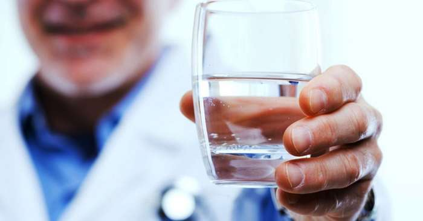
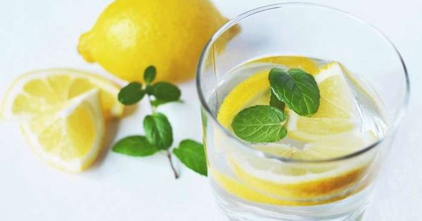

# Шүлтжүүлсэн ус хорт хавдар, үрэвсэл дарж, биеэс хор гадагшлуулдаг

Шүлтжүүлсэн ус нь биеийг хорноос цэвэрлэж, рН түвшинг тэнцвэржүүлж, архаг хууч өвчинүүд, хорт хавдарыг устгах үйлчилэл үзүүлдэг бөгөөд өдөр бүр уух аяга шүлтлэг ус, орчин үеийн байгальлаг бус хоол хүнсний бүтээгдэхүүнээс үүссэн биедэх хүчиллэг орчинг бууруулж, бие организмын эрүүл мэндэд ихээхэн ашиг тус өгдөг байна. Архи спирт, сахар, ёотон, давсны орц өндөртэй хоол хүнс, үйлдвэрийн аргаар боловсруулсан хүнсний бүтээгдэхүүнүүд хүний биед өвчин үүсэх хөрс болдог хүчиллэг орчинг бүрдүүлж, аажмаар хүний биеийг үхүүлэх үйлчилэл үзүүлж байдгийг тэр бүр мэддэггүй маань харамсалтай. Бие дэх хүчиллэг орчин ихэссэнийг, байнга толгой өвдөх, гэдэс хямрах, дархлаа унаснаас өвдөмтгий болох, амархан ядарч сульдах зэрэг байдлууд харуулдаг. Шүлтлэг ус нь, эд эсийг чийглэж, нийт биеийг эрүүлжүүлдэг бөгөөд хорт хавдарын эд эс шүлтлэг орчинд үүсэх боломжгүй гэж үздэг. Мөн хэт шүлтлэг орчин биед бүрдэх нь, эрүүл эд эсийг устгах аюултай байдаг. Шүлтлэг усыг бэлтгэж хэрэглэх арга:

-лимон 1 ширхэг\
-гималайн давс 1 цайны халбага\
-цэвэр ус 2 литр\
Том шилэн саванд цэвэр усаа хийж, зүссэн лимон, гималайн давсаа нэмж сайтар хутгана. 1 өдөр тавиад, өглөө бүр өглөөний цайны өмнө 2 аягыг ууна. Хэдхэн өдрийн дараа үр дүн нь мэдэгдэж эхэлдэг.
