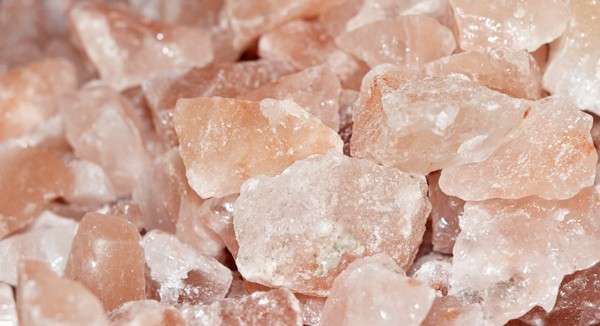
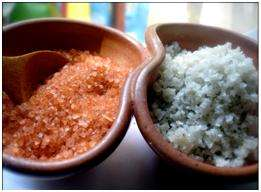

# Шүлтжүүлсэн ус, хорт хавдарын эд эсийг устгаж, эрүүлжүүлдэг

Амин дэмээр дутмаг, ашиг шимээр муу буруу хооллолтын улмаас бие организмд исгэлэн орчин бүрдэж, дархлааны системийг сулруулдаг. Бие организм дахь шүлтлэг ба исгэлэн байдлыг pH коэфциентын тусламжтай тодорхойлдог бөгөөд pH-нь, 7-с доош байвал эрүүл мэндэд аюултай гэж үздэг. pH түвшин 7-с доош байвал, биед исгэлэн орчин давамгай, хэрэв 7-с дээш бол шүлтлэг орчин нь давамгай байна гэж үзнэ. Бидний биед, исгэлэн орчин давамгайлахад, эрүүл эд эс маань хортой болж хувирч байдаг байна.

Исгэлэн орчин давамгайлсан үед дараах шинж тэмдгүүд илэрдэг:\
-Толгой байнга өвдөх\
-Гэдэс өвдөх\
-Байнга сульдаж ядрах\
-Дархлаа унах\
Бие организм, уснаас бүтдэг тул pH ус хэрэглэх нь өндөр үр дүнтэй бөгөөд ус нь хүний бие организмд маш чухал хэрэгцээтэй байдаг. Шүлтжүүлсэн усыг ууж хэрэглэхэд: арьсны чийгээ хадгалах чадварыг сайжруулдаг, илүүдэл жингээс салдаг, бүх эд эрхтэнүүдийг цэвэрлэдэг, халдвар авахаас сэргийлдэг гэх мэт олон ашиг тустай ажээ. Мөн организм дахь, хөгшрөлтийн шалтгаан болж байдаг чөлөөт радикалуудын эсрэг үйлчлэлтэй бөгөөд байнга хэрэглэхэд хорт хавдарыг дарах чадвартай байдаг байна. \
**Бэлтгэх:**\
-1 хоолны халбага гималайн давс\
-2 литр шүүсэн ус\
-1 ширхэг нимбэг /жижиглэж хэрчсэн/\
Том шилэнд усаа хийн, эхлээд нимбэгээ хийж хутгаад, дараа нь давсаа хийж, тавьж хонуулаад хэрэглэнэ. Өглөө бүр өлөн элгэн дээрээ 3 стаканыг ууж хэрэглэнэ.

Энэхүү зөвлөгөөг, гималайн давсыг, Увс аймгийн Давст суманд орших Шүдэн уулын чулуун давсаар орлуулж болох болов уу гэсэн бодол төрснөөр, мөн урд нь манай энэ давс гималайн давснаас эрдэсийн агууламжаар баялаг байдаг гэж уншиж байсандаа тулгуурлан ашиг тустай зүйлийг олон түмэндээ хүргэх хүслээр хуваалцаж буйдаа хүлцэл өчье. Гэхдээ, гималайн давс манайд, худалдаалагддаг байж ч болох юм. Мэргэжлийн хүмүүс, анхаарч, мэдэх зүйлсээрээ тусалж хуваалцна гэдэгт найдаж байна.
