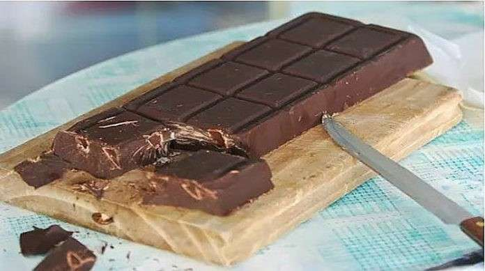
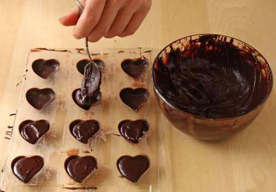

# Шоколад хийх, хялбар жор

Гэртээ гарын дорх зүйлсээр 10 минутад шоколад хийж иднэ гэхэд, та, итгэхгүй байна уу? Үлгэр биш шүү, үнэн... Ямар нэг бодисын нэмэлтгүй, гэртээ, өөрийн гараар хийсэн амтлаг шоколад хийхэд, ердөө бүхний танил, бараг айл бүрт байдаг дараах зүйлс хэрэгтэй. Хэрэв гэрт чинь байхгүй бол хажуугийн чинь дэлгүүрт байж байдаг нь мөн давуу тал.

#### Орц:

• Какао – 5 хоолны халбага\
• Элсэн чихэр – 2 хоолны халбага\
• Цөцгийн тос - 50 грамм\
• Сүү – тал стакан\
Сүүгээ халаана. Элсэн чихэр какао хоёроо тусад нь саванд холиод, халаасан сүүндээ бага багаар хийж, дараа нь хайлуулсан цөцгийн тосоо мөн бага багаар нэмж, 2 минут орчим зөөлөн гал дээр тасралтгүй хутган чанана. Халуунаар нь хэвэнд эсвэл өөрт таалагдсанаар хэвлэн, багахан хөргөсний дараа хөргөгчид хийн 2 цаг болгоод бэлэн болно. Өөрийн тань гараар бэлтгэгдэх, дэлхийн хамгийн амттай шоколад таныг хүлээж байна.
