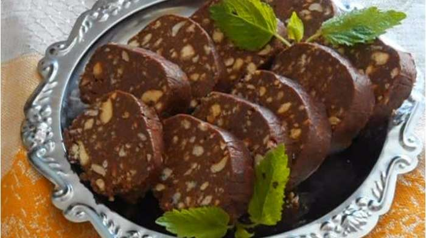

# Шоколадтай, амтлаг “хиам”, хийх арга

Хиам гэхээр бид, махан хиам толгойд орох нь гарцаагүй. Гэв ч энэ хиам, амтлаг, хийхэд хялбар, орц нь гарын доор учраас, хүүхэд ч хийгээд идчих боломжтой юм.

#### Орц:

- Жигнэмэг, /янзага печенье/ 500гр\
- Өтгөрүүлсэн сүү /молоко/ 200гр /1 лааз/\
- Масло эсвэл маргарин 200гр\
- Какао 5 хоолны халбага\
- Самар /дурын/ хүссэнээрээ /хийхгүй байсан ч болно/

#### Бэлтгэх:

-Печеньеээ буталж саванд хийнэ. Бутлахдаа, гурилын элдүүрээр элдэхэд амар байдаг. Бүрэн элдэхгүй бөндгөр хэсгүүд үлдээгээрэй. /өөх шиг харагдуулах/\
-тасалгааны температурт байсан, зөөлөн масло дээрээ, бүх орцуудаа хийж 2-3 минут хутгана\
-ердийн нимгэн гялгар уутанд хийж, хиам шиг гонзгой болгож шахаад, хөргөгчинд, 2 цаг байлгаад бэлэн болно.

Нэг дор, нэгмөсөн идээгүй тохиолдолд, 2 долоо хоног хөргөгчинд хадгалж хэрэглэж болно.
