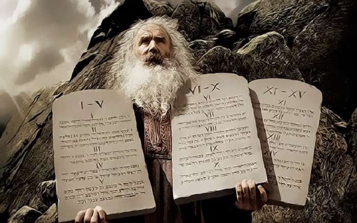

# Сод ухаантан 5 еврей хүний тодорхойлсон муу зүйлс

-“Хүмүүсийн муу амьдрал энэ нь муу болохоор”, гээд **“дух”** -аа заажээ. Энэ еврей бол **МОИСЕЙ** байв.\
-“Хүмүүсийн амьдрал муу байгаа нь, энэ нь муу болохоор” гээд, **“зүрх”** -ээ заажээ. Энэ бол **ХРИСТ** байлаа.\
-“Хүмүүсийн амьдрал муу байгаа нь, энэ нь муу болохоор”, гээд **“халаас”** -аа заав. Энэ хүн бол **КАРЛ МАРКС** байв.\
-“Хүмүүсийн амьдрал муу байгаа нь, энэ нь муу болохоор”, гээд **“бэлхүүснээс доош”** заасан нь **ФРЕЙД** байжээ.\
-Харин тавдах еврей, хүмүүсийн амьдрал тийм ч муу биш, бүх зүйл **“харьцангуй”** гэж хэлсэн нь **ЭЙНШТЕЙН** байв.
