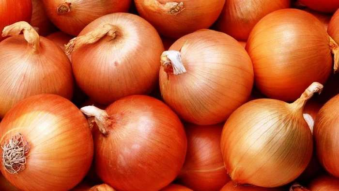

# Сонгиноор эрүүлжих хялбар арга

Сонгино дэлхий дээрх хамгийн ашигтай хүнсний ногоонуудын нэг юм. Эрүүл мэндэд тустай хүнсний эслэг, марганц, В6 амин дэмээр баялаг ногоо бөгөөд эрүүл мэндэд дараах үйлчлэлүүдийг үзүүлдэг:

-нян бактерийн эсрэг үйлчлэлтэй учраас, биендэх нян вирусыг устгадаг\
-С аминдэмээр баялаг, дархлааг дэмждэг\
-кварцетин гэдэг бодисын агууламжтай, хорт хавдраас сэргийлнэ\
-хромын агууламжтай тул цусандах сахарын түвшинг барьна\
-ногоон иш нь А амин дэмээр маш баялаг байдаг\
-чөлөөт радикалуудыг дардаг учраас ходоодны шархтай болгохгүй\
-халдвараас сэргийлж, үрэвсэл дарна\
-шумуул, шавьжны хазсан хэсгийг шүүсээр нь арчихад хорсолт нь дарагддан\
-түүхий сонгино зүрхийг дэмждэг, яагаад гэвэл муу холестириныг үүсгэдэг LDL-г бууруулдаг\
-фосфорын хүчил нь цусыг цэвэрлэдэг, биеэс хор гадагшлуулна \
Энэхүү ашигтай ногоог биеэ эрүүлжүүлэхэд ашиглах хялбар аргыг танилцуулъя: \
Хөлийн уланд маш олон дотоод эрхтэнүүдтэй холбоотой мэдрэлийн цэгүүд байдаг. Тиймээс хэдэн зүсэм сонгиныг уландаа тавьж оймс өмсөөд унтах нь мэдрэлийн системээр дамжуулан дотор эрхтэнүүдэд нөлөөлөх боломж өгдөг. Энэ үедээ оймстойгоо гэр дотроо хэсэг алхах зүгээр. Фосфорын хүчил арьсаар нэвчиж цусыг цэвэрлэхээс гадна биен дэх нян вирусыг устгадаг.
