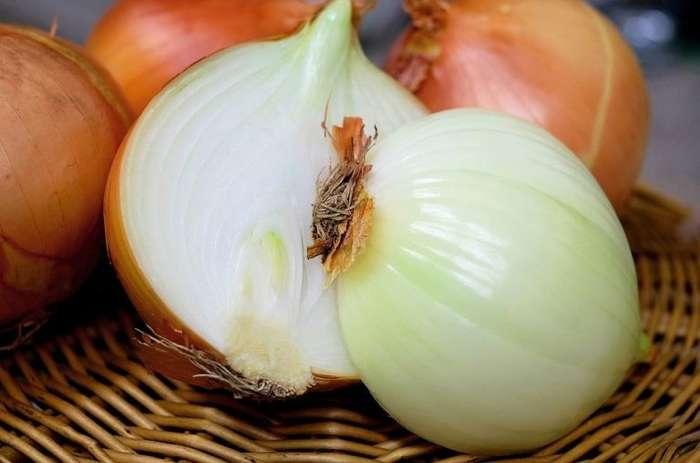
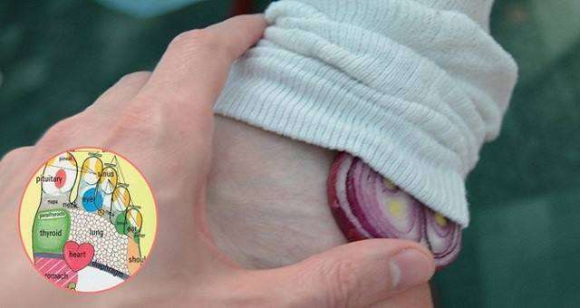

# Сонгиныг эмчилгээнд ашиглах 10 арга

Сонгины найрлагад, бактери устгах фитонцид хэмээх бодис ихээр агуулагддаг бөгөөд сонгино, дархлаа өсгөх, холестирины түвшинг бууруулах зэрэг олон эмчилгээний чанартай байдаг байна. Аюул, эрсдэл дагуулахгүй, ашигтай энэхүү хүнсний ногоог өвчин, өвчилөлийн үед хэрэглэх 10 аргыг хүргэе.

#### Ханиад

Бүтэн сонгиныг голоор нь зүсэж хуваагаад, 1 хоолны халбага элсэн чихэр, тус бүр дээр асгаж нэг цаг орчим байлгаад, өдөрт 2 удаа идэх. Бактери устгах, үрэвслийн эсрэг үйлчилгээтэй учираас ханиадыг эмчилнэ.

#### Хуурай ханиалга

Сонгиноо жижиглэн хэрчиж нухаад, бага зэрэг ургамлын тостой хутгаж өтгөвтөр холимог болгон цээжиндээ түрхээд дулаан алчуур тавьж бооно. Сонгиныг байгалийн антибиотик гэдэг ба дархлаа өсгөж, түүнээс ялгарах уур нь, цэр ховхлох үйлчилгээ үзүүлдэг.

#### Хоолой өвдөх үед

Сонгинын хальсыг буцалгаж, бага зэрэг нимбэгийн шүүс, зөгийн бал нэмж, уг холимогоор хоолойгоо зайлах нэн тустай. Үрэвслийн эсрэг үйлчилэл нь, хоолойн өвчинг намдаана.

#### Дотор муухай оргих үед

Сонгиныг үрж жижиглээд шүүсийг нь шахаж, хоёр цайны халбага шүүсийг, мөн хоёр халбага гааны цайтай 5 минутын зайтай уух.

#### Чихний үрэвсэл

Сонгиноо хэрчээд, нимгэн даавуунд боогоод чихэн дээрээ тавих. Хэсэг хугацааны дараа өвдөлт намдана.

#### Эсгэж зүссэн шарх

Шархан дээрээ нимгэн зүссэн сонгино тавих. Антибиотикт чанар, үрэвслийн эсрэг үйлчилэл нь шархыг түргэн эдгээдэг.

#### Халуурах үед

Сонгиныг нимгэн зүсээд нилээд хэдэн зүсмийг хөлийн уланд тавих. Өмнө нь уландаа ургамлын тос түрхэж өгдөг. Нимгэн гялгар уутаар ороож оймсоо өмснө. Оройд хэрэглэх тохиромжтой.

#### Шавьжинд хазуулсан үед

Хазсан газартаа нимгэн зүссэн сонгино тавих. Үрэвсэл, өвдөлтийг дарна.

#### Үс унахад

Сонгиноо буцалгаад, уг усаа хөргөн ангижруулагчийн оронд хэрэглэн үсээ зайлах. Үс унахыг зогсоож, ургалтад сайнаар нөлөөлнө. Мөн хаг арилгадаг.
