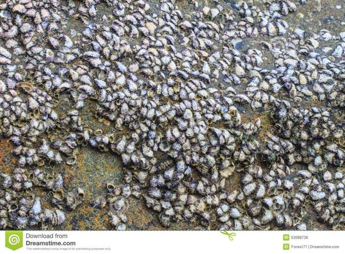

# Сонгох эрх танд л байдаг

Бурхан хүнийг бүтээгээд, чи хэн болмоор байна гэж асуув. Хүн залуу, туршлага мэдлэггүй тул сандран –“Би мэдэхгүй байна” гэхэд, Бурхан түүнийг хөтлөн далайн хөвөөнд дагуулан ирж, усны ёроолд хэвтэх дунгуудыг харуулан, -Хэрэв чи хүсвэл эд нар шиг амьдарч болно. Чи сая саяар хэвтэх эдгээр ёроолын амьтдын дунд, усны урсгалаар л зөвхөн ирэх идшээр хооллон, өчигдөр чинь өнөөдөртэй чинь, мөн маргааштай чинь адил, ямар ч эрсдэл, өөрчилөлтгүй амьдарна. Ялалт бөгөөд ялагдал чамд байхгүй. Цаг үргэлж ёроолдоо хэвтэн нэгэн хэмээр амьдрах юм. Ингэж хэлээд, дараа нь хүнийг уулсын зүг хөтлөн явж, өндөр уулын оргил дахь бүргэдийн үүрийг харуулав. Тэр, -Хэрэв чи хүсвэл энэ амьдралыг сонгож болно. Чи бүргэдийн адил хүссэнээрээ өндрөөс өндөрт элин хальж, хамгийн өндөр оргилд ч хүрч чадах бөгөөд тэрхүү оргил дээр чи, зөвхөн өөр шигээ адил цөөхөн хүнтэй л учирна. Чи, хаашаа нисэхээ өөрөө тодорхойлж, энэ нь ямар үнээр олдох болон хэн ч юу ч, хэзээ ч зүгээр олддоггүйг мэдэх амьдралаар амьдрана. Чи өдөр бүр хоол тэжээлээ эрж хайхаар нисч, хөлс цусаараа түүнийгээ олж амьдрах юм гэжээ.

Тэр цагаас хойш, хорвоо дээр, дунгийн амьдралаар амьдардаг олон хүн, харин бүргэдийн амьдралыг сонгосон цөөн хүн үүссэн юм гэнэ.

