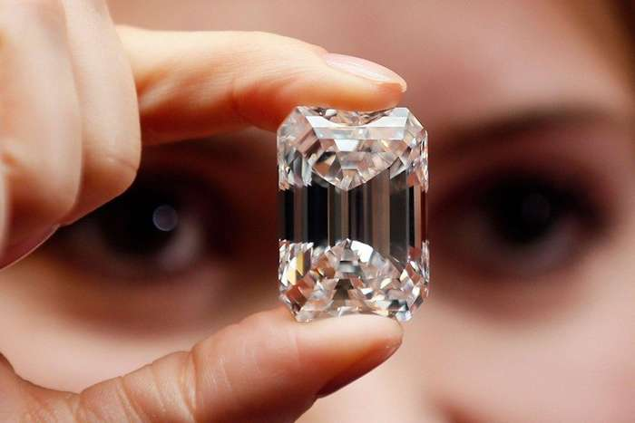
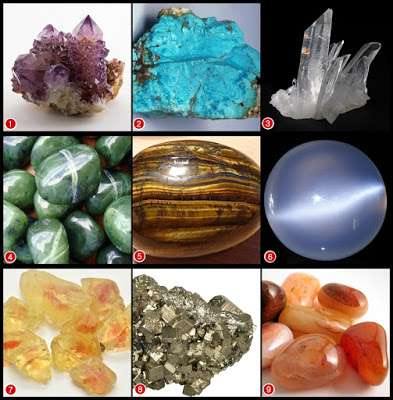
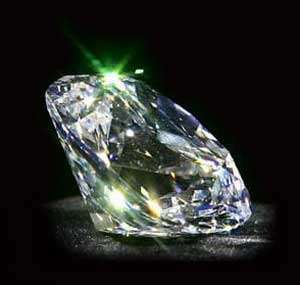

# Сонгосон чулуу тань, таны нандин хүслийг илэрхийлнэ

Эртнээс чулууны ид шидийн хүчид итгэн, ач холбогдол өгч ирсэн байдаг. Чулууг гоёл чимэг болгон ашиглахаас гадна, сахиус хамгаалалт маягаар өргөн хэрэглэдэг бөгөөд энэхүү эрдэс чулуулгийг сонирхох, үнэлэх асуудал 21-р зуунд ч буураагүй байгаа билээ. Эрдэнийн чулууг, хүмүүс хэдэн цагаар ч харж суухаас буцахгүй өндөр үнээр худалдан авч байдаг нь үүнтэй холбоотой биз ээ. Тэгээд ч, хүмүүст өөр өөрсдийн дуртай чулуу байдаг ба түүнийг харж сонгох нь, мөн тэрхүү чулууны өнгө, хэлбэр дүрс, мөн хүнийг татаж буй шалтгаан нь, тухайн хүний тухай өгүүлэх чадвартай гэж үздэг аж. Үүн дээр тулгуурлан, дараах зургаас таалагдсан чулууг сонгон, харгалзах тооны тайлбарыг уншиж өөрийн дотоод нандин хүсэл, мөн чанараа таних нэгэн боломжийг танд, олгоё.

---

#### 1. Ягаан болор

Өөдрөг үзлийг билэгддэг. Сөрөг энергийг зайлуулж байдаг. Таны, сэтгэлийн гүнд, хамгийн өөдрөг, хамгийн найрсаг чанар нуугдаж, түүнийг жинхэнээсээ хүсч байдаг.Та, өөрийн дуртай зүйлсэд хамаг анхаарлаа төвлөрүүлж, өөр бусад муу хэл амыг тоохгүй байхад суралц. Та, бол эвлэрэл, шударга байдал, цэвэр ариун зүрх сэтгэлийн билэгдэл. Энэ чулууг сонгосноороо, таны дотор дээд хүчинээс ирдэг, цэцэн мэргэн ухааныг авах боломж буйг харуулдаг.

#### 2. Оюу

Шударга үнэний билэгдэл. Та, амьдралдаа шударга байдлыг өндөрт тавьдаг. Та, зөн билэгтэй, олон төрлийн чадвартай, зоримог, урьдчилан харах, тооцоолох чадвартай, аз жаргал, эв эеийг цогцлоохоор төрсөн хүн. Дайснуудыг ч эвлэрүүлж чаддаг, мөн уур хилэнг сарниулах, эв эеийг сахиулах сайхан чанартай. Таны сонгосон чулуу, таны доторхи, манлайлагч, тэмцэгч, шийдэмгий, биеэ даасан чанаруудыг зааж байна.

#### 3. Кварц

Амжилтын билэгдэл. Таны амжилтад нөлөөлөх, зүтгэл, сэргэг ухаан аль аль нь танд,байна. Амбицтай, тууштай, зарим тохиолдолд халирах магадлалтай. Няцаж болохгүй, бүх зүйл тань бүтнэ. Дээр үед, хүмүүс кварцаар дамжин бурхны гэрэл дэлхийд ирдэг гэж үзэж биширдэг байжээ. Мөн, дэлхийн астрал бүрхүүл гэж үзэх нь ч бий. Таны энэхүү сонгосон чулуу, таны дотор өргөн төсөөлөл, товч тодорхой үг хэлэх чадвар буйг хэлж байна. Та хөгжүүлээрэй.

#### 4. Хаш

Хөгжил дэвшлийн чулууг та, сонгожээ. Та маш том мөрөөдөлтэй, хэрэв та өнгөрсөнд алдсан алдаагаа тунгааж ойлгож чадвал, мөрөөдөл тань бүтнэ. Сонгосон чулуу тань таны өөрчлөлтийг зааж байна. Таны дотоод сэтгэхүйд, сайн үйлсийг эрхэмлэдэг, энэрэнгүй буянтан оршиж байна.

#### 5. Барын нүд

Эрүүл мэнд аз жаргалын билэгдэл, бие сэтгэлийн эрүүл мэндийг хамгаалдаг. Та эрүүл мэнд, эрүүл оршихуйг жинхэнэ ойлгодог, дээдэлдэг хүн юм. Та, эрүүл саруул ухаанаар сэтгэж ажилладаг. Таны дотор нэвт шувт харах ухаан, азыг дуудах нууц хүч оршдог. Бясалгал тустай.

#### 6. Сарны чулуу

Зохилдлогоо, ирээдүйн билэгдэл. Хувь заяаны ивээл чулууг сонгожээ. Энэ нь таны дотор бие сэтгэл хоёрын тэнцвэр, зохилдлогоог дээд түвшинд хүргэх нууцхан хүслийг тань илэрхийлж байна. Дурлалыг дээд сэтгэлийн зүйл гэж үзэх ховорхон чанартай. Хэрүүл маргаанд дургүй, тэвчээртэй халамжит хүн. Бясалгалын тусламжтайгаар, дотоод ухамсраа нээх, нууц авъяас чадвараа нээх өргөн боломж буйг зааж байна.

#### 7. Наран чулуу

Баяр баясгалангийн билэгдэл. Нар мэт өөдрөг, эерэг энергитэй чулуу. Таны сэтгэл зүрх тодоор туяарч, бүр хамгийн муу харанхуй байр байдлыг ч гэрэлтүүлж байдаг. Таны эргэн тойрныхон,азтай хүмүүс, учир нь та байгаа. Зөн совинтой, төсөөлөл сайтай, урам зоригтой. Таны далдхан хүсэл, эрч хүч, өөдрөг сэтгэлийг хаа сайгүй тараах. Таны хүрээлэлд байгаа даа бид ч баяртай байна. Та, идэвхитэй хүн.

#### 8. Пирит

Эд баялаг эрч хүчний билэгдэл. Та, элбэг хангалуун байдалд дуртай. Мөн эрч хүчтэй байж сөрөг энергид автахгүй байхыг хүсдэг. Эр хүний хүчирхэг зан чанар давамгай. Амьдралын баяр баясгаланг ойлгодог, зорилготой хүн. Маш биеэ даасан байдаг тул бусдын үгээр ховорхон явдаг. Дотор тань амьдралын эрч хүч буцалж байдаг.

#### 9. Карнеол

Эрх мэдлийн билэгдэл. Сэтгэл санааны эрх чөлөө, эрч хүчтэй хүмүүс. Та, өөрийн бүтээлч чанарын эхлэлийг тавихаар эрэлхийлж байдаг. Харилцаа, хүмүүстэй ажиллах үйл ажиллагаа тань хөгжсөн байдаг. Зөөлөн, дуулгавартай чанарыг агуулдаг энэ чулуу яг л таны дотор байгаа юм шиг таны төлөө үйлчилдэг. Энэ нь, таны дотоод хүч, тиймээс та, энэ чулууг сонгосон. Энэ чулуунд дуртай ёс журамтай хүмүүс, их азтай, бусдын хайрыг татсан, дарга удирдлагынхаа итгэлийг хүлээсэн хүмүүс байдаг.

Уншигч зочид та нартаа, сонгосон чулууныхаа ид шидийн хүчийг сэтгэлдээ шингээн, урам зоригоор жигүүрлэн, нандин хүсэл, дотоод хүч юугаан амьдралдаа хэрэгжүүлэх сайхан ерөөлийг дэвшүүлье.
