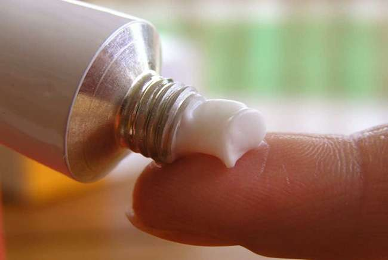

# Сонирхолтой зөвлөгөө

Хүмүүс амьдралын явцад, янз бүрийн туршлага хуримтлуулж үе дамжуулан хүргэж ирсэн нь амьдралыг хөнгөвчлөхөд тустай байдаг билээ.

Түүдэг гал асаахад, зориулалтын гал асаах шингэнээс илүү бидний идэх дуртай чипс тусална. Бүр нойтон модыг ч асаах чадвартай аж.

---

Түлэгдсэн арьсанд шүдний оо түрхвэл өвчин нь намдана.

---

Бялуу, амтат жигнэмэг хийхэд, өндөг байхгүй бол бананаар орлуулж болно. Тал банан нэг өндөгтэй тэнцнэ.

---

Төмсийг хурдан болгохын тулд, чанаж буй усандаа, багахан масло нэмээрэй.

---

Сүүг хурдан хөөрүүлье гэвэл чимх элсэн чихэр нэмдэг.

---

Бяслагийг үрүүлээр үрэхдээ, үрүүлээ ургамлын тосоор тосол.
