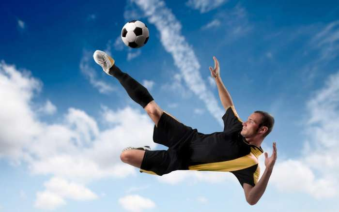
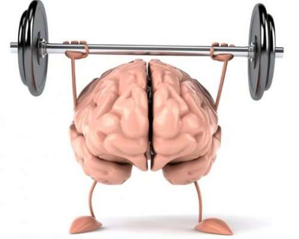

# Спорт тархийг эмчилнэ

Спортоор хичээллэх нь булчинг хөгжүүлэхээс гадна мөн тархийг хөгжүүлдэг болох нь тогтоогдлоо. Финляндын эрдэмтэд, спорт, тархинд хэрхэн нөлөөлдгийг тогтоохоор, сайн дурын үндсэн дээр 10 хос, ихэр эрэгтэйчүүдийг оролцуулсан судалгаа явуулсан бөгөөд спортоор хичээллэх нь, тархийг хөгжүүлж, бүр томруулдаг болохыг нотлов. Туршилтад оролцогсод, спортын дасгалуудыг янз бүрийн түвшинд гүйцэтгэж байсан бөгөөд санаанд оромгүй, гайхалтай үр дүн гарчээ. Спортоор идэвхитэй хичээллэж байсан ихрийн өрөөснүүдийн, биеийн булчин нь хөгжиж, томорсноос гадна, хүний хөдөлгөөний баримжааг хариуцдаг тархины хэсгийн үйл ажиллагаа нь идэвхжиж, хэмжээ нь томорсон болох нь харагдав. Эдгээр эрдэмтэд, энэхүү нээлт нь ирээдүйд, биеийн хөдөлгөөний баримжааллыг хариуцдаг тархины хэсэгтэй холбоотой өвчнүүдийг эмчилэхэд ихээхэн ашиг тустай судалгаа байлаа гэж дүгнэжээ. Тиймээс, биеийн хэсгүүд саажих, мэдээгүй болох өвчлөлүүдийг ялах цаг ойртлоо.
