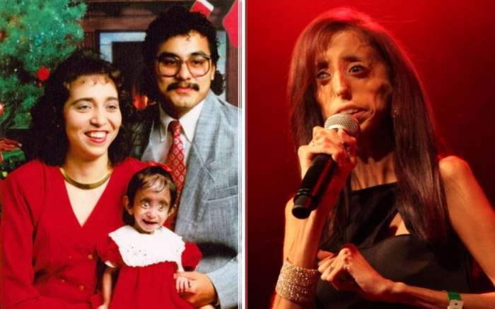
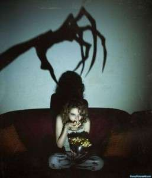

# Сөрөг муу бодлуудаас салахын тулд унш

Атаархал. Атаархал хүний дархлааг унагаж, бүх энергийг нь устгаж байдаг хамгийн хүчтэй сэтгэлийн хөдөлгөөн юм. Хүн, өөрийн бодлууд болон алтан цаг хугацаагаа атаархал буюу бусдын амьдрал сайн байхад, өөрийнх нь болохгүй байна гэсэн бодлууд тээн амьдарч, цаг, хүч энергээ атаа жөтөөнд гарздах нь, бие организмийн өөрийгөө хамгаалах төрөлх чанарыг үгүй хийж дархлааг сулруулдаг байна. \
Уур уцаар. Хамгийн түрүүнд сэтгэл санаанд нөлөөлж, бие мах бодийн эрүүл мэндийг сулруулж өвчилүүлдэг сэтгэл хөдлөл. Уур уцаартай үед хамаг юм бүтэхээ больж урд нь болж бүтэж байсан зүйл ч хэцүү болж байдгийг мэдэхгүй хүн байхгүй бизээ. Байнгын уур уцаартай байдал шиг хүнийг өвчилүүлдэг зүйл үгүй гэнэ. \
Гомдол. Хэрэв байнга гомдож, гомдол тээн, түүнийхээ буруутныг үзэн ядаж, өөрийгөө өрөвдөн амьдрах нь зайлшгүй өвчилөлд хүргэдэг байна. \
Айдас. Хэрэв айдас тээж амьдардаг бол хамгийн хүнд өвчин тусахад хүргэдэг. Бидэнд, зөвхөн эрүүл айдас буюу “болгоомжлол”, өөрийн болон ойр дотныхныхоо амь насны төлөөх багахан айдас байж болох, харин болж буй үйл явдлуудаас урган гарах сайн муу үр дүн, хохирлоос айх, ирээдүйгээс айх, орчин тойрныхныхоо үйлдэл, үйл хөдлөлөөс айх айдас хэрхэвч байж болохгүй юм. \
Өөртөө итгэхгүй байх. Хэрэв хүн өөртөө итгэхгүй бол, ердийн нэг зүйлийг биелүүлэхдээ, асар их хүч энерги зарцуулж байдаг гэнэ. Түүнийг хийхээр шийдэхдээ хүртэл асар их бодол, энергээ хий зарцуулдаг байна. Байнгын, өөртөө эргэлзсэн бодлуудад зарцуулагдаж байгаа энергийн алдагдал зөвхөн өвчин өвчилөлд л хүргэдэг. Наад захын жишээ нь, толгой өвдөх, сэтгэл санааны хямрал бөгөөд улмаар хүндэрсээр аюулт өвчинд хүргэдэг. \
Өөртөө итгэлгүй байдлаа давахад туслах, дэлхийн хамгийн муухай царайтай ч, сайхан сэтгэлтэй бүсгүй өөрийгөө ялж, өөртөө итгэлтэй байдлаа хэрхэн олж авсан тухай түүхийг толилуулъя. \
25 настай америк бүсгүй Лиззи Веласкес, “Хамгийн үзэшгүй муухай царайтай эмэгтэй” бичлэгт оролцох санал авч, 8 секундын бичлэг хийлгэжээ. Энэ бичлэгийг 4 сая гаран хүн үзэж, мянга мянган сэтгэгдэл цугларсан бөгөөд ихэнхи сэтгэгдлүүд нь, “Яаж ийм царайтай байдаг байна”, “Лиззи үхээч”, “Яаж ийм царайтай амьдардаг байна аа?” гэх мэтчилэн харааж зүхсэн доромжилсон утгатай байсанд, бүсгүй ихэд эмзэглэн зовсон ч, хатуу ширүүн дайралтуудад бууж өгөхгүйгээр шийдэж, дэлхий нийтэд өөрийгөө харуулж, өөрийн дотоод үнэт зүйлсээ харуулах, гадаад үзэмжээс илүү үнэ цэнэтэй зүйлс байдгийг хүмүүст ойлгуулах, өөр бусад доромжлогдон гадуурхагдсан хүмүүст туслах зорилгоор томоохон хурал зөвлөлгөөнд оролцон илтгэл тавьж, ярилцлага өгөх болсон байна. Тэрээр, танд таарсан, оноогдсон муу муухай гэх зүйлийг байгаагаар нь хүлээж авч, өөрийгөө буруутгахгүй, буруутныг хайхгүй байж, хичнээн хэцүү, шударга биш санагдсан ч түүнийгээ давж гарах нь л чухал юм шүү гэж зөвлөдөг. Өөрийгөө хэзээ ч битгий бусадтай харьцуулж зов, энэ нь өөрийгөө шийтгэж цээрлүүлж байна гэсэн үг. Зөвхөн, өөрийгөө байгаагаар нь хүлээж авч чаддаг болсон тохиолдолд л, амьдрал хөнгөрч сайхан болдог, энэ бүхнийг мөн эрүүл саруул улсуудад ч гэсэн зөвлөмөөр санагддаг гэж ярьдаг. Миний нүүр царайтай холбоотой ирсэн сэтгэгдлүүдийг уншаад их уйлдаг байсан, гэхдээ би тэр үед, үг яриагүй 8 секундын бичлэгийг хүмүүс ингэж хүлээж авсанд гайхаж, намайг миний юу чаддаг, юу мэдэрдэг, ямар хүн бэ гэдэг талаас огт харахгүй байгаа байдлыг нь голж эхэлсэн. Зөвхөн гадаад үзэмжээр амьдарна гэж үү? Би бол сайн хүн, бусдын л адил сэтгэл зүрхтэй, бусдын л адил сайхан харилцааг авах эрхтэй хүн. Доромжлол уур хилэнд, адилхан хариулах нь, өөрийнхөө орчиныг л муутгана, гомдоосон хүмүүсийг зөвхөн өөрийн хүрсэн өндөрлөгөөр л ялна, мөн тэдгээр доромжлогсод үүнийг хараад шившигт унана гэдгийг мэднэ, тэгээд ч би үүнийг тунхагладаг. Миний эвгүй гаж царай надад хүч, итгэлийг өгсөн. Хүнд хэцүү зүйл, сорилтууд, хүнийг өсч хөгжих шаардлагатай нөхцөлүүд болж өгдөг юм шүү. Амьдралд таардаг хүнд хэцүү асуудлууд, бидэнд хүссэндээ хүрэхэд шаардлагатай мэдлэг, туршлагатай болоход тусалдаг. Эдгээр нь биднийг хатуужуулж хүчтэй болгодог. Хүмүүс надад итгэдэг юм шүү. Ийм муухай царайтай хүн ярьж байгаа зүйлээ мэдэж байгаа гэж хүлээж авдаг. Та амьдралд бууж өгөх, эсвэл аз жаргалтай амьдрахаа өөрөө л сонгоно. “Шулам” мэт атаархуу, гоморхуу, аймхай, уур уцаартай, өөртөө итгэлгүй зан хүнийг өвчилүүлж, амжилтаас улам холдуулдаг гэж ярьдаг байна.
