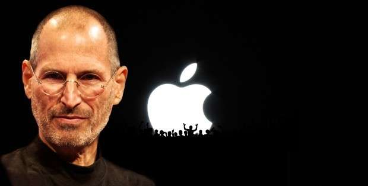
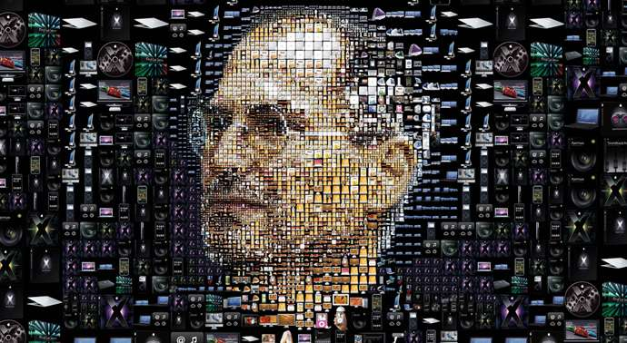

# Стив Джобсын сүүлийн захиа

Стивен Пол Джобс, 1955 оны 2 сарын 24-нд, Сан-Франциско хотод төрсөн бөгөөд төрөөд долоо хонож байхад нь, сири гаралтай эцэг, америк эмэгтэй эх хоёр нь, түүнээс татгалзаж, Маунтин-Вьюгээс ирсэн Клара, Пол Джобс нар өргөн авч өсгөсөн гэдэг. Түүний бага нас, “Цахиурын хөндий” болон хувирч буй, электрон тоног төхөөрөмж, хэрэгслүүд, инженерүүдээр дүүрэн, Калифорнийн тэр нэгээхэн хэсэгт өнгөрчээ. Өргөсөн эцэг эх нь, төрсөн эхэд нь амалсан ёсоор төлбөр өндөртэй нэртэй колледжид оруулсан ч нэг семестр сураад орхин, дорнын агийн ёс судлаж нилээд хугацааг өнгөрүүлсэн бөгөөд байнга мацаг барьдаг зөвхөн жимсээр хооллон амьдралынхаа нэгэн үеийг өнгөрүүлж байсан гэдэг. Тэр, IT-технологийн анхдагчидын нэгээр хүлээн зөвшөөрөгдсөн, Pihar, NeXT, Apple компаниудын үндэслэгчидийн нэг, агуу нэгэн байсан бөгөөд 2011 оны 10 сарын 5-нд, 56 насандаа өвчнөөр нас нөгчсөн юм.

Би, ажил хэргийн ертөнцөд амжилтын оргилд хүрсэн гэж хэлж болно. Бусдын нүдэнд, миний амьдрал, амжилт буцалсан гайхалтай амьдрал харагддаг. Гэтэл, миний ажлаас гадуурх амьдрал тийм ч баяр баяслаар дүүрэн биш байлаа. Эцсийн эцэст, хөрөнгө, эд баялаг бол миний дассан амьдралын хэв маягийн нэгээхэн баримт л байж. Яг одоо, эмнэлгийн орон дээр, өнгөрсөн амьдралаа эргэн харахад, миний бахархаж явсан нэр төр, хөрөнгө, эд баялаг, ойртож буй үхлийн минь өмнө ямар ч үнэ цэнэгүй болохыг ойлгосоор байна. Харанхуйд, надад залгаатай, түүний хүчээр би, амьд байгаа аппаратны ногоон гэрлийг харан, чимээг нь сонсон хэвтэхдээ, Бурханы амьсгалыг сонсож, үхлийн дөхөхийг мэдэрсээр байна. Хүмүүс, хэдийгээр хангалттай эд баялаг хураасан байсан ч, эд хөрөнгөтэй холбоогүй тэс өөр, амьдралын бусад зүйлүүдийн тухай бодох, эрмэлзэх хэрэгтэйг ухаарах ёстой. Эд баялагаас илүү, хүмүүсийн хоорондын нандин харилцаа, магадгүй, гайхамшигт урлаг, эсвэл бүр хүүхэд насны мөрөөдөл... хамгаас чухал ажээ. Эд баялагийн хойноос зогсолтгүй хөөцөлдөх нь хүнийг ердийн нэг утсан хүүхэлдэй болгодог гэдгийг би өөрийн амьдрал дээр ойлгосон. Бурхан бидэнд, хайраа зүрх бүрт хүргэх мэдрэмж өгсөн, харин баялагтай холбоотой “хуурмаг үзэгдэл болох хоосон”-г өгөөгүй аж. Би, амьдралынхаа туршид хураасан эд хөрөнгөө аваад явж чадахгүй. Харин, хайртай хүмүүстэй минь холбоотой сайхан дурсамжуудаа л авч явж чадах нь. Зөвхөн энэ л, биднээс хэзээ ч салшгүй, мөн хүч, гэрэл өгөх жинхэнэ баялаг ажээ. Хайр мянган бээрийг ч туулна, амьдрал мөн хязгааргүй. Хаашаа явмаар байна тийш яв. Хүссэн өндөрлөгтөө хүр. Эдгээр нь таны зүрх сэтгэл, таны гарт байдаг гэдгийг сана. Та, хэнийг ч юм хөлслөөд өөрийн төлөө юуг ч хийлгэж чадна. Харин, хэн ч өвчинийг чинь өөртөө авч чадахгүй. Бид, гээж алдсан материаллаг эд зүйлсийг дахин олж авч чадна. Харин, эргэж хаанаас ч олохгүй нэг зүйл байдаг нь амьдрал юм. Амьдралын чухам аль үедээ явж буй нь чухал биш, нэг л өдөр, хүн бүрийн өмнө, энэхүү хөшиг хаагддаг. Та бүхний юутай ч зүйрлэшгүй эрдэнэс бол, гэр бүлээ хайрлах хайр, хайртай хүнээ хайрлах хайр, найз нөхдөө хайрлах хайр юм. Мөн өөрийгөө хайрла. Бусдыг халамжлан хайрла.
