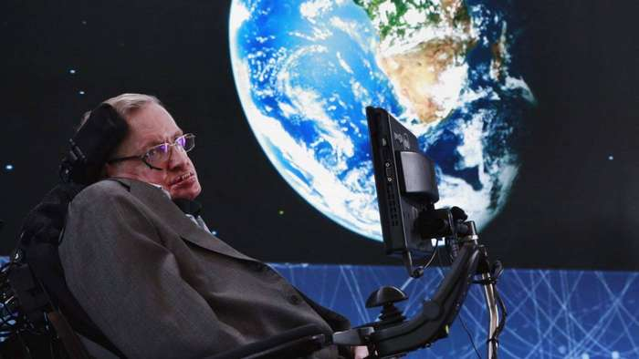
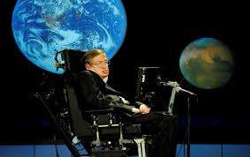

# Стивен Хокинг: хүн төрөлхтөний түүхэнд байгаагүй хүнд үе ирээд байна.

Английн, нэрт онолын физикч, Стивен Хокинг, хүн төрөлхтөний түүхэнд байгаагүй хүнд үе ирээд байна гээд, дэлхийг даяарчлалын аюулаас аврахын тулд эдийн засгийн тэгш бус байдалтай хойшлуулахгүй тэмцэх хэрэгтэй гэж үзэж байна. Тэрээр, эдийн засгийн даяарчлал, технологийн хөгжилийн үр дүнд гарч буй үйлдвэрлэлийн автоматчилалаас үүдэлтэй ажлын байрны хомсдол үүсч, зөвхөн удирдлага, зохион бүтээгчидэд ажиллах боломж олгож буй энэ үеийг эдийн засгийн тэгш бус байдлын оргил, хамгийн эрсдэлтэй үе гэж үзэв. Хөрөнгө санхүү, цөөн тооны хүмүүсийн гарт төвлөрч, дээд анги буюу чинээлэг давхаргынхныг үзэн ядах хандлага газар авч буйг, Англи, Европын холбооноос гарсан, Америкт Трамп ялсантай холбон тайлбарлажээ. Энэ бол хүмүүсийн, өөрсдийг нь хайхрахгүй байгаад уурссан уур хилэнгийн дуу хоолой болсон сонголт байлаа, тиймээс, дэлхийн хэмжээний, мөн аливаа улс орны лидерүүд мухардлаа хүлээн зөвшөөрч, өөрсдийн гарт байгаа асар их санхүүгийн нөөцийг хуваах, хуваалцаж сурах ёстой болж байгаа бөгөөд үгүй болж буй ажил мэргэжил, үйлдвэрийн ажилчидыг дахин өөр мэргэжлээр сургах, материаллаг тусламж үзүүлэх, арай дээр амьдралыг эрэлхийлэн цагаачилж буй сая сая цагаачдыг эх орондоо аз жаргалтай амьдрах боломж бололцоог бий болгох зэрэгт хуралдсан хөрөнгөө зарцуулахгүй бол, төгсгөл нь тааварлашгүй аюул нүүрлэж байна гэж мэдэгджээ. Мөн, бичсэн ном товхимол шинжлэх ухааны судалгааны ажлуудыг минь дагалдан ирсэн алдар нэр, намайг цөөн тооны чинээлэг хүмүүсийн эгнээнд оруулж, хангалуун амьдарч ирсэн, гэхдээ чинээлэг давхаргынхныг таагүй үзэх, өссөөр буй энэ хандлага яг надад илгээгдээд байгаа юм шиг санагдаж шаналдаг. Гэхдээ, би их өөдрөг хүн. Лондонгоос Харвард, Кембриджээс Холливуд хүртэл сонсоно гэж итгэж байна гэж The Guardian сэтгүүлийн сайтад нийтлүүлжээ.
