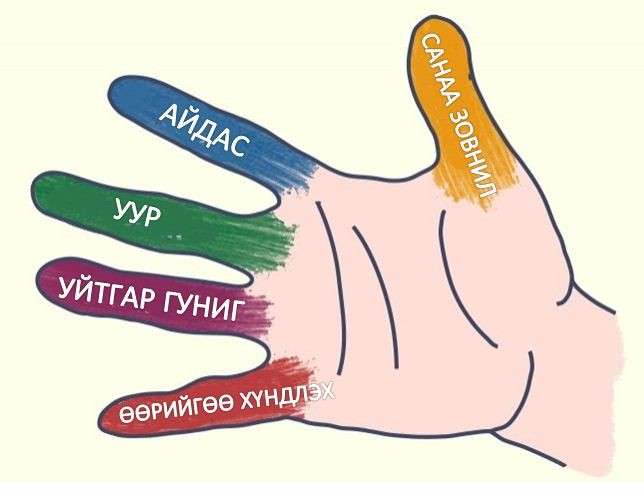

# Стрессээс салах 5 минутын Япон дасгал

Энэхүү дасгалыг хийхийн тулд, бид хуруу тус бүрийнхээ, тухайн сэтгэл хөдлөлүүдтэй харилцах уялдааг мэдэх хэрэгтэй.\
**Эрхий хуруу**- сэтгэл зовнил, түгшүүрээс салгана.\
**Долоовор хуруу**- Айдастай тэмцэхэд тусална. \
**Дунд хуруу**- Гомдол, уур бухимдлыг хянахад тусална. \
**Ядам хуруу**- Уйтгар гуниг болон сэтгэл гутралд. Таныг илүү шийдэмгий болгоход тусална. \
**Чигчий хуруу**- Тайвшруулах болон өөдрөг байдал, өөртөө итгэх итгэлийг тань дээшлүүлж өгдөг. \
**Арга:**\
Амьдралын энергиэ эрчимжүүлж, хуруу тус бүрийн харгалзсан сэтгэл хөдлөлийн уялдааг сайжруулахын тулд, нэг гарын хуруунуудаа, нөгөө гараараа тус бүрийг нь 1 минут орчим атгаж өгөх ба дараа нь бүх хуруунуудаа нийлүүлж мөн 1 минут базаж өгөх хэрэгтэй. Энэ үед, дасгал зөв хийгдэж байгаа тохиолдолд, зүрхний цохилтны лугшилт мэдрэгдэж байдаг. Оюун санаагаа тайвшруулахын тулд, алганыхаа гол хэсэгт мөн нөгөө гарынхаа эрхий хуруугаараа хамгийн багадаа 1 минутаас доошгүй хугацаанд зөөлөн дарна.

Энэхүү дасгалыг өдөр бүр хийснээр та, сэтгэл санааны тайван байдлаа хадгалж, тэнцвэржүүлж чаддаг болдог.
