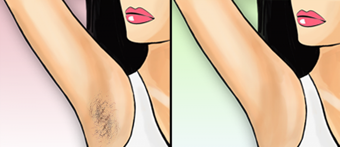
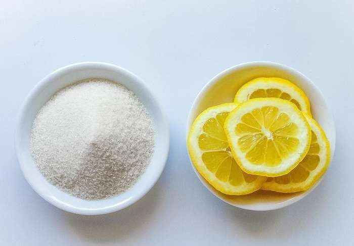
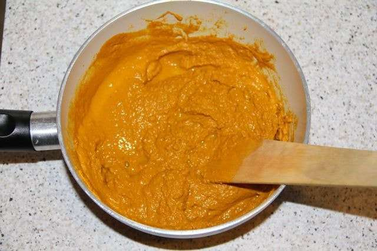

# Суганы үсийг арилгах арга

Дараах 100 хувь байгалийн гаралтай хүнсний бүтээгдэхүүнүүдийг ашиглан, таагүй суганы үснээс салж болдог гэнэ. Эдгээр нь тухайн хэсгийн арьсыг, хусах, үс хуулуулах үйлчилгээний үеийнх мэт гэмтээхгүй, толигор зөөлөн болгодог бөгөөд хүн хүний бие организмын онцлогоос шалтгаалан янз бүрийн хугацаанд арилгадаг.

#### Элсэн чихэр нимбэгний шүүс

2 хоолны халбага нимбэгний шүүс, 1 хоолны халбага элсэн чихрийг хутгаад сугандаа түрхэж 2-3 минутын дараа бүлээн усанд норгосон алчуураар арчина

---

#### Өндөгний цагаан, эрдэнэшишийн гурил

1 хоолны халбага өндөгний цагаан, 1 хоолны халбага эрдэнэшишийн гурилыг хольж, суганы хэсэгтээ түрхээд хаттал байлгана. Дараа нь бүлээн усаар угаана

---

#### Сүү, куркума

2 хоолны халбага сүүнд, куркума хийж хутгаад, суганы хэсэгтээ түрхэж 2-3 минут байлгаад угаана
