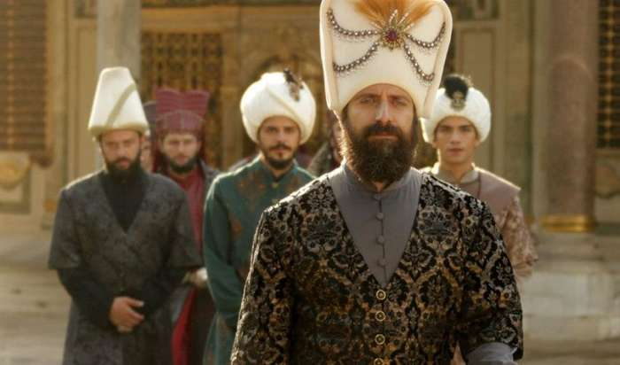
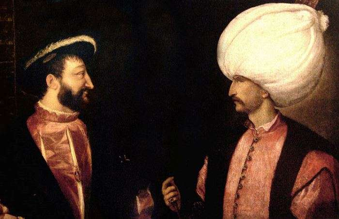

# Сулейман султаны гайхалтай, 3 гэрээслэл

Баян, ядуу ямар ч байсан үхлийн өмнө хүчин мөхөсддөг билээ. Тиймээс амьдралаа үнэлж, өдөр бүрээ баяраар дүүргэж, эргэн тойрноосоо баяр жаргалыг олж сурахыг хичээх хэрэгтэй аж. Сулейман султан нас барахынхаа өмнө, түшмэлээ дуудан, 3 гэрээслэлээ хэлэхэд, түшмэл нь гайхсандаа эгээтэй л унаагүй гэдэг.

Султаны гэрээслэл:\
1. Түүний шарилтай авсыг, Османы улсын хамгийн шилдэг эмч домч нар өргөж явах ёстой\
2. Мөн энэ үед, замын турш алтан зоос, эрдэнэс цацаж явах\
3. Авснаас, султаны хоёр гарыг бусдад харагдахаар байрлуулж, бүгдэд харуулж явах гэсэн аж. \
Сонссон зүйлдээ итгэж ядсан түшмэл нь, ямар учиртайг айж мэгдэн түүнээс асуухад, Сулейман Кануни: \
-Хамгийн сайн эмч домч нар шарилыг маань өргөж явах нь, үхлийн өмнө ямар ч сайн эмч домч хүчгүй гэдгийг хүмүүс, харж мэдэж аваг\
-Миний алт эрдэнэсийг цацаж тараах нь, энэ амьдралд олж хураасан эд баялаг, энэ амьдралдаа л үлддэг гэдгийг харуулах\
-Авснаас цухуйх миний гарыг харах нь, хаадын хаан Сулейман Кануни султан ч энэ амьдралаас гар хоосон явж буйг харуулж, амьдралын хамгийн энгийн үнэнийг таниулахын тулд болой, хэмээн хариулсан ажээ.

Сулейман Кануни султан /1494-1566/ тэр үеийн Османы гайхамшигт гэдэг хочтой гарамгай улирдагч, алдар нэр нь түгсэн хаан байжээ.
