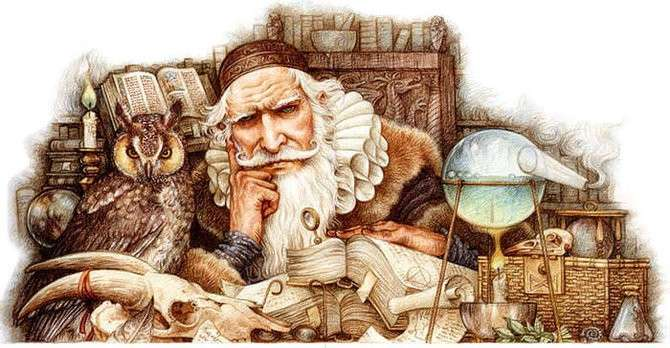

# “Сум ба манан”. Зорилгодоо хүрэх, бэрхшээлүүдийг давахад тусална.

Багшаа, бидний, зорилгодоо хүрэх зам яагаад ийм хүнд байдаг юм бэ? Хүссэн зорилгоос маань хазайлгах, мөн сул доройг маань мэдрүүлэх гээд байгаа юм шиг, гэж сурагч нь асуув. Багш нь түүнд, -чиний хүнд гэж үзэж байгаа зүйлс бол зорилгын чинь салшгүй хэсэг юм. Тиймээс зорилгоо сонгохдоо энэ бүхнийг тооцоолж сонгох хэрэгтэй болдог. Мөн бэрхшээлүүдийг тооцсон байх ёстой, харин түүнтэй тэмцдэггүй. Чи нум сум харвах гэж байна, гэж бодъё. Чиний бай, манан буусан учраас харагдахгүй байна. Чи манантай тэмцэхгүй биз дээ? Чи мананг сарнихыг хүлээнэ. Манан арилж, бай харагдаж байв ч салхи хүчтэй байна. Чи салхитай тэмцэхгүй. Харин чи, сумны нисэлтийн өнцөг, чиглэлийг тодорхойлж арай өөр байрлалаас харвана. Мөн чиний нум чинь хүнд хатуу, хүч чинь хүрэхгүй бол чи нумтай тэмцэхгүй, харин булчингаа хөгжүүлж эхэлнэ гэв. Сурагч, -гэхдээ манангүй, салхигүй үед хөнгөн сайхан нумаар харвадаг хүмүүс байдаг шүү дээ, харин миний харвалт л хүнд, бэрхшээлтэй байх юм, энэ ертөнц миний урагшлах хөдөлгөөнийг эсэргүүцээд байгаа юм уу, гэж хариуд нь гомдоллов. Багш нь инээмсэглээд, -чи бусдыг битгий хар, хүн бүрт өөрийн гэсэн нум, бай,харвах хугацаа байдаг. Нэг хэсэг нь байгаа онож тусгахыг, нөгөө хэсэг нь харваж сурахын тулд харвадаг гэснээ дуугаа намсган, би бас чамд нэг аймаар нууцыг задлая, манан чамайг харвах үед саад болохоор буудаггүй, салхи мөн сумны чинь чиглэлийг өөрчлөхөөр салхилдаггүй, хатуу нум чамайг хүчгүй гэдгийг чинь мэдрүүлэхээр хийгдээгүй, эдгээр зүйлс бүгд байсаар л ирсэн зүйлс. Харин, ийм нөхцөлүүдэд харваж, байгаа онохоор шийдсэн нь чи! Тиймээс хүнд бэрх байна гэж гомдоллохоо больж, харваж эхэл эсвэл өөрийнхөө бардам зангаа дарж илүү хөнгөн, тулгаад харваад байгаа онохоор жижиг зорилго тавь...гэжээ.
