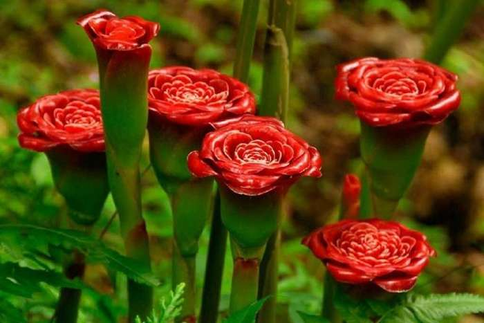
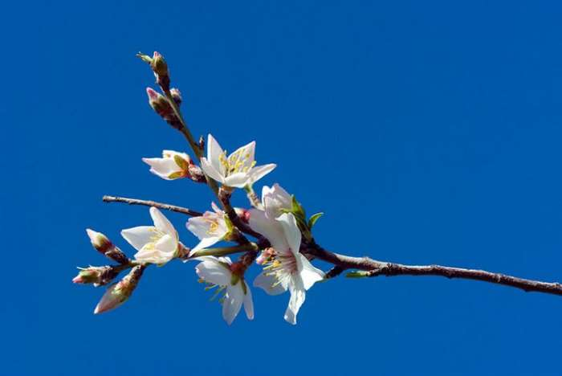
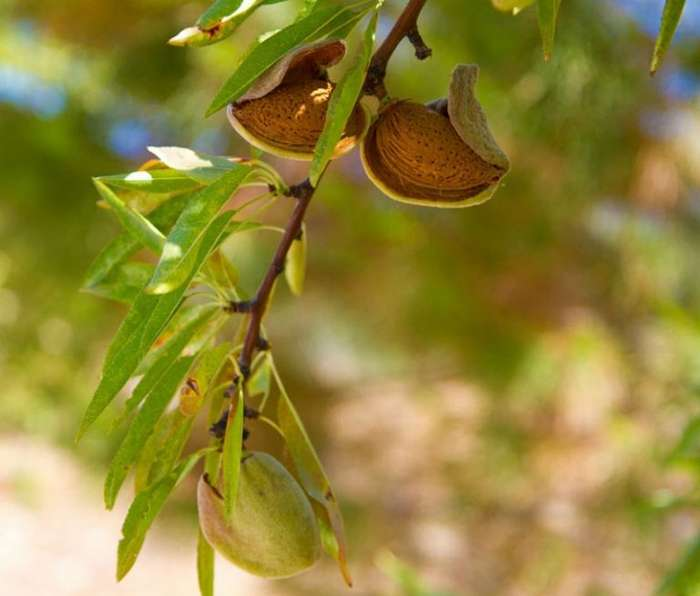
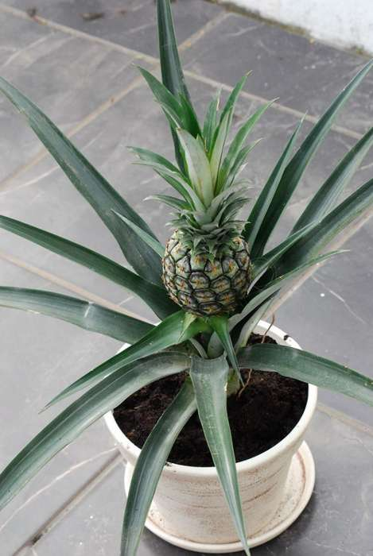
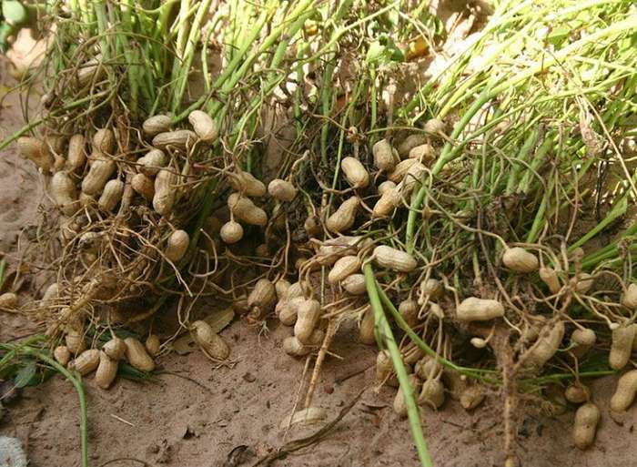
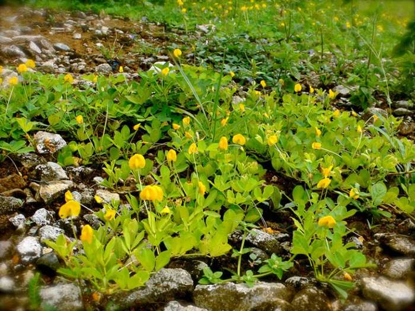
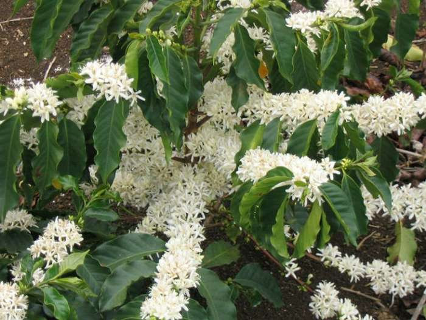
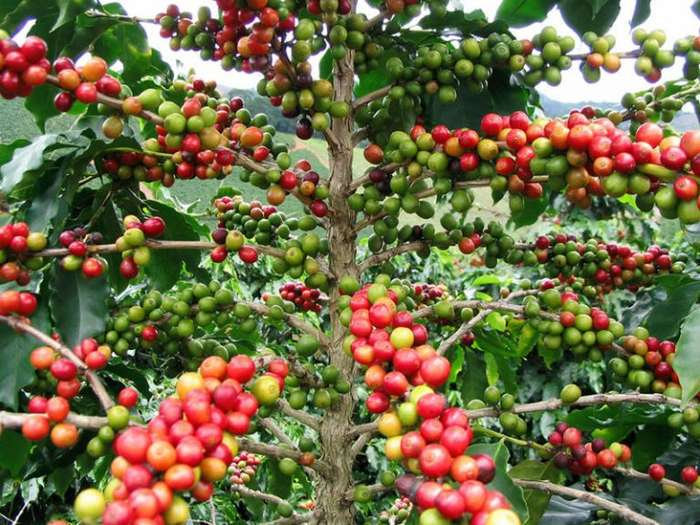
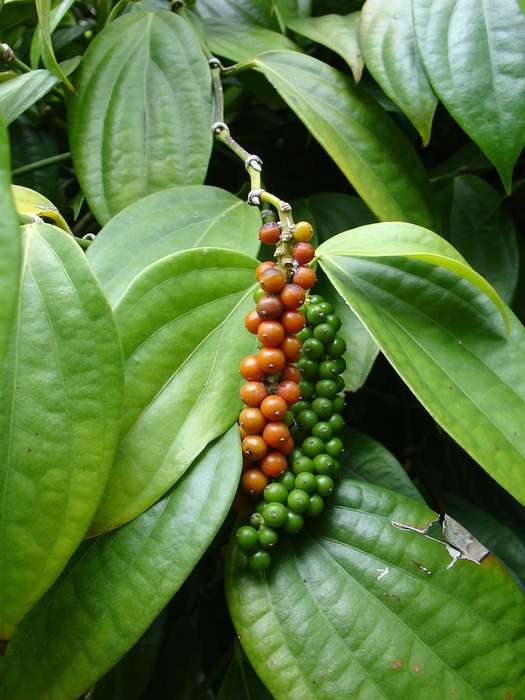

# Та, дараах хүнснүүдийг таних уу?

Эдгээр хүнснүүд, бидний байнга хэрэглэдэг хүнснүүд. Бид энэ хүнснүүдийг, худалдаж авч өргөнөөр хэрэглэхээс бус лангуун дээр ирэхээсээ өмнө ямархуу байдгийг мэддэгггүй. Сонирхолтой бөгөөд гайхмаар!

#### Миндаль(Бүйлс)

Хүмүүс миндалийг самар гэж боддог гэтэл, нэг төрлийн чавганы ясны үр юм байна.

---

---

#### Хан боргоцой

Хан боргоцой бидний төсөөлдөгөөр далдуу модон дээр урагадаггүй, харин өвсний төрлийн ургамалд багтдаг аж.

---

#### Газрын самар

Газрын самар буурцагт ургамалд хамаардаг бөгөөд газар доогуур ургадаг.

---

---

#### Кофе

Кофег худалдаанд гаргахаас өмнө, ийм байдаг гэж хэн ч төсөөлөхгүй.

---

---

#### Хар перец

Хар перец, мөлхөө модлог ургамал дээр ургадаг. Эхэн үедээ, цагаанаар цэцэглэж, жимс шиг молцоглон ургадаг.

---

#### Цагаан гаа

Цагаан гааг ийм цэцэгний үндэс гэж төсөөлөх үү?

Бид, ийм баялаг, сонирхолтой ертөнцөд, өдөр болгон нэгийг мэдэж амьдардаг маань сайхан.
