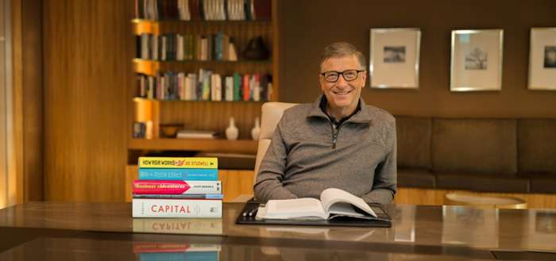
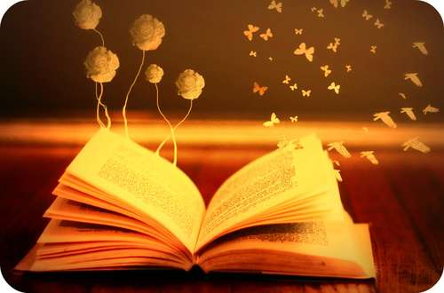

# Та, илүү амжилтад хүрэхийн тулд, тэрбумтанууд шиг унш

Санхүүгийн шинжээч Элль Каплан, нэртэй хүмүүсийн унших барилуудыг судалснаа уншигчидтай хуваалцаж байна. Саятан Дэн Кеннеди нэг удаа, -“баян хүмүүсийн номын сан том байдаг, харин ядуу хүмүүсийн телевизор том байдаг” гэж хэлж байсан нь тэмдэглэгдэн үлджээ. Энэ үнэхээр үнэн байдаг гэнэ. Тэрбумтан Уоррен Баффет өдөрт 500 хуудас ном уншдаг бөгөөд тэрээр, зөвхөн энэ дадал маань намайг амжилтад хүргэсэн гэж нотолдог байна. Америкийн хэвлэл мэдээлийн магнат Марк Кубан, өдөрт 3 цагийг уншихад зориулдаг. Билл Гейтс жилд 50 ном уншдаг. Илона Маскагаас хэрхэн пуужин хийж эхэлсэн талаар асуухад, “ би ном уншдаг байсан” гэж хариулсан байдаг. Номыг чөлөөт цагийг өнгөрүүлэх хэмжээнд биш, харин ухаан, бүтээлч чанар, аливааг ойлгож санаа авах чанарыг нэмэгдүүлэхээр уншихын тулд, дараах зөвлөгөө хэрэг болно.

#### Зөв номнууд унших

Судлаач Томас Корли: -хүмүүс номыг янз бүрийн зорилгоор уншдаг бөгөөд унших номын сонголтод, амьдралын түвшин нөлөөлөх байдал анзаарагддаг гэж үзсэн байна. Жилийн орлого нь 160 000 доллар, 3.2 сая доллараас дээш хөрөнгөтэй хүмүүс, өөрийгөө хөгжүүлэх, боловсрол эзэмших, амжилтад хүрэх зорилгоор ном сонгож уншдаг бол жилийн орлого нь 35 000 долараас доош, 5 саяас бага хөрөнгөтэй хүмүүс номыг сонирхолын журмаар уншдаг гэж тогтоосон аж. Амжилтад хүрсэн хүмүүс, өөрсдийн хөтөлбөрийн дагуу байнга суралцаж байдаг мөнхийн оюутнууд байдаг, тэд, өөр бусад алдартануудын намтар, замнал зэргээс санаа, туршлага, сэдэл авахаар уншдаг, мөн өөрсдийн намтар, ярилцлагадаа гол нөлөө үзүүлж байсан номнуудыг олонтаа дурдсан байдаг аж. Хэрэв та, юунаас эхэлж уншихаа мэдэхгүй байгаа бол, алдартай хүмүүсийн дуртай номын жагсаалтаас сонгож уншиж болох юм.

#### Төлөвлөгөө гаргах

Нэр алдартай хүмүүсийн, ном унших дадал зуршилын талаар мэдсэнээр танд, унших хүсэл төрөх нь лавтай. Гэхдээ бид 24 цагийн турш амжилтруу тэмүүлэх нөхцөл, боломжтой чинээлэг биш учраас ажил, гэр бүл, асуудлууд гээд цаг зав гаргахаас эхлээд саад гарна. Гэсэн ч ном уншихыг зуршилын хэмжээнд хүргэхийн тулд, тодорхой цаг хугацаа гарган төлөвлөж, үүнийг хийхгүйгээр амжилтад хүрэхгүй, маш чухал ажил гэж хандах хэрэгтэй аж.

#### Бага багаар уншиж эхлэх

Өдөрт 30-с дээш минут уншихаар тооцож, цаг гарган унших. Энэ хугацаанд 20-30 хуудас уншигдах ба орчин үеийн, хамгийн хялбар хэллэгээр бичигдсэн ном сонгож уншиж эхлэх хэрэгтэй.

#### Төрөл бүрийн ном уншиж эхлэх

Уоррен Баффет, бүх түүхэн үеийн номуудыг, төрөл бүрийн сэдвээр уншихыг зөвлөдөг. Ингэснээр, олон төрлийн мэдлэг, төрөл бүрийн санаануудыг олж авдаг аж. Таны хувьд, нэрт хүмүүсийн замнал, намтараас, түүхэн роман эсвэл бизнес-ном руу шилжин унших, таагүй байж болох ч та, дараа нь номын амтыг шимтэн унших сайхан дадал зуршлыг эзэмших нь гарцаагүй юм. Түүнчлэн, ингэж сэлгэж уншихыг, номыг ойлгох болон мэдээлэл боловсруулах хоёрын хурдыг, хоёр дахин нэмэгдүүлдэг гэж үздэг байна.
