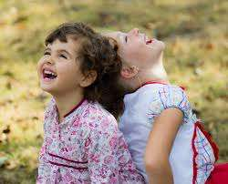

# Та өөрийгөө хэзээ ч бясалгаж байгаагүй гэж боддог уу?

Та өөрийгөө хэзээ ч бясалгал хийж байгаагүй, оюун санааны ямар нэг дасгал огт хийж байгаагүй гэж боддог бол, үгүй гэнэ.

1. Бага байхдаа, баярлаж хөөрөн, эргэлддэг байснаа санаж байна уу? Энэ бол эзотерикийн дасгал бөгөөд дервишүүд ийм сургуулилалт хийж оюун санаатайгаа ажилладаг\
3. Бага байхад, эргэн тойрон маань гайхалтай сайхан, ид шидийн юм шиг санагдан, түүнийг мэдэрдэг байсан даа... Оюун санаатай холбоотой бүхий л дасгалууд, сургалтууд, аливааг хүлээн авах чадварыг цэвэрлэх, ертөнцийг ид шидийн газар мэт хүлээж авахад чиглэсэн байдаг\
4. Хүүхдүүд нүдээ байн байн дардаг, мөн хүүхэлдэйн кинонд дотор нь орчихсон юм шиг үзэх зэрэг нь, түвдийн цогчингийн Тогал хэмээх дасгалд ордог\
5. Хүүхэд, зүгээр байхгүй годгонож, мушгиралдан, янз бүрийн ухаангүй хөдөлгөөн гарган инээж баярлаж байдаг нь, христийн юрод, буддын галзуу мэргэн ухааны дасгал хийж байна гэсэн үг гэнэ\
6. Хүүхдийн, хариу нэхээгүй ээж, ааваа хайрлах хайр нь, ариун гэгээнтнүүдийн хайртай адил байдаг бөгөөд тэр хайрыг сургахад, олон оюуны санааны сургалтууд чиглэгдэж байдаг\
7. Бага байхад, шинэ жилийн шөнө нэг л ердийн бус, баяртай, ид шид, гайхамшиг байгаа юм шиг санагддаг байсан даа... энэ нь, үнэхээр ер бусын зүйл болох баярын амьсгалыг сонсдог, ертөнцийг мэдэрдэг байсныг маань харуулдаг. Бид, ертөнцтэй илүү ойр дотно байжээ. Та догдолж байна уу? Мартаагүй биз?
