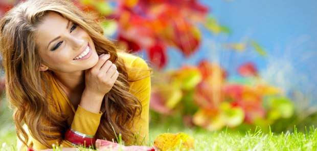

# Та өөрийнхөө амьдралыг өөрчилж чадна

Өнөөдөр, би өнгөрсөн амьдралаа хараад, төгс болохыг эрмэлзэж байсан минь амьдралын минь гол дайсан байсныг ойлгосон. Би, өндөр хүмүүжил хүн бүрээс ижил хэмжээнд шаарддаг, анги хамт олон, хоорондоо бие биенээс илүү байхын тулд үргэлжид өрсөлдөж байдаг нөхцөл, нийгэмд хүмүүжжээ. 10-д настай байхдаа, хэдийгээр, хэл уран зохиол, гадаад хэл, зургийн хичээлдээ сайн ч, физик математик ойлгохгүй тэнэг тархитай гэдэгтээ итгэж байлаа. Дараа нь, насанд хүрэхдээ, өөрийгөө хангалттай ухаантай биш, тийм ч амжилттай биш, хөөрхөн сайхан биш гэж өөрийгөө тооцдог болсон. Үргэлжлэн, авъяас, туршлага минь сайн цалинтай ажил хийхэд хангалтгүй, илүү сайн ажил хийх чадваргүй, сайхан залуугийн хайр татах өгөгдөлгүй гэх мэтээр өөрийгөө төсөөлж явлаа. Харин өнөөдөр, амьдрал минь шал өөр, би, өөрийн өөрчилөгдсөн “би”-дээ баярлаж, талархаж явдаг. Би, өөрийгөө байгаагаар нь хайрлаж чаддаг болж, өөрийн дур хүслээр, өөрт заяагдсан авъяас чадварын дагуу ажил төрөл эрхэлж амжилттай, аз жаргалтай яваа. Энэхүү өөрчлөлтийг би, санамсаргүй, стрессээс хэрхэн салах талаар интернетээс хайж байгаад, Луиза Хейгийн “Та өөрийн амьдралаа эрүүлжүүлж чадна” /You Can Heal Your Life/ гэдэг бичлэг үзсэнээс эхэлсэн. Дараа нь, Уйэн Дайер, Байрон Кейти, Дон Мигель Руис нарын “гэгээлэг” номуудыг уншиж, өөрийгөө үнэлэх үнэт аргуудад суралцсанаар, хязгаарлагдмал итгэл үнэмшил, нийгмийн соёлоор суусан хуучин сэтгэхүйгээс салсан. Энэхүү зөвлөгөөнүүдийг хэрэгжүүлэх гэж чармайсны хүчинд би, өнөөдөр үнэхээр эрх чөлөөтэй, шинэ хүн болсон гэж боддог. Би өөртөө дараах өөрчилөлтүүдийг хийсэн:

-Төгс хүн болохын төлөө хөөцөлдөхөө больсон. Төгс төгөлдөр зүйл гэж байхгүйг ойлгосон бөгөөд алдаа, азгүйтлийг, өсөлтөд түлхэх, ухаан суулгах зүйл гэж хүлээж авч, өөрийгөө шүүмжлэх, үгүйсгэх, өнгөрсөнд харамсах нь өөрийгөө устгадаг гэдгийг ойлгодог болсон.\
-Заавал, байнга ямар нэг зүйл хийж, эрхлэх ёстой, үгүй тохиолдолд өөрийгөө буруутгадаг байснаа больсон. Бие организмаа сонсож сурсан гэж хэлж болно. Зөвхөн, сайхан кино үзэх, сайхан хөгжим сонсч, дуртай ном зохиол унших, агаар салхинд гарах, дуулах гэх мэт өөрийн бие сэтгэлд таашаал үзүүлэх зүйлсэд цаг гаргадаг болсон.\
-Өөрийгөө шүүмжлэхээ больсон. Өөрийгөө албадахгүй, өөртөө хүндэтгэлтэй ханддаг болсон. Мөн, бид амьдралдаа, хүсч буй зүйлээ бус, харин өөрийн бодож төлөвлөн хийсэн зүйлийнхээ шанг, шагнал болгон авдаг болохыг ойлгосон. Тиймээс, өөртөө амьдралын өгөх хамаг сайныг эдлэх эрхтэй хүн гэж хандаж, өөртөө итгэх хэрэгтэйг ухамсарласан.\
-Бусдыг буруутгахаа больсон. Хайран цагаа бусдыг буруутгахад зарцуулахын оронд, бодож, мэдэрч, үйлдэж буй бүх зүйлийнхээ төлөө өөрөө хариуцлагатай байх хэрэгтэйг ойлгосон. Одоо, би, миний өнөөдрийн сонголтын үр дүнгээс ирээдүй минь шалтгаалахыг ухаарсан. Би бол, миний хүсэл, итгэлийн илэрхийлэл.\
-Би бусдыг үнэлж дүгнэхээ больсон. Хүн бүр өөр өөрсдийн хувь тавилантай. Би зөвхөн өөрийн амьдралын зорилгод төвлөрөх хэрэгтэйг ойлгосон. Бусдад буруугаа тохох, бусдын үйлдэл, байр байдлыг үнэлэх нь өөрийгөө өөрчилөх боломжуудаа алддаг болохыг ухаарсан.\
-Бусдын санаа бодол, мэдрэмжийг тааварлан, өөрийнхөөрөө хүлээж, хүлээн авахаа больсон. Миний орчин тойрны бүхий л үл ойлголцолын шалтгаан, миний хүлээлттэй холбоотой болохыг анзаарсан.\
-Бусадтай өрсөлдөхөө больсон. Өрсөлддөг чанар минь, миний өөрийгөө шалгах хүслээс үүдэлтэй аминч зангийн минь илрэл болохыг ойлгосон. Сайхан байхын тулд хэн нэгний ялагдалыг харах шаардлагагүй болохыг ухаарсан. Би, хамтын ялалт, хамтын үйл ажиллагаа, эв эеийг хичээх болсон. Би өөрийгөө бусадтай харьцуулахаа больсон. Айдас болгоомжлол шаардлагагүй, хайр хүндэтгэл дээр тогтсон харилцааг өөртөө бүрдүүлсэн.\
-Ирээдүйн аз жаргалд хэт итгэн хүлээхээ больсон. Ирээдүйн зүйлс ирээдүйдээ л байгаа. Харин одоо байгаа бодит зүйлсээсээ, жижиг сажиг гэхгүй үнэлэн, баяр баяслыг авч сурсан. Өдөр бүрийг, хором бүрийг үнэт бэлэг гэж тооцон хүлээж авдаг болсон. Өдрийн турш тохиолддог зүйлсээс зөвхөн сайн зүйлс дээр анхаарлаа төвлөрүүлж сурсан, одоо өөрт минь байгаа, эрүүл мэнд, бие, оюун ухаан, гэр бүл, найз нөхөд, ажил алба зэрэг бүхий зүйлсдээ талархаж сурсан. Ертөнц, талархалд дуртай байдаг, хир их талархана, төдийчинээ сайхан зүйлс тохиолддог болохыг мэддэг болсон.\
-Ирээдүйд санаа зовохоо больсон. Нэгэнтээ, одоо хянаж чадахгүй зүйлд санаа зовох шаардлагаггүй гэж боддог болсон. Санаа зовсон бодол орж ирэх үед, “цаг хугацаа харуулна”, “бурхан мэдэг” гэж өөртөө бушуухан хэлдэг.\
-Би бусдад таалагдах гэж эрмэлзэхээ больсон. Одоо хэн нэгний дэмжлэг магтаалаар дутахгүй, хүлээхгүй амьдардаг. Бусад хүмүүс юу гэж бодох бол гэж зовинон амьдрахаас салж чадсан. Бусад хүмүүс намайг яаж харах нь миний хувьд ямар ч ач холбогдолгүй. Би мөн, өөрөө өөртөө өгч чаддаггүй, өгч сурахаар хичээсээр байгаа хайр, халамж, анхаарлыг бусдаас хүлээхээ больсон. Би өнөөдөр сонголтоо бусдын таалалд нийцүүлэхээр биш өөртөө таатай байхаар хийдэг болсон. Надаас ямар нэг өөртөө таатай зүйл хүлээж байсан хүмүүсийн сэтгэл гонсойвол, өөрсдөө л буруутай байх юм. Учир нь, бид тус тусдаа хувь тавилантай.\
Миний энэхүү өрчлөгдөх процесс, одоо ч явагдсаар байгаа. Би амьдралын их сургуульд суралцсаар, өдөр бүр намайг амьдрал олон сайхан зүйлд сургасаар, оюун ухаанаа эрүүл бодол санаагаар дүүргэхийг хичээсээр явна. Би, оюун ухааны хүчинд бүрэн итгэдэг шүү. Сара Фабиан.
