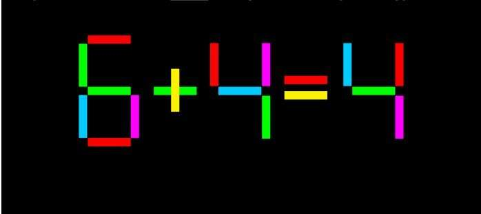
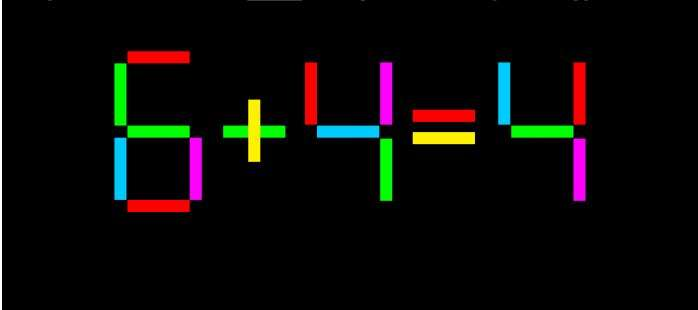
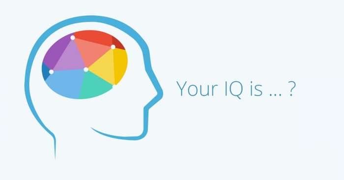

# Та, өөрийнхөө  IQ-г өндөр гэж боддог уу?

Танд, нэг хар шоколад идэж, тархиндаа, тэжээл өгөхтэй тэнцэхүйц, оюуны дасгал болно. Олохгүй бол, та, өөртөө шоколадны өртэй!

Таны даалгавар, зөвхөн нэг зураасыг хөдөлгөн, ялгавар эсвэл нийлбэр нь зөв байх, 3 хувилбарыг олох.

---

---

#### Хариулт:

0+4=4 эхний тооны голын ногоон зураасыг хөдөлгөж, “0”\
8-4=4 нэмэх тэмдэгний зураасыг авч эхний тоог “8”\
5+4=9 эхний тооны, цэнхэр зураасыг авч, нийлбэрийг “9” болгоно

Та, шоколадны өрөнд ороогүй гэж найдаж байна. Амжилт хүсье!
