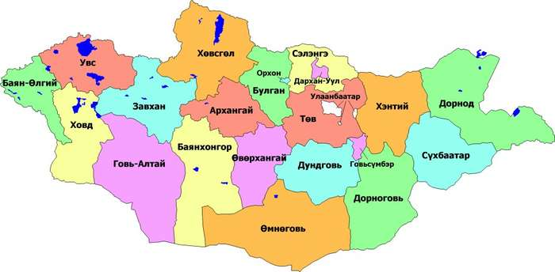

# Та таа! Тунгаа!

Ханагүй гэрт хаалга байх уу

Хадгүй ууланд хагд ургах уу

Хавцалгүй аманд янгир дүүлэх үү

Харьяагүй иргэнд зарлан ирэх үү

Загасгүй усанд тор хаях уу

Завьгүй далайд осол гарах уу

Захиагүй дугтуйнд хариу бичих үү

Зальгүй илбэнд хүүхэд хууртах уу

Дайны талбарт цус, дарь үнэртэхдээ

Дажингүй цагийн цэнийг хүн санадаг

Дандаа амар жимэр суусаар, залхахын цагт

Дайн тулаантай киног өөрсдөө тэд сэддэг

Эрүү тачигнах өвлийн жавар дунд

Эрлэг болж, амьтны халуун цус хөргөөд

Ээрэм талын эзэн чоно, үүрээр гэдрэг буцахдаа

Ээрсэн бэлтрэгнүүддээ юу гэж шивнэдгийг та мэдэх үү

Загас усандаа жаргалтай гэдэг хэр үнэн бэ

Загас өөрөө лав тийн өчсөн удаагүй

Завины ёроолд шидэгтэлээ усны ачийг мэдэлгүй

Заламгай нь хатахын алдад сая ухаардаг бол яана

Амьд явах дээдийн заяа гэж

Амьд хүн номлох нь инээдтэй

Үхэж үзсэн бол, яахав харин

Үзэж харьцуулаад хэлж байна гэх сэн

Загас шиг бид хэт оройтсон хойно л

Заяа таарч орчноо ажих хувьтай бол яана

Хувинтай цэвэр ус, хогийн муу усны алинд

Хоргодон амьдарч аснаа мэдэхгүй дуусвал яана

Навчаа нь Цэцгээдээ дуртай үгүйг

Навчаагаас өөр хэн ч мэдэхгүй

Нарны хувьд сар юу болохыг

Нэрт одон оронч ч хариулж зэхэхгүй

Чандагыг чоно идэж, чоныг хүн авладаг

Чухам аль дүрд нь та тоглоном бэ

Чиний ертөнц миний ертөнцтэй давхарддаггүй хорвоод

Чөтгөр нь үү, бурхан нь гэдгээ Та таа, тунгаа

Зохиогч “Дусал үг”

