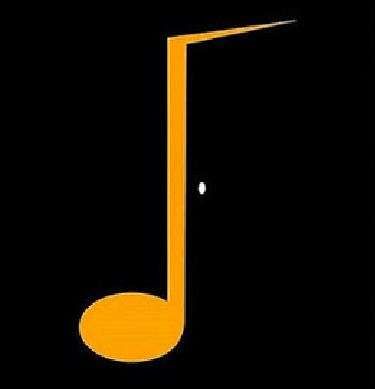

# Та ямар хүн бэ? 98%-н зөв хариулттай тест

Хүний амьдрал зураг мэт бидний оюун санаанд жирэлзэн өнгөрдөг. Нэг зүйлийг олон янзаар харах, янз бүрээр хүлээж авах нь бидний тархины тайлагдашгүй нууцуудтай холбоотой байдаг. Үүнийг ашигласан хүний зан чанарыг тодорхойлох тестээр өөрийгөө, найз нөхдөө шалгаарай.

#### Энэ зурган дээр юу харж байна вэ?

а/ нот\
б/ хаалга\
в/ шар гэрэл

---

#### Тайлал:

а/ хөгжмийн нот – та их эвсэг, бусадтай сайн зохицдог хүн. Таны амьдрал найрал хөгжим шиг. Та өөрийн амьдралаа цогцлоохын тулд ямар хөгжмийн зэмсгээр тоглохоо өөрөө сонгодог. Энэ шугамаасаа бүү хазайгаарай.\
б/ хаалга – та номын хүн. Та бусдын олж, тайлаагүй зүйлсийг мэддэг. Та хорвоо ертөнцийг өөрчилж чадах сэтгэлтэй. Харин бусад хүмүүстэй илүү ойр байх харьцаа, харилцаа, орчин нөхцөлийг бүрдүүлэх ёстой.\
в/ шар гэрэл – энэ бол амьдрал. Та “нар” мэт гэрэлтдэг хүн, бусдад аз жаргал хайр сайн сайхныг өгөх чадвартай. Ер нь энэ ертөнцөд гэрэл гэгээ хайрлахаар ирсэн хүн
