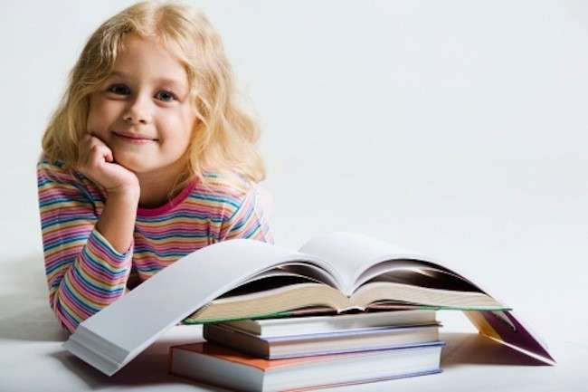
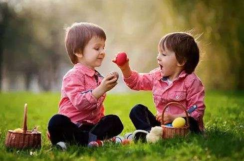

# Талархалын хүмүүжил ба хүүхдийг байгаа зүйлсээ үнэлж чаддаг болгох арга

Талархал нь, аз жаргалтай хүний суурь зан чанарын нэг юм. Талархал маань, “Баярлалаа” гэсэн үгээр хязгаарлагддаг гэж хэлж болох, бидний материаллаг ертөнцөд, хүүхдийг хэрхэн талархал дүүрэн хүн болгон хүмүүжүүлэх вэ? Талархалыг өөрт байгаа зүйлсээ үнэлэх чадвар гэж үздэг бөгөөд энэ зан чанарыг хүүхдэд төлөвшүүлэхийн тулд дараах дасгалуудыг байнга давтан хийж байх хэрэгтэй байдаг байна.

**Энэ өдрийн бэлэг**\
Өдөр бүр хүүхэдтэйгээ суугаад, энэ өдрийн бэлгүүдээр тооцож болох, үйл явдал, тохиолдол, сэтгэгдэл, сайхан харьцаа, тоглоом, амттан, цаг хормуудыг хамтдаа ярилцан тоолох хэрэгтэй. Эдгээр нь үнэхээр сайхан бэлгийн хэмжээнд хүрэхээр байхад анхаарах хэрэгтэй юм. Мөн “талархалын өдрийн тэмдэглэл” хөтлүүлж болдог. **Сайн үйлсийн өдөр.** \
Сард нэг өдөр тодорхой өдөр товлон, байгал орчиноо цэвэрлэх, буяны байгууллагын ажиллагаанд оролцох, амьтан хооллох зэрэг хүүхэдтэйгээ сайн үйлс хийж сурах хэрэгтэй байдаг. Энэ нь хүүхдийг, өөрөө бусдаас юм авах тааламжтай байдаг, мөн өгөх ч таатай сайхан зүйл гэдэгт сургадаг маш чухал хүмүүжлийн арга хэмжээ болдог.\
**Чи санаж байна уу...** \
Сайхан цаг хормуудыг сэтгэлд нь суулгаж бэхжүүлж өгөх маш чухал байдаг. Тухайн өдрийн сайхан үйл явдлуудыг, “чамд ёстой таалагдсан, санаж байна уу”, “тэгэхэд, чи их баяртай байсан”, “чи аз жаргалтай харагдсан, санаж байна уу”, гэх мэтээр сайхан хормуудыг сануулж, таагүй зүйлийг ч таатай болгон, хоолоо идэхгүй байсныг нь хүртэл, “чамайг хоол идэх дургүй байхад чинь, бид хүчээр идүүлээгүй нь сайн хэрэг” гэх мэтээр талархал төрөх сэдэв болгон өгч байх хэрэгтэй байдаг. \
**Чи миний туслагч!** \
Энэ үгийг хүүхдэд хэлэхэд, хүүхэд өөрийгөө үнэлж байгааг мэдрэн, жинхэнээсээ тусалж, туслахыг хичээж эхэлдэг.\
**Чи халамжтай шүү.** \
Бусдыг халамжлах чадвар нь талархал дүүрэн хүн төлөвшүүлэхэд тун чухал байдаг. Хүүхдийнхээ хийж буй жижиг зүйл дээр ч “ чи халамжтай, сайн. баярлалаа” гэж халамж гэдэг үгийг толгойнд нь суулгаж байх хэрэгтэй. Анхааралтай, хариуцлагатай, халамжтай болгох асуудал энэ үгээс эхэлдэг. \
**Өнөөдөр бид юуг бусадтай хуваалцаж болох вэ?** \
Хүүхдүүд, ямар ч зүйлийг хуваалцах дуртай, энэ үедээ жаргалтай байдаг нь шинжлэх ухааны судалгаагаар нотлогдсон байдаг. Ялангуяа өөрийн гараар хийсэн, хамтдаа бүтээсэн, өөрийнхөө цуглуулсан мөнгөөр худалдаж авсан зүйлсээ хуваалцахдаа илүү их баярлаж байдаг байна. Үүнийг нь дэмжих, мөн сайхан үгийг ч мөн бэлэглэж болдог гэдгийг ойлгуулж өгөх хэрэгтэй. Өдөр бүр нэг удаа ийм зүйлс хийлгэхийг хичээх нь таны үүрэг юм. \
**Бид ёстой азтай байна шүү.** \
Болж буй аятай таатай бүхнийг азтай байлаа гэж илэрхийлж сургах хэрэгтэй. Хөлд эвтэй гоё гуталтай алхаж байгаа маань аз шүү, кафед сул ширээ байна азтай, мөн амттай зайрмаг идэцгээлээ азтай юмаа, гэх мэтээр аз гэсэн үгийг толгойд нь суулгаж, болж буй бүх зүйл, байгаа юмсыг азтай холбон ойлгуулснаар хүүхэд бүх зүйлийг эерэгээр харж сурдаг. \
**Ёстой гоё байна тийм үү?** \
Өмнөх дасгалтай төстэй, “гэр бүлээрээ хамтдаа хооллож суугаа маань гоё байна тийм ээ?”, “ингээд хэвтэж байх цаг хугацаа байгаа нь ямар гоё юм бэ? гоё байна тийм үү?”, “ бид хоорондоо сэтгэл санаагаа хуваалцаж чадах боломжтой байдаг маань гоё юм аа” гэх мэт өгүүлбэрүүдийг байнга хэрэглэн сайн сайхныг мэдрүүлж сургахад, хүүхэд ирээдүйд аливааг сайхнаар хардаг, аз жаргалыг мэдэрсэн хүн болж өсдөг.\
Аз жаргал нь, бид ямар нэг зүйл олж авсанаар ирдэггүй, бидэнд байхгүй байгаа зүйлийг илэрхийлдэггүй, харин байгаа зүйлийнхээ үнэ цэнг мэдэрч амьдрахыг хэлдэг. Хүүхдүүд, ялангуяа жоохон байхдаа, тэдний төлөө, тэдний хүүхэд насыг аз жаргалтай байлгах, тэднийг тав тухтай байлгахын тулд хийж байгаа бидний хичээл зүтгэлийг мэддэггүй. Харин дээрх дасгалуудыг тогтмол хийлгэж сургаснаар, тэд, байгаа зүйлээ анзаардаг, үнэлж чаддаг болоод зогсохгүй эцэг эхийнхээ хөдөлмөр зүтгэлийг ойлгодог, үнэлдэг, орчин тойрноо үнэлдэг хүмүүс болж өсдөг.
