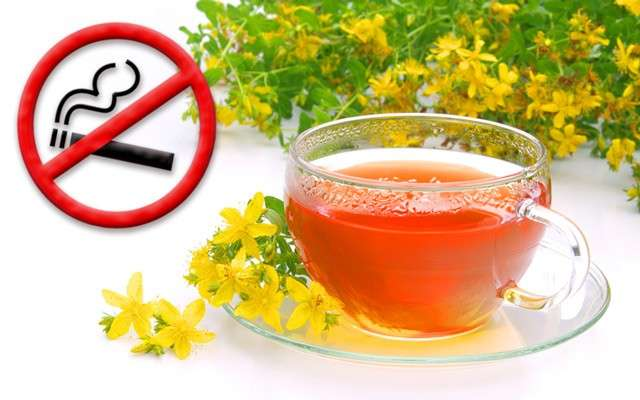

# Тамхи татах хүсэл дарах унд

Тамхинаас гарах гээд чадахгүй байна уу? Тамхи бол хүнийг өөрийн боол мэт болгодог хамгийн муу зуршил гэдэгтэй санал нийлнэ биз ээ. Энэхүү оросын ардын эмчилгээний аргыг хэрэглэн тамхи татах хүслээ дарахын тулд хоёр төрлийн өвс ургамал орсон хандыг цай маягаар уух хэрэгтэй юм байна.

#### Хэрэглэх арга:

Багульник -1 хоолны халбага\
Зверебой -1 хоолны халбага\
Ус - 800 грамм\
Эдгээрийг зөөлөн гал дээр 20минут буцалгаад, 3 цаг орчим тавиад дээр нь 800 грамм буцалсан ус нэмж цайны оронд ууж хэрэглэнэ. Энэ цай сайхан үнэртэй, өрөө тасалгааны эвгүй үнэрийг арилгахаас гадна тасалгааны температурт 3 хоног хадгалж болдог. Мөн хоол идэх дуршил дарах, гэдэс, давсаг, бөөрний үйл ажиллагаа сайжруулах, депрессээс сэргийлэх, нүүрний арьсны эрүүл байдлыг хангах үйлчилгээтэй бөгөөд тамхи татдаг хүмүүсийн хувьд, хамгийн чухал асуудалтай эрхтэн, уушгийг цэвэрлэдэг байна.

Дашрамд дурдахад, дээрх цайг шүүж, хөлдөөгөөд нүүрэнд, мөсөөр нь жин тавин арчихгүйгээр хатаахад батга, тослог арьс, нүүрний үрчлээг багасгах үр дүнтэй гэж үздэг.
