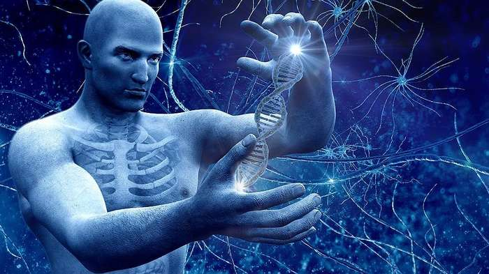

# Таны биеийн хэсгүүд, мөнгөний асуудлуудыг тань илэрхийлдэг

Мөнгөтэй холбоотой 4 хэсэг, хүний биед байдаг. Нэгдэх хэсэг нь- орлого мөнгө, хоёрдох нь-зарлага, гуравдах нь-мөнгө хураах, дөрөвдөх нь мөнгийг эд баялаг болгон хувиргах чадвартай, тус тус холбоотой байдаг байна.

Нэгдэх хэсэг болох, орлого мөнгөтэй холбоотой хэсэг-хүзүү. Хүзүүнийхээ байдлыг анзаар. Чөлөөтэй, толгойгоо хажуу тийш, дээш доош ямар нэг саадгүй эргүүлж, хөдөлгөж чадаж байвал мөнгө олох төрөл бүрийн аргыг хэрэгжүүлэх боломж буйг заадаг. Хүзүү бол, сонголтын боломж, эрхэт байдлыг илэрхийлдэг. Өөрийгөө болон бусдыг хялбар хүлээж авч чаддаг, хатуу дүрэм журам баримтлахгүй буулт хийх , өөрийн сэтгэл бодлоо сайн илэрхийлэх, өөрийн үзэл бодлоо хэлж ойлгуулах чадваруудыг эрүүл зөв, чөлөөт хөдөлгөөнтэй хүзүүний хэсэг хариуцаж байдаг. Эдгээр хүмүүст, мөнгийг олох төрөл бүрийн өргөн боломжууд байдаг. Хүзүүний хөдөлгөөн хязгаарлагдмал хүмүүс, хэт нэг талыг баримталдаг байх нь анзаарагддаг. Сайн гүйцэтгэгч нар байдаг.\
Хоёдох хэсэг, мөнгө хуваарилагч хэсэг бол-гар. Тиймээс, “ мөнгө гарын салаагаар урсах” гэсэн хэлц үг хүртэл гарсан байдаг. Танд хүн мөнгө өгч байна гэж бодъё, та авахаар гараа сунгах үед, гарын аль нэг хэсэг чангарах, эсвэл ямар нэг мэдрэмж төрж байвал, үүнийгээ анзаарах хэрэгтэй: Сарвуунд ямар нэг өөрчлөлт мэдрэгдвэл, та, уг мөнгийг авч буйдаа, хэн өгч буйд, яаж өгч буйд их ач холбогдол өгдөг, мөнгө авах ёс, журам баримталдаг хүн. Хэрэв мөнгийг өгч буй байдал таалагдахгүй бол, өөрөөр өгөхийг шаардаж ч чадна. Үүндээ, хэт туйлширахаас болгоомжлоорой. Гарын шууны хэсэгт өөрчлөлт мэдрэгддэг бол, мөнгөтэй холбоотой, хүнд өгөх, хүнээс авах, худалдан авалт хийх, мөнгөний хөрөнгө оруулалт хийх зэрэг асуудлуудаа шийдэхдээ эргэлздэг, шийдэх нь хэцүү байдгийг илэрхийлдэг. Хэт их бодож тооцдогоос, алдах үе ч гарч байдаг. Далд ухамсраараа мөнгийг түлхэж, дэргэд тань байгаа мөнгийг оруулахгүй байсаар, мөнгө залхаад явчихвал, яах билээ? Бодоорой. Мөнгийг хүнд өгөхдөө, тайван чөлөөтэй хөдөлгөөнөөр, гараа сунган өгдөг бол та, өгөөмөр, өөртөө итгэлтэй хүн. Харин мөнгөө ойрхон барьж, хүн гараа сунгаж авахаар байдалд өгдөг бол, та, мөнгөө өгөх эсэхдээ эргэлздэг хүн. Мөн мөнгөнөөсөө салах дургүй байдаг гэсэн үг.\
Гуравдах хэсэг болох, гэдэс аарцаг –мөнгө хураах цугларах асуудлыг хариуцдаг. Баячуудыг, том гэдэстэй бүдүүн хүнээр дүрсэлсээр ирсэн нь үндэслэлтэй гэж үздэг. Гэхдээ том гэдэс нь мөн айдсыг илэрхийлэх бөгөөд мөнгө хөрөнгөнөөс салах айдас нь шунал болж, шунал нь таргалуулдаг гэнэ. Зөөлөн, том биш, чанга гэдэстэй, аарцгаараа чөлөөтэй хөдөлдөг, алхаа гишгээ нь эрхэмсэг хүн-амьдралдаа сэтгэл хангалуун, баярлаж чаддаг, хором бүрээс сэтгэлийн ханамж авч байдаг, бие мах бодын таашаалыг эдэлж чаддаг, өөрийнхөө эд хөрөнгөний өсөлтөд итгэлтэй ханддаг сайхан чанаруудтай байдаг. Мөнгө хуримтлуулъя гэвэл, алхаа гишгээг эрхэмсэг болгодог, дорно дахины бүжиг сурахад гэмгүй шүү. Сонирхуулахад, мөнгө өгөхдөө харамсдаггүй, тайван үрдэг хүмүүсийн биеийн энэ хэсэг зөв хөгжилтэй байдаг.\
Дөрөвдөх, эд хөрөнгө өсгөдөг биеийн хэсэг бол-хөл. Хөл хичнээн бат тулгууртай байна төдийчинээ эд хөрөнгөө өсгөхөд хялбар байдаг байна. Байр, хувийн тансаг байшин, тогтвортой бизнес, байнгын орлого, тансаг хэрэглээ энэ бүгд бол мөнгө, эд хөрөнгө болон хувирдаг хэлбэр юм. Эд хөрөнгийг тогтоохын тулд хөл дээрээ бат зогсох хэрэгтэй гэдэг нь үүнээс улбаатай байдаг бөгөөд хэрэв хөл тань асуудалтай, бүдэрдэг, булгардаг, хугаралд өртөмтгий, судасны бүдүүрэл зэрэг өвчлөлд өртсөн бол таны эд хөрөнгөний тогтворгүй байдлыг заан, мөн энэ байдлаас айж буйг тань харуулах магадлалтай. Хөл дээрээ бат зогсож сур. Ялагчийн алхаагаар алхаж сур. Хөлийнхөө улаар бүтэн гишгэж, өвдгөөрөө үл ялиг түлхэлт өгөн, бүх биеийнхээ жинг гишгэж буй хөлдөө эвлэгээр шилжүүлэн итгэлтэйгээр алхаж сураарай. Өсгийтэй гутлыг, тулгуурын хэмжээнд хүлээж авч сурах болтлоо, өмсөхөө хойш тавих нь дээр гэж зөвлөдөг. Өсгий дээрээ, арай гэж тогтох, дэнжигнэх хөдөлгөөн, мөнгө санхүүд тань зүдэргээтэй байх нь лавтай. Зундаа боломжоороо хөл нүцгэн алхан, хөлөө газар дэлхийтэйгээ харилцуулан, хөлөө дасгалжуулж, хөлдөө анхаарал тавин эрүүлжүүлснээр, та, хөл дээрээ бат зогсохын зэрэгцээ санхүүгийн эрх чөлөөнд хүрэх, ялагчийн эрхэмсэг алхаагаар урагшлах боломжтой болох юм.
