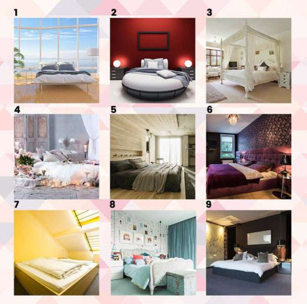

# Таны чухам ямар зан, бусдад таалагддаг бол?

Эдгээр унтлагын өрөөнүүдээс таалагдахаа сонгоод, харгалзах хариултыг уншин, таны чухам ямар шинж чанар, ойр тойрныхон болон бусдад таалагддаг болохыг мэдэж аваарай.

---

1. Илэн далангүй зан.\
Та, цонхны цаад үзэгдэх орчин нь ил, хамгийн сайхан харагдаж буй өрөөг сонгожээ. Энэ нь, та, өөрийнхөө тухай хүмүүс хэрхэн бодохоос төдийлөн болгоомжилдоггүй, дур сонирхолтой зүйлээ бусдаас нууж болгоомжлоод байдаггүй, өөрөөрөө байдаг сайхан талыг тань, мөн таны, аялал, адал явдалд дуртайг шинэ соргог зүйлийг сонирходгийг тань харуулж байна.\
2. Загварлаг.\
Та, юу хүсч буйгаа, хэрхэн түүндээ хүрэхээ сайн мэддэг хүн. Тиймдээ ч хүнд, улаан хүрэн өнгийн хана, өнгө дүрсний харилцан зохилдлогоог харж чаджээ. Та, гайхалтай сайхан хувцасладаг, үүгээрээ, өөрийн тусгаар хүчирхэг чанарыг илэрхийлж чаддаг.\
3. Зөөлөн сэтгэл.\
Энэ тасалгаанд, хайртай дотныхон чинь мөрийг чинь түшин сэтгэлээ хуваалцахад зохихоор юм. Саруулхан өрөө, гоёмсог хөшиг, таны зөөлөн дулаан сэтгэл, зочломтгой занг илтгэнэ.\
4. Гүн ухаан.\
Энэ өрөөгөө та, дахин хараач!...маш олон тооны жижиг зүйлс, хэрэгслүүдээс бүрдсэн гайхалтай зохилдлогоо. Таны, хувь хүн ч мөн ийм...Андуурсан гэж хэн ч хэлэхгүй. 5. Тэнцвэр.\
Саарал хүрэн өнгө зонхилсон, олон зүйлгүй, цэгцтэй энэхүү өрөөг сонгосон хүн, зорилготой дайчин хүн байдаг. Юмсийг утгат чанараас нь хардаг, магадгүй хүсэл сэтгэлээ тэнцвэржүүлэх йогын дасгалаар хичээллэдэг байж магад.\
6. Биеэ даасан байдал.\
Хүнд, ягаан бор өнгийг хаадын өнгө гэдэг. Та, хаан, хатан хаан. Та, магадгүй, одоохондоо баян биш ч байсан, ганцаараа бүхэнд хүрч чадахаа мэддэг биеэ даасан, тусгаар хүн юм. амьдралд чинь юу ч болж байсан, тэр чинээгээр хүчээ авч байдаг. Танаас холдсон, холбоогоо тасалсан хүмүүс, хэнийг алдчихав даа гэж харамсаж байдаг.\
7. Инээд, хошигнол.\
Хамгийн сайхан нарлаг өрөөг сонгожээ. Яг энэ өрөө шиг, хаана ч орсон нар мэт гийгүүлж явдаг байна. Хүнд хэцүү үед ч гарц олж, хүмүүсийг инээлгэж баясгаж чаддаг. Үүний чинь төлөө, хүмүүс, таныг хайрлан хүндэлдэг.\
8. Бүтээлч.\
Унтлагын өрөөнд чинь, юу бодож санадагийг чинь харуулсан олон зүйлс, зураг номнууд байна. Та, өөрийн нууцлаг ертөнцөд амьдран, бүтээл, үйлдэл, үл хөдлөлөөрөө бусдыг гайхашруулж, бишрүүлж байдаг.\
9. Амбицтай.\
Та, өөрийн төгс чанар руу дөхөх замд ямар ч саад байхааргүй илүү дутуу зүйлсгүй, баян тансаг өрөөг сонгожээ. Та, хүссэн ажил алба, бүр асар үнэтэй амтлаг хоолыг ч сонгон авах чадвартай. Түүнээс гадна, та өөрийн их эрч хүчээ бусдад халдаах мэт түгээж явдаг.
