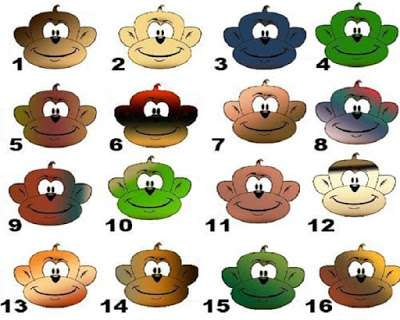

# Таныг эд баялагт хүргэх арга чухам юунд тань байдгийг харуулна

Та энэ хөөрхөн сармагчингуудаас анхааралтай харж, аль нэг таалагдсанаа сонгож харгалзах тооны тайллыг уншаарай. Таны ажил мэргэжил ба бизнесийн амжилтад хүрэх боломжууд болон энэ ертөнцөд ямар зорилготой ирсэн, баялагт хүрэхийн тулд юуг ашиглах зэргийг харуулна.

---

1. Таны баялагийн эх булаг бол, сурталчилгаа, алдаршуулалт, олон нийттэй холбоотой ажил, мэргэжил. Гадаад үзэмж, чанартай сонголтод анхаарах асуудал таны хувьд маш чухал. Та, сэтгүүл, загварын бизнес, гоёл чимэглэл, брендийн эд зүйлсийн худалдаа, урлагийн ажил мэргэжлүүдээр амжилт, баялагт хүрч чадна.\
2. Таны эд баялагт хүрэх арга, танд өөрт тань, таны санаа, бодол, оюуны чадавхид байдаг. Та аливааг, шинээр үүсгэх эсвэл хуучныг сайжруулан шинэчлэх чадвартай мөн маш оновчтой шийдвэр гаргадаг. Таныг амжилтад хүргэх мэргэжил, салбарууд:-санхүү, хууль, шинжлэх ухаан. Та их чөлөөтэй, далайцтай сэтгэдэг. Үүнийгээ ил гаргахаасаа ичих хэрэггүй, хэлж ярьж байх хэрэгтэй. \
3. Таны эд баялаг итгэлд тань байгаа. Жинхэнэ, гүнзгий, хүчтэй итгэл, энэ бол таны амьдралын гол утга учир. Энэ заавал шашин биш. Та, өөрийн мөрөөдөл, хүч чадал, хийж байгаа зүйл, орчин тойрныхондоо гайхалтай сайхан итгэл хайрлах чадвартай. Энэ сайхан чанараа та бусадтай хуваалцах, бэлэглэхэд суралцах ёстой. Танд бүх ажил тохирно. Хүнд туслах зориулалттай багш, эмч, лам зэрэг мэргэжлүүд илүү зохино. \
4. Таныг эд баялагт хүргэх зүйл бол нэг үзэл бодолтой хүмүүс хамт олонтой хамтран ажиллах. Та офист эсвэл гэрээр ажиллах, мөн хувийн бизнес эрхлэх аль алийг нь чадна. Гэхдээ тантай хамт таныг байнга дэмждэг итгэлтэй хүмүүс байх ёстой байдаг. \
5. Харин таны баялаг гэр орны тав тухтай холбоотой зүйлс. Нийтийн хоол, гал тогооны хэрэгслүүдийн засвар, тавилгын дэлгүүр, оёдол нэхмэлийн үйлдвэр эдгээрээс та ашиг олж болно. Гэхдээ та, өөрийгөө гэр бүлдээ зориулан ажиллахгүй байх магадлал бий. \
6. Таны эд баялагт хүрэх эх булаг таны хөдөлгөөн, идэвхи зүтгэлд оршдог. Таны амжилт дагуулах ажил мэргэжил тань, аялал, томилолт, хол явж ирж очдог ажлуудтай холбоотой байдаг. Спорт мөн таных. Хэрэв ийм ажил эрхэлдэггүй бол хобби болгоно. \
7. Таны баяр жаргал, сэтгэл ханамж, амьдралд шунан дурладаг чанар тань баялагийн тань эх булаг. Тоглоомын газрууд, рестораны бизнесийн орчинд “усандах загас” шиг эргэлдэн амжилттай удирдна. Та амьдралаас баяр жаргалыг хүлээж, оюун санаа болон бие мах бод аль алийг нь баярлуулж чаддаг. Та, хамгийн гол нь эрхэлж байгаа ажилдаа дуртай байх ёстой. \
8. Баярын арга хэмжээ, фестиваль уулзалт зохион байгуулах чадвар тань гайхалтай хөгжсөн, энэ бол таныг баялагт хүргэх зам. Баярт мөчүүдийг мөнхжүүлэгч фото зурагчин эсвэл хөтлөгч, хөгжимчин, дизайнер, зураач, цэцэгчин энэ бүгд таных. Аялалын компани, хэвлэлийн бизнест ч амжилттай байна. Танд хурц тод үйл явдлаар дүүрэн амьдрал хэрэгтэй ба ердийн саарал амьдрал зохихгүй. \
9. Таны бусдыг ойлгох сэтгэл илүү хөгжсөн. Сайн сэтгэл зүйч болох боломжтой. Хэт сэтгэлийн хөдлөлөө дарж байх хэрэгтэй, эв эе зохицлыг эрхэмлэдэг. Өөрийгөө илэрхийлэх боломж олгодог уран бүтээлчийн ажил танд ихийг өгнө. Та энэрэнгүй, зовсон зүдэрсэн хүмүүсийг ойлгодог. \
10. Таны үл ялиг зарчимтай сайхан сэтгэл, таныг баялагт хүргэх замыг нээдэг. Сайн зүйл хийх эрмэлзлэлтэй. Хүмүүст зарчимч шаардлага тавих хандлага тань бусдад тустай байдаг. Таны энэ зарчимч чанарын цаана зөөлөн уян сэтгэл нуугдаж байдаг. Таны сайхан сэтгэл, сайн санаа, “нударга”-тай мэт байдаг. Та цэрэг арми, цагдаа хууль сахиулах салбараар илүү амжилтад хүрнэ. Оновчтой шүүмжилдэг олдмол зантай. \
11. Та өөрийн хувийн бизнесээр эд баялагаа бүтээнэ. Барилгатай холбоотой бол сайн. Та хүмүүст урт удаанаар ашиглагдах зүйлсийг бүтээх босгох үйлсэд амжилттай ажиллана. Та хариуцлагатай, өөртөө шүүмжлэлтэй хандах чадвартай, өөрийн алдаанаас сургамж авдаг ухаантай багш. \
12. Таны эд баялаг, төмөр эд зүйл, хурдтай холбоотой зүйлсэд байна. Бүх төрлийн тээврийн хэрэгслийн үйлдвэр, засвар, үйлчилгээ гэх мэт. Та их орчин үеийн хүн, аливаа хурдад дуртай. Та үргэлж уралдаж буй мэт амьдардаг. \
13. Таны баялагийн эх булаг, бусдад баяр, сэтгэлийн дулаан өгөхтэй холбоотой зүйлсэд байдаг. Санаагаа оргилуулж, сараалж босгож, сууриа тавих бол таны гайхалтай чадвар. Үүнийг тань мэдсэн ч ойшоогоогүй хүмүүс сүүлд нь амаа барих нь бий. \
14. Таны баялагийн эх булаг, гайхалтай хошин шооч зан тань. Та үүнийгээ ямар ч салбар хүрээлэлд гайхалтай ашиглаж чаддаг. Таны хурц ухаан, олон найз нөхөдтэй болгоод зогсохгүй албан тушаал ахих асуудлыг шийдэж байдаг. Хошигнолоо хоргүй байхад анхаарах хэрэгтэй. \
15. Цэвэр, бүр ариун гэмээр орчинтой холбоотой ажил үйлс баялагийг тань бүтээнэ. Эмч, эрдэмтэн болох нь зохилтой. Мөн өөрийн бодол санаагаа толботуулахгүй байлгахыг эрмэлзэх хэрэгтэй байдаг. Худал, хуурмаг зүйл хийвэл, амьдралд тань нөлөөлдөг. \
16. Таны эд баялагт хүрэх зам алс хол далайн цаадруу хөтөлнө гэмээр. Ер нь далай устай холбоотой зүйлс амьдралд тань нөлөөлдөг. Устай холбоотой ажил алба гэхээр загасчин ч юмуу усны хоолой тавигч гэж битгий хүлээж аваарай. Хэрэв өөр мэргэжилтэй бол, сэлэлтээр хичээллэх эсвэл аквариумтай болж анхааралтай харж бясалгал хийх танд түлхэц өгнө.
