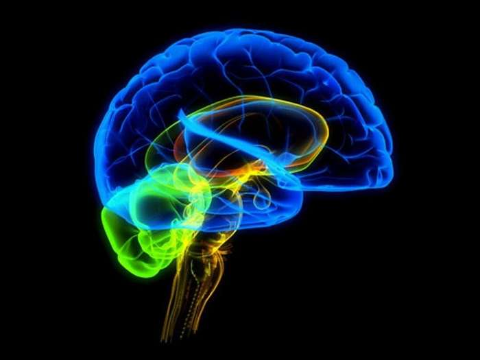
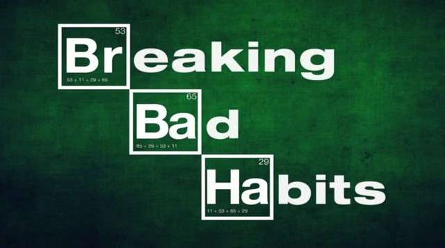
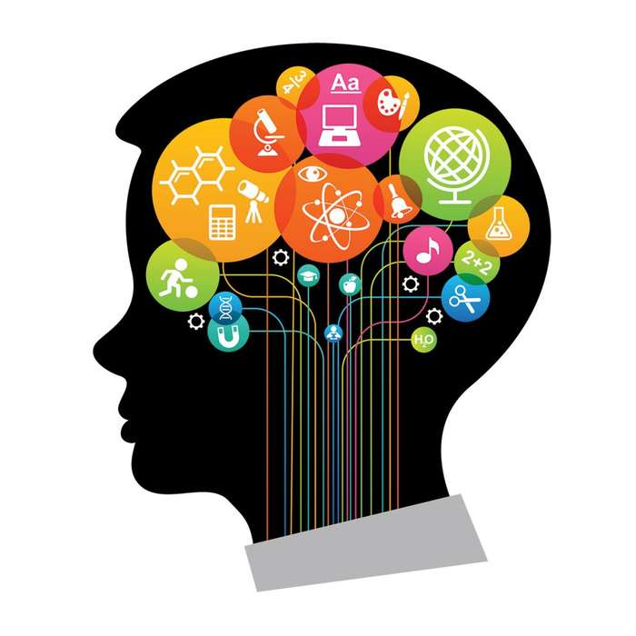

# Тархинд маш муу нөлөө үзүүлдэг 10 зуршил

Тархи нь хүний хамгаас чухал эрхтэн. Бидний бие организмыг хянах удирдах үүрэгтэй ба тархи хэдхэн хоромд төсөөлшгүй олон үйлдлүүдийг хийдэг бөгөөд ой санамж хэмээх гайхалтай үйл ажиллагааг гүйцэтгэж байдаг.

Тархи, нарийн түвэгтэй эмзэг бүтэцтэй бөгөөд бид өдөр бүр, түүнийг өөрсдөө мэдэхгүйгээр гэмтээж байдаг нь олон арван өвчлөл үүсгэх шалтгаан болдогоос 10-г нь танилцуулъя.

---

#### 1. Өглөөний цай уухгүй байх

Өглөө, бие организм хоол тэжээлээр дутагдсан байдаг ба өглөөний цай уухгүй бол, бүх бие организмаа өвчлөх “эрсдэлд” оруулдаг байна.

#### 2. Нойр дутуу явах

Хүн нойрсох үед, тархи, өдрийн турш авсан мэдээллүүдээ дахин боловсруулж, дараагийн мэдээллээ хүлээн авахаар хүчээ сэлбэдэг аж. Нойр дутуу байх нь тархины эд эсийг үхүүлэхэд хүргэдэг байна.

#### 3. Чихэрлэг зүйлийн хэрэглээ

Өнөөдөр, сахар ороогүй хүнсний зүйл олоход бэрхшээлтэй болжээ. Тиймээс их сахарын орцтой хоол хүнсийг хэрэглэхгүй байсан нь дээр. Их хэмжээгээр сахар хэрэглэх нь бие организм ашигтай бодисуудыг шингээх процессыг удаашруулж, тархинд муугаар нөлөөлдөг.

#### 4. Хэтрүүлэн идэх

Хэт идэх нь илүүдэл жинтэй болгохоос гадна, артерт нөлөөлсөнөөр тархины ажиллах чадварыг бууруулдаг байна.

#### 5. Тамхидалт

Тамхины бие организмд учруулдаг хор хохиролыг бүгд мэдддэг.Тамхи нь тархинд бүх талын дарамт учруулдаг бөгөөд Альцгеймерийн өвчилөлд хүргэх ганц шалтгаан болдог.

#### 6. Толгойгоо хучиж унтах

Хүн нойрсож байх үед, тархи хүчил төрөгчийн хэрэгцээгээ хангалттай авах шаардлагатай байдаг бөгөөд хэрэв агаар дутагдвал, нүүрс хүчлийн хий хэд дахин ихэсч тархинд муу нөлөөлнө.

#### 7. Бохир агаар

Тархийг эрүүл байлгахад, их хэмжээний цэвэр агаар хэрэгтэй. Том хот суурингийн нөхцөлд, энэ нь бэрхшээлтэй тул аль болох хотоос гарч цэвэр агаарт амарч байхыг зөвлөдөг.

#### 8. Өвдсөн үедээ тархийг хэт ачаалалтай ажиллуулах

Хүн өвдөх, өвчлөх нь бидний бие организмын үйл ажиллагаа муудаж, амрах болсоныг харуулж өгч байна гэсэн үг. Ямар ч өвчний үед, тархиа хэт ажиллуулах нь тархины үйл ажиллагааг өөрчлөлтөд оруулах эрсдэлтэй.

#### 9. Ёс зүйгүй харилцаа

Хүмүүсийн хоорондын харилцаа, харилцан яриа тархийг ажиллуулж, хөгжүүлж байдаг. Ёс зүйгүй харилцаа, ярианаас зайлсхийх хэрэгтэй. Харин оюунлаг, мэдлэг ухаан тэлсэн яриа хөөрөө нь тархинд шинэ мэдрэлийн холбоосуудыг үүсгэх чадвартай ба тархины үйл ажиллагааг сайжруулж байдаг.

#### 10. Тархийг хэт өдөөсөн сөрөг бодлууд

Бодож сэтгэх процесс нь тархины гадаргууд эерэг үйлчлэл үзүүлдэг. Сөрөг өдөөлт үзүүлэхээр бодлууд нь, тархины гадаргуу буюу тархины үйл ажиллагааны хурд, хөгжлийг хариуцдаг энэхүү чухал эрхтэнийг гэмтээх эрсдэлийг дагуулдаг.

Хүний тархийг, бүрэн судлагдаагүй маш өвөрмөц бүтэцтэй механизм гэж үздэг бөгөөд энэхүү хосгүй чухал эрхтэний үйл ажиллагаа тайлбарлагдашгүй олон нууцуудыг дагуулж байдаг билээ.
