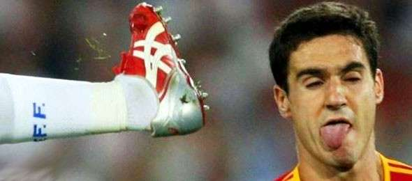
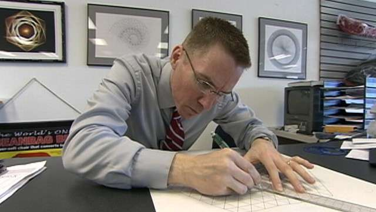
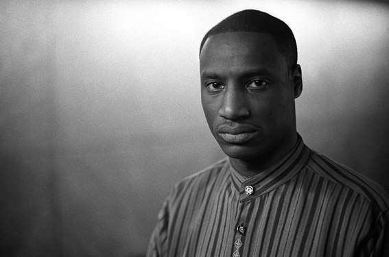
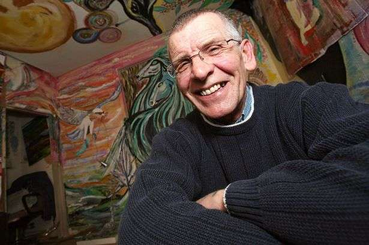
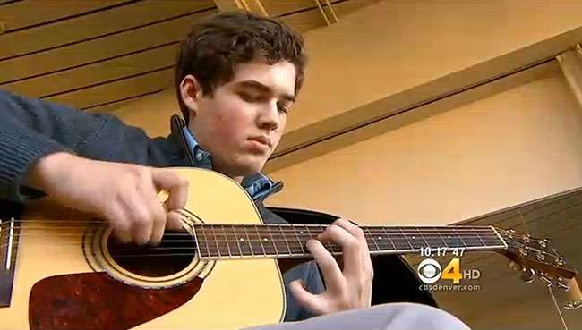

# Тархиндаа гэмтэл авсаныхаа дараа гоц авъяастан, суут ухаантан болсон гайхалтай хүмүүс

Хүний тархины бас нэг тайлагдашгүй нууцуудын нэг нь тархины гэмтэл авсан хүмүүс сэргэхдээ, гэнэт, өөр орны хэлээр ярих, урд нь тоглож байгаагүй хөгжмөөр гойд сайн тоглох, тооны ухаан, ой санамж нь онцгой сайжрах зэрэг гоц авъяас, чадвар нээгдсэн олон тохиолдлууд юм.

Эдгээр сонирхолтой баримтуудаас танилцуулъя.

Джейсон Пэджетт: математикч, физикч\
Джейсон дунд сургуулиа төгсгөлгүй орхиж, эцгийнхээ мебелийн дэлгүүрт ажиллах болсон байна. Гэтэл “нэгэн сайхан өдөр” 31 настай нэг ажилчин, түүнийг хэрцгийгээр зодох үед, тархиндаа гэмтэл авсанаар физик математикийн суут ухаантан болох нь тэр. Одоо тэрээр, геометрийн фракталуудыг гараар зурж чаддаг дэлхийн хэмжээний, цөөхөн хүмүүсийн нэг юм.

---

Орландо Серрелл: хуанлийн тооцоог гаргууд хийдэг нэгэн.\
10 настай Орландо бейсбол тоглож байгаад, толгойдоо бөмбөгөнд цохиулсан байна. Энэ талаар эх, эцэгтээ ч хэлээгүй аж. Жил орчим толгой нь өвдөж явсан бөгөөд толгойн өвчин нь намжсаны дараа долоо хоногийн гаригуудыг өдөр сараар нь тааруулж, тодорхой хэлж чаддаг болсноо анзаарсан байна. Серрелл , хуанлитай холбоотой ямар ч тооцоог нүд ирмэхийн зуур хэлж чаддаг. Тэр, дурын хоёр хуанлийн тооллын хооронд хичнээн хоног байгаа вэ гэдгийг асуувал тэр дор нь хэлнэ. Жишээ нь, 1000 жилийн туршид пүрэв гаригтай давхацсан, хэдэн 3 сарын 12-н байдаг вэ гэхэд тэр дор нь алдаа мадаггүй хариулдаг онцгой чадвартай болсон аж.

---

Томми Макхью: уран зургийн авъяастан\
51 настай Томми Макхью 2001 онд 2 удаа /субарханадальный кровоизлияние/ цус харвасан боловч амьд гарч чадсан бөгөөд үүний дараа түүний уран зургийн авъяас нээгджээ.

---

Бен Макмахон: хятад хэлтэй болсон.\
Бен машины осолд орж комд орсон байна. Эх эцэг нь хэзээ ч сэргэхгүй нь гэж айж байсан боловч, долоо хоногийн дараа ухаа орохдоо хятадаар ярьж эхэлжээ. Тэрээр,” би сэрэхдээ хятад сувилагчийг хараад, хятадад байна гэж бодоод хятадаар ярьсан” гэж хэлдэг. Урд нь хятад хэлний курст явж байсан боловч төгсгөөгүй орхисон байжээ. Дараа нь англи хэлээ сэргээсэн байна. Одоо тэр Австралид хятад хэлний хөтөч-орчуулагч, хятад цагаачдад зориулсан хятад сувгийн нэвтрүүлэгчээр ажилладаг.

---

Лахлан Коннорс: хөгжмийн гоц авъяастан.\
Коннорс бага байхдаа, хөгжмийн ямар ч сонсголгүй тул, ээжийнхээ урмыг ихэд хугалдаг байжээ. Харин спортод дуртай, лакросс хэмээх спортоор хичээллэдэг, энэ үедээ 2-ч удаа тархиа хөдөлгөж,үүний улмаас унаж татдаг, хий юм хардаг мэдрэлийн өвчтэй болсон байна. Гэвч тэр энэ үедээ төрөл бүрийн хөгжмийн зэмсгээр тоглож чаддаг болсоноо мэджээ. Мэргэжилтэнүүд агуу хөгжмийн зохиолч Фредерик Шопен мөн ийм өвчтэй байсан гэж үздэг. Коннорс 13 төрлийн хөгжмийн зэмсэг дээр тоглох авъяастай.

Ийм, сонирхолтой, тайлбарлашгүй тохиолдлууд анагаахын түүхэнд олноор бүртгэгдсэн байдаг ажээ.
