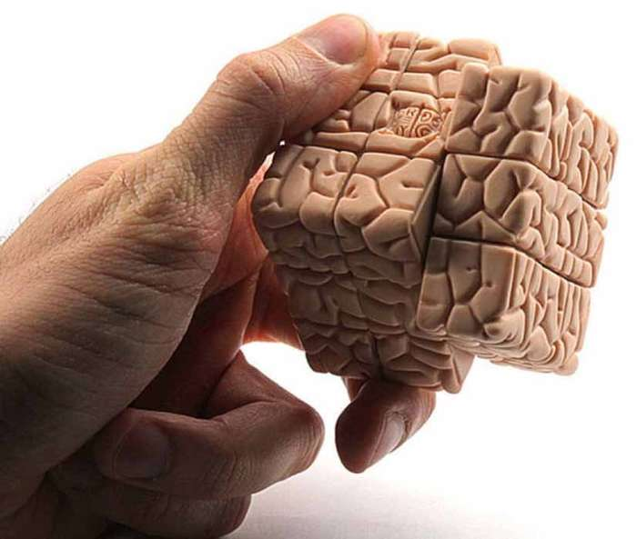

# Тархины, үр дүнтэй дасгал

Сэтгэл зүйч Алексис Кастори, өглөө сэрээд, орон дотроо, 5-10 минут хийх тархины үр дүнтэй дасгалыг санал болгож байна. Тархи бол мөн л, биеийн бусад эрхтэний адил дасгал сургуулилалт шаардаж байдаг. Унших, оньсого таавар таах, баяр баясгалангаар дүүрэн байх, эерэг бодол тээх зэрэг нь дасгал болдог боловч тодорхой хэмжээний дасгал хийх нь хүний хамгийн чухал эрхтэн тархины үйл ажиллагаа сайжруулж, ой санамж, тогтоолт, ойлголт, сэтгэлгээний хурд зэргийг өсгөдөг бөгөөд энэ бүхнээс бидний ажиллах чадвар, амьдрал хамаарч байдаг. Мөн эрт зөнөглөх, оюун мохох зэргээс сэргийлдэг. Тиймээс эдгээр дасгалыг хийж хэвшээрэй.

1. 100-с нэг хүртэл, аль болох хурдан, сонсогдохуйц хэлж тоолох, энэ үед нүд нээлттэй байх ёстой.\
2. Цагаан толгойн үсгийн дарааллын дагуу, үсэг тус бүрд, эхэнд нь орсон үгсийг аль болох хурдан олж хэлэх\
3. 20 эрэгтэй хүний нэр олж хэлэх. Өдөр бүр өөрчилж байх\
4. Эмэгтэй хүний 20 нэр олж хэлэх\
5. 20 төрлийн хүнсний нэр хэлэх, дараагийн дасгалууд дээр аль болох давтахгүй байх\
6. Цагаан толгойн үсгээс нэгийг сонгон тухайн үсгээр эхэлсэн 20 үг олох, үг тус бүрийг дугаарлан дугаарыг санах\
7. Нүдээ аньж, 20 хүртэл тоолоод нүдээ нээснээр, дасгал дуусна.
