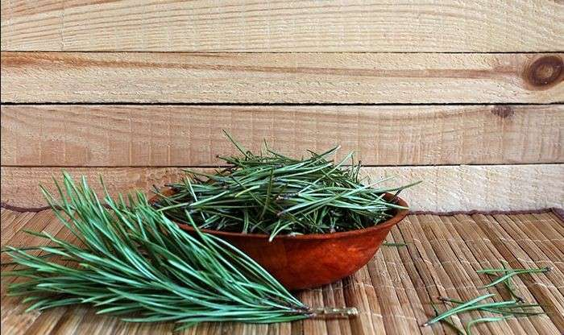
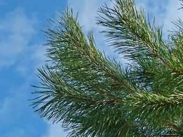

# Тархины судас цэвэрлэх үр дүнтэй арга

Хүн бүр урт удаан, эрүүл саруул амьдрахыг хүсч байдаг. Тиймээс эрүүл мэнддээ санаа тавих нь хүн бүгдийн үүрэг юм. Тархины цус харвалт, мигрень болон бусад толгойны өвчнүүдээс сэргийлэх тархины судас цэвэрлэх аргыг хүргье.

#### Орц:

Нарсны шилмүүс /буталсан/ -5 хоолны халбага\
Нохойн хошуу /буталсан/ -2 хоолны халбага\
Сонгинын хальс /буталсан/ -2 хоолны халбага\
Эдгээрийг, 1 литр усанд хийж, буцалмагц гал дээрээс авч зузаан зүйлд ороож, хонуулна. Маргааш нь хэрэглэнэ. 500гр өдөрт уух ба өдөр өдрөөр нэмж 1 литр болгоно. Уухад муухай амтгүй. Ямар нэг дагалдах нөлөөгүй. Сонгинын хальсгүйгээр бэлдэж ууж болно. Гэвч, сонгинын хальс бөөрөнд сайн тул хамт хэрэглэх нь зүйтэй.

Энэ ханд, бөөрний өвчнүүд, зүрх судасны өвчин, харааны мэдрэлийн атрофия, шөрмөс татах зэрэгт маш сайн. /Эдгээрийг, дурын аргаар үрж, буталж, нунтаглаж хэрэглэх юм/
