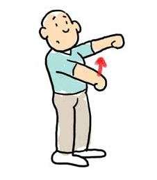

# Тархины цус харвалтын өмнөх үеийн 4 шинж. Та энэхүү шинжүүдийг мэдсэнээр өөрийгөө болон бусдыг аврах боломжтой болно

Хүмүүс ихэвчлэн тархинд цус харвахыг гэнэт явагддаг гэж үздэг. Гэтэл, үнэндээ харвалт өдрийн турш ч юмуу хэсэг хугацааны турш явагдаж байгаад харвадаг байна. Энэхүү, үхлээр төгсдөг эсвэл насан туршид тахир дутуу болгодог, энэ аймшигт өвчний эхэлж буй үеийн шинж тэмдэгүүдийг мэдэх нь хүн бүрт хэрэгтэй.

1. Харвалт явагдаж байж болзошгүй хүн, бүрэн хэмжээнд инээмсэглэж чаддаггүй. Өөрөөр хэлвэл, завьж нь мэдээ алдаж эхэлсэн байдаг байна. Ямар нэг аргаар инээмсэглүүлэхийг хичээ.

---

2. Хэл яриа нь ээдэрч, бүтэн өгүүлбэр хэлж чадахаа больдог. Тиймд 2-с дээш үгтэй энгийн өгүүлбэр хэлүүлэх гэж оролдох хэрэгтэй. Мөн 2 гараа толгой дээрээ өргөж чадах эсэхийг нь шалга. Зэрэг өргөж чаддаггүй.

---

3. Хэлийг нь гаргуулахад нэг талруугаа муруйсан, хазгай гаргаж байвал нэн даруй эмнэлэгт хүргэх шаардлагатай.

---

4. Хөл гар мэдээ алдах, толгой хүчтэй өвдөх, толгой эргэх, нүд бүрэлзэх, өрөөсөн нүд муу харах, шалтгаангүй огих, хөдөлгөөний баримжаа алдагдах, ухаан алдах зэрэг шинж тэмдэгүүд нь энэ өвчний эхлэлийн шинжүүд тул нэн даруй эмчид хандах хэрэгтэй.

Эдгээр шинж тэмдэгүүдийг мэдэж, ойр тойрныхондоо анхааралтай байх нь нэг бус хүний амийг аврах маргашгүй сайн үйлс юм.
