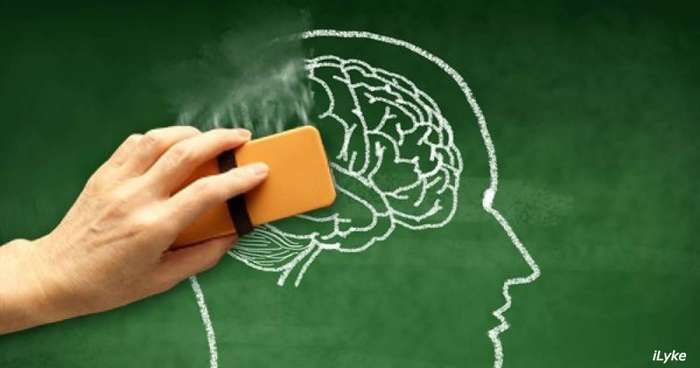
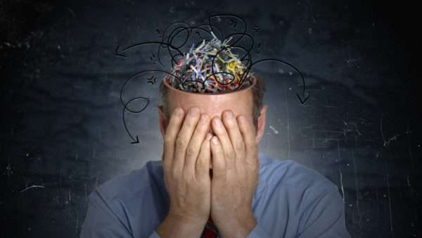

# Тархины “устгах” товчлуурыг хэрхэн дарах вэ?

Давтах цээжлэх нь сурахын үндэс гэж үздэг бөгөөд энэ нь, гадаад хэл сурах, төгөлдөр хуур тоглож сурах, жонглёроор хичээллэх зэрэгт бүрэн илрэлээ олж байдаг. Хир их аливааг давтна, төдий чинээ тархинд сууж өгдөг гэдгийг эрдэмтэн судлаачид батлаад байгаа бөгөөд сүүлийн үед, мөн, сурахын тулд мөн зарим зүйлийг мартах шаардлагатай гэсэн хандлагыг дэвшүүлээд байна. Мартах процесс буюу хуучин нейронуудын холбоосуудыг устгаснаар шинийг сурах боломжийг өсгөнө гэж үзэж байна.

Хүний тархийг нэгэн модот цэцэрлэг гэж үзвэл, мод, бутны оронд бидний нейронуудын синаптик холбоосууд ургаж байдаг бөгөөд үүнийг тархины глиаль эд эс, усалж арчилах “цэцэрлэгч”-ийн үүрэг гүйцэтгэдэг. Тэдгээр нь, арчилахын зэрэгцээ, унасан навчис, зэрлэг өвс зэргийг цэвэрлэн шүүрдэх үүргийг мөн гүйцэтгэдэг байна. Энэ цэвэрлэгээний процесс буюу “устгах” товчлуур хүнийг унтаж байх үед явагддаг бөгөөд тархи унтах үед, тархи өдрийн хэмжээнээсээ 60% хүртэл багасч глиаль эд эсэд, цэвэрлэгээ хийх боломжийг олгодог гэнэ. Сайхан унтаж амарсаны дараа толгой хөнгөн сэргэлэн байдаг нь, тархины цэвэрлэгээ сайн хийгдсэний шинж аж. Энэ үед, усалгаа, арчилгаа шаардлагатай, ашигтай зүйлсээ үлдээхийн тулд юу хийх ёстой бол? Төлөвлөсөн ажилаа анхаарахгүй өөр бусад тоглоом, тэс өөр зүйлийг сонирхоод байвал, мэдээж ажилаа цалгардуулах байдалд орно. Өдөр нь хүнтэй муудалцчихаад, түүнийгээ бодоод байвал тархи сэтгэхүй, өс хонзонгоор л дүүрнэ. Бидний тархи, сайн мууг ялгахгүй зөвхөн бодож тунгаагаад байгаа зүйлийг л хадгална. Юунд илүү анхаарах, төвлөрөх ёстойгоо бид л шийддэг байна. Тиймээс, зөвхөн өөрийгөө хөгжүүлэх, өөрт тулгарсан асуудлуудаа шийдвэрлэхэд тустай бодлууддаа анхаарлаа төвлөрүүлж сурах, бүтэшгүй мөрөөдлөө бодохын оронд бясалгал хийж сурах зэргээр оюун ухаанаа чөлөөлж амраах хэрэгтэй байдаг байна. Ямар ч тохиолдолд, ашиггүй, үр дүнд хүргэхгүй, муу сөрөг зүйлс бодохгүй байж сурах нь тархийг тань амрааж, ой тогтоолт сэргэх, тархи, амьдралд тань үр ашигтай зүйлсийг зөвөөр шийдэх дүгнэлтүүд гаргах зэрэг олон таатай боломжийг ашиглах үр дүнд хүргэнэ.
