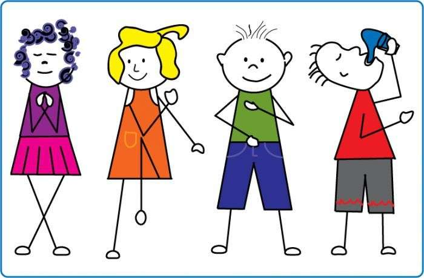
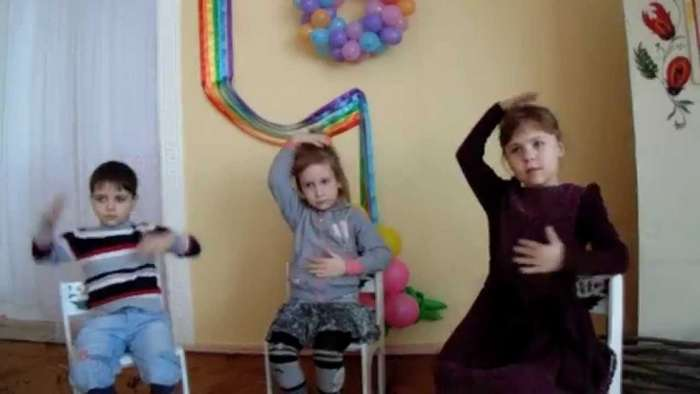

# Тархийг бүрэн чадлаар нь ажиллуулах, кинезиологийн 9 дасгал

Кинезиолог гэдэг нь хөдөлгөөнт дасгалаар дамжуулан биеийн эрүүл мэнд, оюун ухааны чадавхийг хөгжүүлэхийг судалдаг шинжлэх ухааны салбар бөгөөд дараах дасгалууд нь, томчууд хүүхдүүдийн алинд ч гайхалтай нөлөөлдөг, гүйцэтгэхэд, суугаа, босоо хэвтээ ямар ч байрлалд хийж болох талаас нь сонгосон, хамгийн үр өгөөжтэй шалгарч нотлогдсон гайхалтай үр дүн үзүүлдэгээрээ хүлээн зөвшөөрөгдсөн. Бие организмыг сэргээж, ядаргаа тайлж, толгой хүндрээд байх мэдрэмжийг арилгаж, нойрмог байдлаас гарган, ой ухааныг хурцлан, анхаарал төвлөрүүлэх чадварыг дээшлүүлж тархийг маш сайн ажиллахад нөлөөлдөг.

1. Мэдрэлийн системийг тайвшруулж, тархины ачааллыг тайлах, сэтгэхүй, сэтгэл хөдлөлийн тэнцвэртэй байдлыг хангахын тулд, сандал дээр сууж, хөлөө зөрүүлэн зүүн хөлийнхөө өлмийг баруун хөлийнхөө өлмий дээр тавьна. Гарын бугуйгаа зөрүүлэн хоёр гарын хуруугаа зөрүүлж атгаад, гараа тэр чигт нь, цээжрүүгээ эргүүлэн өмнөө авчирч, энэ үедээ хэлийн үзүүрээ тагнайдаа наан хараагаа дээш чиглүүлэн 1-5 минут, хангалттай санагдах хүртлээ сууна. Эвшээх магдлалтай байдаг. Эвшээлт нь хангалттай хугацаа болсныг заана. Энэ хөдөлгөөний байрлал, тархинд хүнд хэмжээний дасгал явагдах нөхцөл бүрдүүлдэг бөгөөд баруун, зүүн тархи, тагнайн дээр байрладаг дунд тархины ажиллагааг идэвхижүүлэн, аливааг сурах, хариу үйлдэлийн хурд, бодол сэтгэхүй, сэтгэл хөдлөлийн холбоог нэгтгэх маш сайн үр дүн үзүүлдэг байна.\
2. Цэвэрхэн хуудас цаас авч урдаа тавиад хоёр гартаа харандаа эсвэл үзэг барин, зэрэг, ижил дүрсүүд зурах, тоо үсэг бичих. Энэ үед, тархины тал бөмбөлгүүд зэрэг ажиллан тархины нийт үйл ажиллагаа гайхалтай сайжирдаг. \
3. Бид бүгдийн танил, хоёр гараа зөрүүлэн хамар чихээ барих дасгал\
4. Хөлийн тавхайг дотогш чиглүүлсэн байдлаар өлмийгөө 8 удаа дээш доош хөдөлгөх. Хоёр хөлөө ээлжлэн хийнэ. \
5. Энэ дасгалыг ажлын дараа хийх хэрэгтэй. Суугаа, босоо, хэвтээ байрлалын алинд ч болно, хоёр хөлөө зэрэгцүүлэн, хоёр гарын хурууг өндөгөөр нь, жижиг бөмбөлөг барьж байгаа мэт нийлүүлж цээжний түвшинд байрлуулан, харцаа доош чиглүүлэн, хэлний үзүүрээ хоёр шүдний хооронд хавчуулан 1-2 минут болох. Тайвширч, мэдрэл, булчингийн системийг суллан, сэтгэлгээний процессыг тогтворжуулдаг бөгөөд баруун зүүн тархины тусдаа ажиллах үйл ажиллагааг сайжруулдаг. \
6. Нэг гарын алгаа, толгойны ар тал, нөгөө гараа духан дээрээ байрлуулж, 2 минут, гүнзгий амьсгаа авч гаргах үйлдлийг хийнэ. Гар духан дээр байрлах үед, цусны эргэлт духны ойролцоох тархины хэсгүүдэд идэвхиждэг ба ухамсар, шинжлэн дүгнэх үүрэгтэй тархины хэсгүүд байрладаг тул асуудал шийдэх, байдлаас гарах санаанууд гарах нөхцөл үүсдэг. Толгойн ар талд тавьсан гарын үйлчлэлээр, мөн тэр хэсгийн цусан хангамж сайжирч, ой санамжийг хадгалагдсан хэрэггүй мэдээллээс цэвэрлэдэг. \
7. Гараа ширээн дээр зөрүүлэн тавьж, эрүүгээ цээжиндээ хүргэхэд, булчин сунах, мөрний хэсэг сулрах мэдрэгднэ. Аажмаар толгойгоо арагш гэдийлгэн гүн амьсгаа авч, нуруугаа хотойлгон цээжний хөндийгөө агаараар дүүргэж, амьсгаагаа гаргахдаа эрүүгээ цээжиндээ хүргэх байрлалд орно. Энэ үед цусан дах хүчил төрөгч нэмэгдэж, тархины хөдлөгөөний тэнцвэр хариуцсан хэсэг идэвхиждэг. Компьютертэй удаанаар ажиллах үед маш сайн нөлөөлдөг. \
8. Хөдөлгөөний баримжааллыг сайжруулан, шинэ мэдээллийг тогтоох, анхаарал төвлөрүүлэлтийг өсгөхөд тустай: \
-Хоёр гарын долоовор, дунд хуруугаар ээлжлэн уруулын дээд тал, доод талын гол хөнгөн массаж хийнэ. Нэг гараа, энэ үед, хүйсэн дээрээ байрлуулах хэрэгтэй байдаг. \
-Нэг гарын долоовор дунд хурууг уруулын доод талд дарж, нөгөө гараар ахар сүүлний дээд хэсэгт массаж хийнэ. \
-Нэг гараа хүйсэн дээр байрлуулж, нөгөө гараар ахар сүүлнийхэсэгт массаж хийх. Хоёр гараар ээлжлэн хийдэг. 20-30 секундын давтамжтай гараа сольж, 5-6 удаа хийнэ. \
9. Пол Деннисоны тархины дасгал гэдэг. Бие организмын бүх системийг идэвхижүүлдэг бөгөөд чихээ мөр рүүгээ аль болох шахах байрлалаар гилжийж, нэг гараа урагш сунган, агаарт наймын тоог цагийн зүүний эсрэг эргүүлэх ба нүдээ гарын үзүүрийг дагуулан харж, хоёр гараа сольж дасгалыг гүйцэтгэхдээ толгойг мөн хоёр тийш сольж гилжийж өгөх хэрэгтэй. Энэ дасгал, тархины нууц хүчийг ил гаргах, ашиглах, тархины боломжуудын хязгаарыг гайхалтай тэлж өгдөгөөрөө гайхагддаг.
