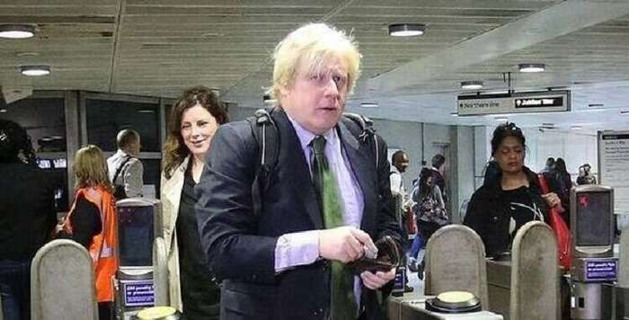
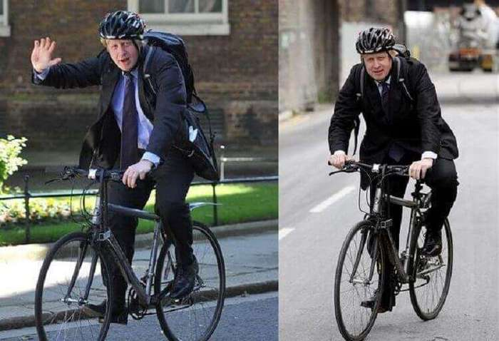
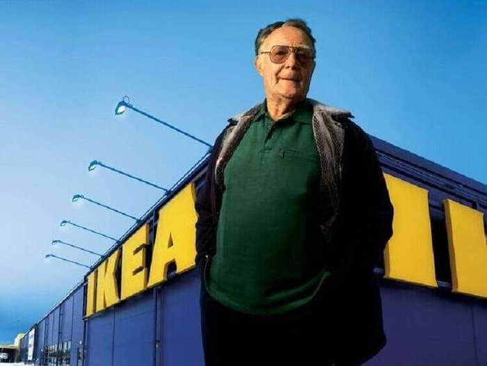

# Тэд тэрбум, тэр бумын хөрөнгөтэй ч, ердийн иргэдээс ялгардаггүй

Та, тэрбумтан хүн нь, дэгжин тансаг үнэтэй хувцсаар шүүгээ нь багтаж ядсан, Майбах, Бэнтли унасан хүмүүс байдаг гэж боддог бол андуурч байна. Эдгээр тэрбумтан, амжилттай, нөлөө бүхий хүмүүс хэрхэн амьдардгийг Lavander.media сайтад нийтэлснийг толилуулъя.

Борис Джонсон\
Лондон хотын захирагч Борис Джонсон ажилдаа өнөөх, ээ! Аймаар үнэтэй тансаг машинаар замын хөдөлгөөн хаалган барин явдаг гэж үү? Үгүй, үгүй! Тэнд тийм асуудал байдаггүй гэнэ. Ноён Джонсон метрогоор зорчиж, эсвэл унадаг дугуйгаар явдаг. Түүнд, “Oyster card” буюу ердийн олон нийтийн тээврийн хэрэгслээр зорчих карт байдаг.

---

Марк Цукерберг\
Фейсбукийг үндэслэн байгуулагч, маш даруухан амьдардаг. Хонда Акура машин унаж, энгийн футболканаас салдаггүй.

---

Майкл Блумберг\
“The New Yoirk Times” сэтгүүлд нийдлэгдсэнээр, Нью-Ойрк хотын захирагч байсан энэ хүн, ажиллах хугацаандаа өөрийн цалингаас татагалзаж, тухайн мужийн хуулиар хотын дарга цалингүй ажиллаж болохгүй гэсэн заалттай байдаг тул, жилийн 1 долларын цалин авч ажиллахаар тохирч, хотын даргын үнэгүй орон сууцанд суухаас татгалзаж, ажилдаа явах унааны зардлаа өөрөө гаргаж, өөрийн Шевроле Сарбан машинаараа ямар ч хамгаалалт, дохиололгүй, бусдын адил замын хөдөлгөөний дүрмээр зорчидог байжээ. Олон тохиолдолд, олон нийтийн тээврийн хэрэгслээр зорчих нь элбэг байсан гэж бичжээ.

---

Чак Фи\
Та, “Duty free Shoppers” группыг үндэслэгч, эрхэм Чак Фи, 4 тэрбум доллараа сайн үйлсэд хандивласныг мэдэх үү? Одоо түүний актив ердөө л, 2 сая доллар. Тэр үүнийгээ, “Би сэтгэл зүрхнээсээ, идэвхи зүтгэлтэй ажиллахыг хүссэнээс биш баян болох гэж ажиллаагүй” гэж тайлбарладаг. Гайхалтай байгаа биз!

---

Ингвар Кампрад\
IKEA брендын үүсгэн байгуулагч асан, Ингвар Кампрад, “Вольво” машинаа 15 жил унаж, эконом классаар нисдэг, гэрийнх нь бүх тавилга IКЕА-нх нь, мөн эхнэртэйгээ, хямд төсөр зоогийн газарт хооллож, худалдааны захуудаас үнэ буулган эд зүйлс, хүнсээ авч яваа нь тааралддаг байсан гэж ярьцгаадаг.

---

Сергей Брин\
“Гугл”-н хайлтын системийг үүсгэн байгуулагч энэ хүн 29 тэрбум долларын хөрөнгөтэй. Гэвч тэр хэмнэлтэд дуртай. Хямд хувцасны дэлгүүрийн хямдралд хамрагдах 55 долларын үнэтэй картыг жил бүр худалдан авч ашигладаг. Түргэн хоолны газруудаар хооллож, нийтийн тээврийн хэрэгслээр зорчих нь элбэг байдаг гэнэ.
