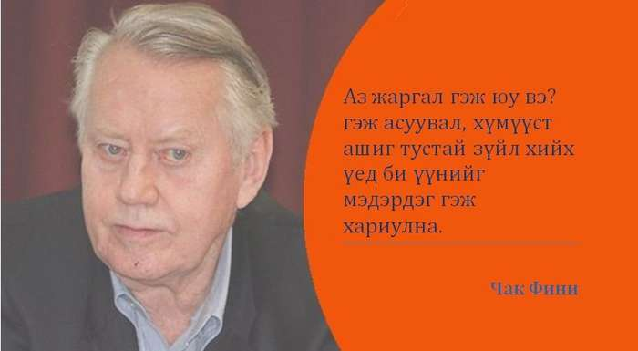

# Тэрбумтан Чак Финийн амьдралын 10 зарчим

Тэр 82 настай. Duty Free-н үндэслэгч. 7.5 тэр бум долларын хөрөнгөтэй. Түүнд машин байдаггүй. Эконом классаар нисдэг. Casio зүүдэг. Түүнийг энэ байдлаас нь жинхэнэ нарийн хүн гэж хэлмээр боловч, тэр сүүлийн 30 жилд дэлхий нийтийн боловсрол, эрүүл мэнд, шинжлэх ухааны салбарууд, асрамжийн газруудад 6 тэрбум гаруй доллар хандив өргөсөн буянтан юм. Билл Гейтс түүнийг, сайн үйлсийн үлгэр жишээ бол Чак Фини гэж дурдаад тэр бол дуурайх хэрэгтэй шилдэг хүмүүсийн нэг юм гэж хэлсэн байдаг.

#### Чак Финийн зарчмууд:

Мөнгө бол хүний хийх ёстой үүрэг. Зарцуулахад ухаан шаарддаг.\
Би 15 долларын цаг хараад цагаа мэдэж болж байхад, яагаад Rolex хэрэгтэй гэж. \
Бизнес классаар, түргэн нисч, түрүүлж буудаггүй. \
Сайн үйлст мөнгө оруулах нь банкны дансанд мөнгийг хураахаас илүү нь ойлгомжтой. \
Мөнгийг өгөх нь, өөрт илүү таатай мэдрэмж авдагт, би бүрэн итгэсэн\
Хэрэв их мөнгөтэй бол, өндөр эрсдэлтэй ч байсан, далайцтай асуудлуудыг шийдэхэд хөрөнгө оруул. \
Азгүй тохиолдол гэж байдаггүй. Нэг ч гэсэн шийдэгдэмгүй асуудлыг шийдэхэд сая хүмүүсийн амьдралыг хөнгөвчилдөг. Үүгээрээ та бахархах болно. \
Би мөнгөнд дуртай биш, гэхдээ надад зарцуулах мөнгөний хэмжээ хангалттай байхаар хэмжээний мөнгө зайлшгүй хэрэгтэй. \
Аз жаргал гэж юу вэ? гэж асуувал, хүмүүст ашиг тустай зүйл хийх үед би үүнийг мэдэрдэг гэж хариулна. \
Хандив өргөх, сайн үйлс хийхийн тулд хөгшрөхөө хүлээх хэрэггүй.
