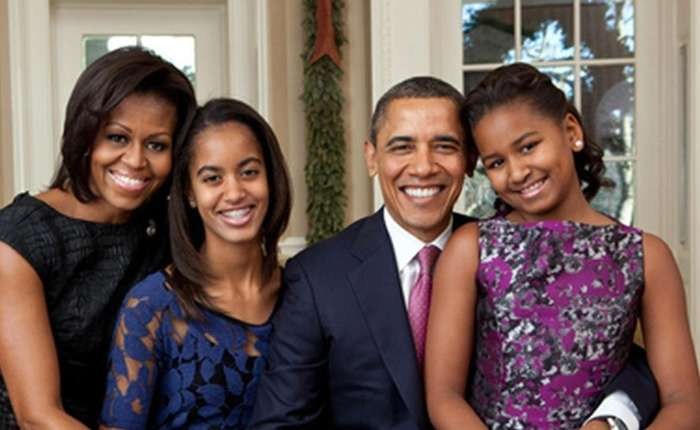

# Төгс гэр бүлийн харилцааг хадгалахад тустай, Барак Обамагийн 3 зөвлөгөө

Нэгэн ярилцлагын үед түүнд тавьсан, бат бөх гэр бүлийн харилцаа болон ойр дотно харилцааг хэрхэн удаанаар хадгалах талаар, мөн өөрийн гэр бүлийн туршлагаас ярьна уу гэсэн асуултад хариулсан хариултыг, гэр бүлийн сэтгэл зүйчид болон зуучилагчид ч авч үзүүштэй зүйл гэж Bored Panda сэтгүүлд нийтэлжээ. Мөн ерөнхийлөгч байсан 8 жилийн хугацаандаа, гэр бүлийн ямар ч асуудалд ороогүй, “Аз жаргалтай гэр бүл” ямар байх ёстой вэ, түүнийг л харуулж байлаа хэмээн сайшаан дурдсан байна. АНУ-ын ерөнхийлөгч асан Обама, түүний гэргий Мишель хоёрын 26 жилийн хамтын амьдрал, олон гэр бүлд үлгэр дуурайл болох хэмжээнд байдаг бөгөөд түүний хайр, хамтын амьдралын талаархи ухаалаг зөвлөгөөнүүд, орчин тойрныхонд нь үнэлшгүй нөлөөлдөг, жишээ нь, түүний сонгуулийн кампанит ажилд оролцсон олон хүмүүс хосоо олсон, ерөнхийлөгчийн ажлын аппаратад ажиллаж байсан хүмүүсийн дундаас 4 хос хуримаа хийсэн, мөн миний зөв сонголт, амьдралаа ухаалгаар шийдэхэд нөлөөлснөөс би аз жаргалтай гэрлэсэн зэргээс харж болно гэж, ерөнхийлөгчийн ахлах зөвлөх байсан Дэн Пфайффер өөрийн номондоо бичсэн байна. Обама түүнд, гэрлэхээс нь өмнө дараах гурван асуултыг өөртөө тавихыг зөвлөсөн байна.

1/ Энэ хүн чиний хувьд, сонирхолтой хүн мөн үү? Учир нь, урт хугацаанд, магадгүй бүх насаараа хамт амьдрахад, ямар ч асуудлаар ярилцах, мөн сэтгэгдлийг нь сонсох хүсэл төрсөөр байх хүн мөн үү гэдэг хамгаас чухал.

2/ Тэр чамайг үргэлж инээмсэглэх байдалд оруулдаг уу? Ер нь хамт байх үед нь, баярын мэдрэмж төрөх үе их байдаг уу?

3/ Тэр сайн ээж эсвэл аав болж чадах уу? эдгээр асуултад хариулаад бодоорой гэсэн ажээ.

Энэ зөвлөгөөнөөс хойш жилийн дараа Дэн Пфайффер гэрлэсэн бөгөөд түүнээс хүмүүс, яаж аятайхан ханьтай болох вэ гэж асуухад нь, Обамагийн зөвлөгөөг ишлэж хэлдэг гэнэ.

Амьдрал урт, тиймээс дээрх 3 зүйл хамтын амьдралд хамгийн чухал байдаг. Миний хувьд, гэр бүлийн амьдрал минь амьдралдаа хийсэн хамгийн том, хамгийн чухал зүйл минь юм гэж АНУ-ын ерөнхийлөгч асан Барак Обама хэлсэн байдаг.

