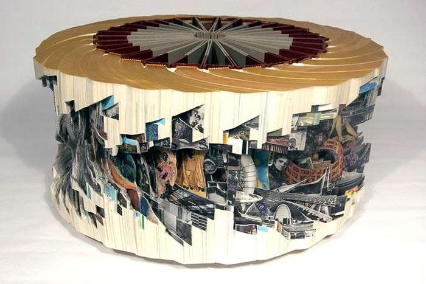

# Түүхээс эхтэй түүх

Дайны үе болон ан авын дараа, мөн сонгуулийн өмнөх үе шиг их худлаа ярьдаг үе хэзээ ч байдаггүй. Отто Фон Бисмарк\
Ардчилал бол засаг төр нь, ёс бус явдалт цөөнхийн гараар томилогдох биш, харин мэдлэггүй олонхоор сонгогдохыг хэлнэ. Бернард Шоу\
Сонгуульд сонгогчид л хожигддог. Эдгар Хоу\
Ардчилал бол ард олны төлөө, ард олны тусламжтай, ард олныг тэнэгтүүлэхийг хэлдэг. Оскар Уайльд\
Сонгууль, ямар нэг зүйлээр биднээс хамаардаг байсан бол, биднийг хэзээ ч оролцуулахгүй байх байсан. Марк Твен\
Ардчилал, сонгогчидын бүрэлдэхүүний материалаас илүү түвшинд хүрч чадахгүй. Бернард Шоу\
Ердийн эр, хаан болж чадах боломжийг, хааны ордонд ардчилал байна гэж бодож болохгүй. Вудро Вильсон
