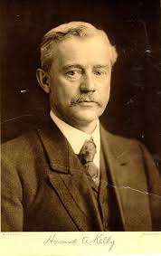

# Төлөөсгүй тус эргэж ирдэг

Гэрээр явж, юм зарж сургалтын төлбөрөө хийдэг нэгэн ядуу хүү, явж байгаад туйлын их өлсөж, халаасандах 10 центээр юм авах боломжгүй тул, дэргэдэх айлаасаа идэх зүйл гуйхаар шийдэн хаалгыг нь тогшив. Үүд нээгдэж, царайлаг сайхан эмэгтэй гарч ирэхэд сандарсан хүү, идэх юм гуйхын оронд аяга ус гуйв. Гэтэл, эмэгтэй, буцаж ороод, хүүг өлсөж байгаа биз гэж бодсондоо, усны оронд сүү авч ирж өгөхөд, хүү сүүг ууж дуусгаад, “Би танд хэдийг төлөх вэ?” гэж асуув. Эмэгтэй, -“Төлбөр хэрэггүй ээ. Ямар нэг сайн зүйл, тус хийгээд түүнийхээ оронд төлбөр, төлөөс бүү авч бай гэж ээж минь сургасан юм” гэхэд, хүү, -“Тэгвэл танд би, зүрх сэтгэлээсээ баярлалаа” гээд явжээ. Эндээс явахдаа, Ховард Келли хүүгийн сэтгэл нь сайхан болж, хүмүүст болон бурханд итгэх итгэлээр дүүрч, хүч орж байгаагаа мэдэрч байв. Он жилүүд өнгөрч, өнөөх эмэгтэй хүндээр өвчилөв. Нутгийн эмч нар, оношийг нь тогтоож чадахгүй байсан тул, том хотын төв эмнэлэг рүү явуулав. Уг эмнэлгийнхэн, энэ ховор өвчиний талаар зөвлөгөө авахаар Ховард Келли докторыг урьсан бөгөөд доктор, өвчитөний ирсэн хотын нэрийг сонсмогцоо, яаран тасаг руу явжээ. Тэр, ормогцоо эмэгтэйг таньсан бөгөөд түүнийг аврахаар, удаан хугацааны турш, чадах бүх зүйлсээ хийсээр эмчилж чаджээ. Келли доктороор, эмчилгээний төлбөрийн хуудаст гарын үсэг зурж батлуулахаар эмнэлгийн ажилтан ирэхэд нь, хуудасны дээд өнцөгт нэг зүйл бичсэнээ, төлбөрийн хуудсыг эмэгтэйд шууд аваачиж өгөхийг хүсэв. Төлбөрийн хуудсыг авсан эмэгтэй, гарсан төлбөрийг насаараа ч төлж чадахааргүй мөнгө байгаа байх гэж айсаар унштал, хуудасны хамгийн дээд өнцөгт, “Таны эмчилгээний төлбөр, нэг аяга сүүгээр бүрэн төлөгдсөн” гэсэн бичиг, доор нь, доктор Ховард Келли гэсэн гарын үсэг байжээ. \
Доктор Ховард Келли /1858-1943/. Эмэгтэйчүүдийн өвчинийг мэс заслын аргаар эмчлэх эмчилгээг үндэслэгч, эмчилгээний цистоскоп зэрэг олон арван багажуудыг зохион бүтээж, хорт хавдарыг туяагаар анагаах аргыг анх үүсгэсэн америк эмч.
