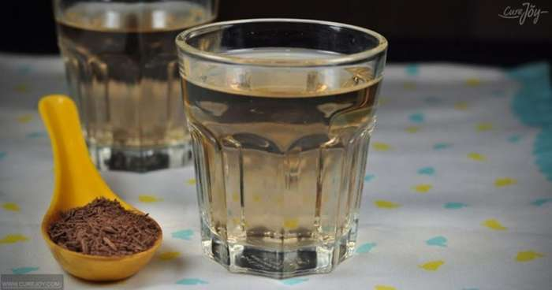

# Тмин буюу гоньдтой ус уухын ашиг тус

Тмин нь, Азийн олон орнууд, Энэтхэгт ашиг тус, эмчилгээт чанарыг нь сайн мэддэгээс,өргөнөөр хэргэлдэг амтлагч ургамал юм. Ашигт чанар болон, хурц сайхан үнэр нь, хоол хүнсэндээ хэргэлэхэд сайхан зохилддог. Тминтэй ус нь, эрүүлжүүлж, жин хасч, арьс үсний асуудлуудыг шийдэх үйлчилгээтэй байдаг бөгөөд бэлтгэж хэргэлэхэд хялбар: нэг стакан усанд, тал цайны халбага тминээ хийж буцалтал халаагаад хөргөн хэргэлнэ.

Өдөр бүр нэг стакан тминтэй ус уухад:\
-Хоолны шингэлтийг сайжруулж, бие организмаас хорыг гадагшлуулж, цээж хорсох, хоолны хордлого, дотор муухайрах зэрэг таагүй асуудлуудыг арилгадаг. -Бие организмын усны тэнцвэрийг ханган, биеийн сэрүүн температурыг барьдаг. Усгүйжилтээс сэргийлж, хаван буулгадаг. Энэ нь, түүний калийн өндөр агууламжтай нь холбоотой юм.\
-Дархлааны системд чухал үүрэг гүйцэтгэдэг, төмрийн өндөр агууламжтай. Мөн чөлөөт радикалуудыг устгадаг, халдвараас сэтгийлдэг олон антиоксидантуудаар баялаг байдаг.\
-Цус багдалтыг эмчилнэ. Тогтмол хэрэглэх нь, төмрийн дутагдлаас үүдэлтэй цус багадалтад нэн тустай.\
-Даралт тогтворжуулна. Калиар баялаг учираас, цусны даралтыг хариуцдаг ус-давсны тэнцвэрийг хангаснаар даралт тогтворжидог. Өглөө өлөн дээрээ тминтэй ус ууж заншсанаар цусны даралтаа тогтворжуулж, зүрх судасны системийн олон өвчинийг үр дүнтэй эмчилж болдог байна.\
-Жин хасах өндөр үйлчилэлтэй. Эслэгээр маш баялаг учираас, бодисын солилцоог сайжруулан, хоолны дуршилыг бууруулж жин хаяхад хүргэдэг. Турахад саад болдог, хор, шлакуудыг үр дүнтэй гадагшлуулдаг.\
-Тминтэй усандах, антиоксидантууд нь, биеэс хор гадагшлуулдагаас, батга, тууралт, арьсны үрэвслүүдийг дардаг. Арьсны тэжээллэг бодисуудын шингээлтийг сайжруулж, арьсыг цэвэрлэдэг бөгөөд залуужуулах, арьс толийлгох үйлчилгээтэй А, Е аминдэмээр баялаг байдаг байна.
