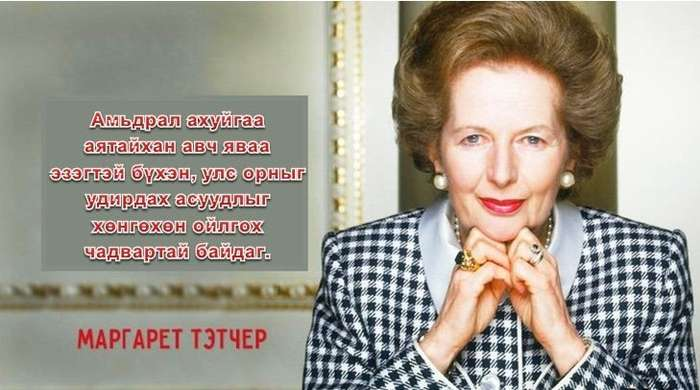

# “Төмөр хатагтай”-н баримтлал

“Төмөр хатагтай” гэж алдаршсан, Английн ерөнхий сайдаар хамгийн удаан 11 жил ажилласан Маргарет Тэтчер, жижиг дэлгүүрийн эзэн, ядуу гэр бүлд төрж өссөн гэдэг. Түүний хувийн зан чанар, мөн олон орны удирдагчидтай явуулсан найрсаг харилцаа түүхэн дэх, хүйтэн дайны үеийг төгсгөхөд ихээхэн чухал үүрэг гүйцэтгэсэн гэж үздэг. “Төмөр хатагтай” гэх алдрыг тэр үеийн Зөвлөлтийн сэтгүүлчид өгсөн гэх бөгөөд энэ нэр нь, түүнд өөрт нь их таалагддаг байжээ. Түүний баримталдаг байсан дүрэм, үзэл бодлууд гайхалтай үнэн байдаг:

-Хэрэв та, ямар нэг зүйлийг хэлэлцмээр байвал, эрэгтэй хүнд ханд, харин бодитоор хийхийг хүсвэл эмэгтэй хүнд ханд\
-Аашилж цамнаж байгаа эмэгтэйг хүмүүс “могой” гэдэг. Харин эрэгтэйг “сайн залуу” гэх юм? \
-Намайг шүүмжилдэг хүмүүст, болдогсон бол, Темза мөрний давалгаан дээгүүр алхаж яваагаа харуулмаар санагддаг. Яагаад гэвэл тэд намайг, давалгаан дээр тогтож байгааг бус харин сэлж чадахгүй дээ алхаж байгаа юм гэж хэлэхийг мэдэх учраас тэр. \
-Үнэгүй бяслаг, зөвхөн хулганын хавхны өмнө тавигддаг. \
-Амьдрал ахуйгаа аятайхан авч яваа эзэгтэй бүхэн, улс орныг удирдах асуудлыг хөнгөхөн ойлгох чадвартай байдаг. \
-Эмэгтэй хүний хувьд, гэр орон “ төв цэг” боловч, амьдралынх нь хил хязгаар биш. \
-Хэн нэгэнтэй хэл амаа ололцохын тулд саналыг нь хүлээн зөвшөөрөх албагүй\
-Бидний санаа зовдог зүйлийн 90%-нь болоогүй зүйл байдаг. \
-Дайснаа сайн судалснаар найз нөхрөө болгож болдог. \
-Улс орны баялаг, баян байх асуудал байгалийн баялаг, түүний нөөц дээр тогтдоггүй бөгөөд бүр огт байхгүй ч байсан болдог. Улс орны хамгийн чухал нөөц бол хүн. Тухайн улс, хүмүүсийн авъяас чадварыг хөгжүүлэх асуудлыг бодлогоо болгож чадвал баялаг урсан орж ирдэг. Тиймээс хүн баялагийн эх үүсвэр. \
-Санхүүгийн эрх чөлөөгүйгээр, өөр бусад эрх чөлөө байж чадахгүй. \
-Агуу байх, жинхэнэ хатагтай байх асуудал нь- хэрэв та, түүнийгээ сануулах үйлдэл гаргадаг бол танд, тэр шинж, байр суурь байхгүй байна гэсэн үг.
