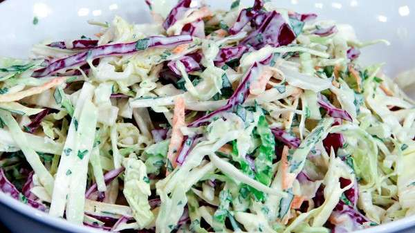
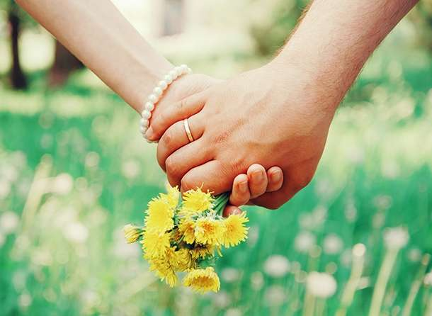

# Төмс, байцааны салат бэлгийн амьдралд тустай

Бэлгийн идэвхитэй амьдралаар амьдрахад тэжээллэг, чанартай хоол хүнс хэрэгтэй. Ихэнх бүсгүйчүүд хайртай хүндээ махан хоол их өгөөд байвал бэлгийн чалх сайжирна гэж боддог нь том эндүүрэл. Энэ тохиолдолд ургамлын гаралтай, сүүн бүтээгдэхүүн илүү дээр байдаг.

Ийм хүнс нь бодисын солилцоог сайжруулж, энэ нь цаашлаад дааврын системд сайнаар нөлөөлдөг. Гурвалжин будаа, яншуй, гогод, цоохор майлз, сонгино бэлгийн чадамжинд их ашигтай. Бэлгийн амьдрал хичнээн идэвхитэй байх тусам хоол их байх ёстой, гэхдээ илчлэг ихтэй гэж байгаа юм биш, витамин, минерал бодисууд их агуулсан байвал зохино.\
Сахар хэрэглэхгүйг хичээ. Өдөр тутам хэрэглэдэг жимс ногоогоор чихрийн хэрэгцээгээ орлуулбал маш сайн. Өдөр бүр хоёр ширхэг лууван идэх нь 200гр сахар буюу 100гр коньяк, архи, виноноос илүү ашигтай. \
Амтлагч халуун ногоог бүү хэтрүүлж хэрэглэ. Аль болох бага давс хэрэглэвэл зохино. Зарим хүн хоолныхоо давсыг хэтрүүлэх дуртай, давс багатай бол амтгүй санагддаг гэдэг. Гэтэл илүүдэл давс биед сөрөг нөлөөтэй. Төмсний, улаан манжингийн, байцааны салат бэлгийн амьдралаа идэвхижүүлэхэд тустай.

Хэт их хоол идсэний дараа шууд хурьцал хийж болохгүй, 2-3 цаг хүлээ. Эс тэгвэл зүрх, бөөр, элгэнд хэт ачаалал ирдэг.
