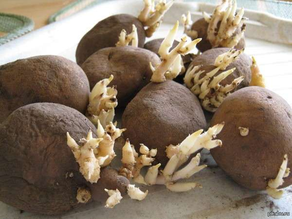
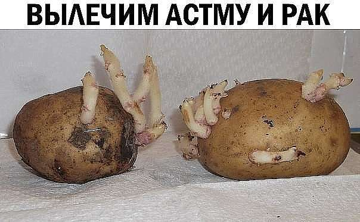

# Төмсний нахиа астма, хорт хавдарыг эмчлэх чадвартай гэнэ

Төмсийг хадгалах явцад төмсөн дээр ургадаг нахиа, хүчтэй эмчилгээний чанартай байдаг байна. Саванд нахиануудаа жижиглэж хийгээд, дээр нь 96%-н цэвэр спиртийг, нахиан дээгүүр 2 хуруу орчим илүү байхаар нэмээд 2 долоо хоног тавьна. Дараа нь хоёр давхар самбайгаар шүүж бэлэн болно.\
Хэрэглэх:\
Нэг дуслаас эхлэн 25 дусал хүртэл, буцаад нэг дуслаар багасгах маягаар өдөрт нэг удаа 200 грамм устай найруулан ууна. Дозыг хэрхэвч хэтрүүлж болохгүй. эмчилгээний чанартай ч, хортой байдаг. Боломжоороо, таслахгүй 2 курс хэрэглэх хэрэгтэй.\
Энэхүү ханд, астмыг эмчлэх, зүрхний өвчин, толгой өвдөх, даралт буулгах үйлчлэлтэйгээс гадна хамгийн гол нь хорт хавдарыг шимэх үйлчлэл үзүүлдэг байна.
