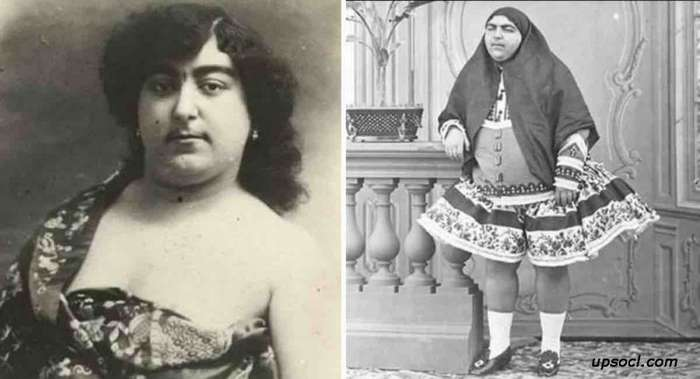
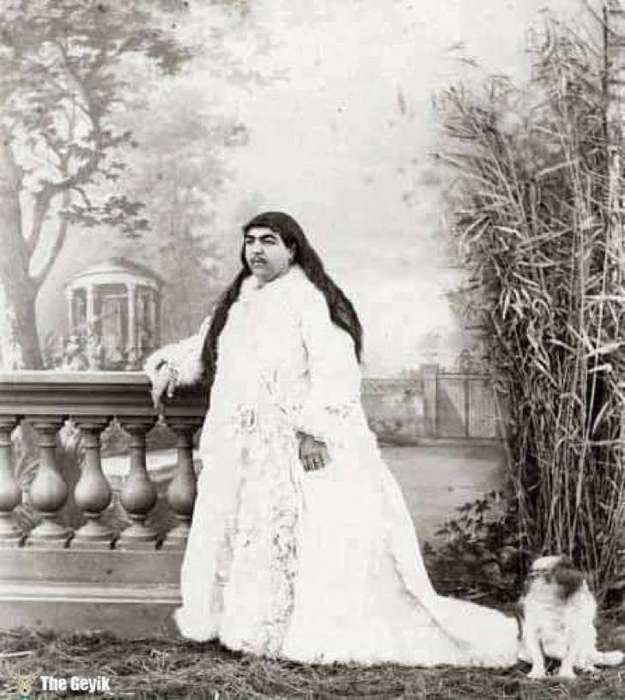
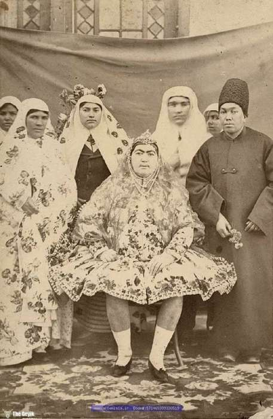

# Түүнд, 100-д амраг байсан.

Ираны гүнж Захру Ханум Тадж эс-Сальтанед 100-д амраг байсан гэдэг. Тэднээс нь 13 нь, хайрыг нь хүлээж авахгүй байснаас амиа хорлож байсан бөгөөд үүний дараа түүнийг эмэгтэй хүний гоо үзэсгэлэнгийн загвар гэж үздэг болжээ. Тэр, 1785-1925 онуудад хаант засгийн эрхийг барьж байсан турк гаралтай хааны гэр бүлээс гаралтай байсан юм. Тэр, нөхөрт гарч 4 хүүхэдтэй болсоныхоо дараа нөхрөөсөө салж, тэр үеийн Ираны нийгмийн амьдралд байж болшгүй зүйл хийж байсан гэдэг. Тэрээр олон яруу найрагчидын онгод нь болсон гайхалтай эмэгтэй байсан бөгөөд эмэгтэйчүүдийн эрх чөлөөний төлөө тэмцэгч, зураач, зохиолч, мөн Иранд анх барууны эмэгтэйчүүдийн хувцасыг өмсч зүрхэлсэн анхны эмэгтэй байсан ажээ.

---

. Тэр тухайн цаг үеэсээ түрүүлсэн, гайхалтай зоримог, шийдэмгий, оюун сэтгэхүй, сэтгэлгээний баялагийн үнэ цэнийг, гадаад үзэмжтэй зүйрлэшгүй гэдгийг харуулж чадсан өөртөө итгэлтэй оюунлаг, бахархууштай эмэгтэй байсан юм. Барууны Upsocl сайт, энэ эмэгтэйн зураг интернет ертөнцөөр тархаж давалгаа нь, вирусын хэмжээнд хүрч буйн учир нь юу бол, гэж гайхашран бичжээ.
