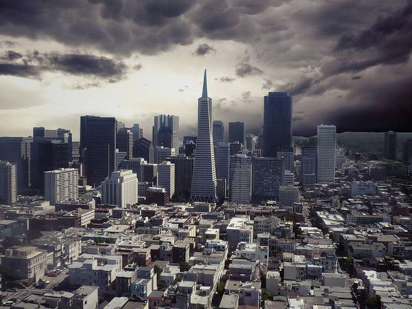
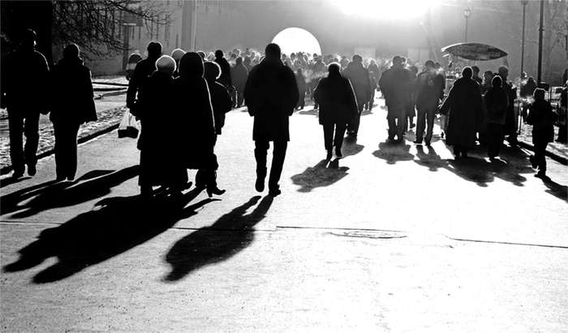

# Том хотууд ба чулуун ширэнгэ

Том хотуудын орчин нөхцөлийг хүмүүсийн амьдралд үхлийн аюултай болж байгаа талаар судалгаа туршилт хийгдсээр, үр дүнг нь олон нийтэд таниулсаар байгаа билээ. АНУ-ын эрдэмтэдийн явуулсан, туршилтын хулгануудыг 6 цагийн турш, хотын агаараар амьсгалуулсан туршилтын үр дүн цочиж балмагдмаар гарчээ. Хулгануудын ой ухаан муудаж, тайван бус уур уцаартай болсон байв. Тэгвэл, хүмүүст үйлчлэх нөлөө ямар байх вэ?

Хот газар, хүмүүст амьдрах орон байр, ажил төрөл, зугаацаж цэнгэх боломж, тав тухтай амьдрал өгдөг боловч огт анзаарагдахгүй, чимээгүй аргаар цаг минут бүр хүмүүсийн бие организм, сэтгэл санаанд муугаар нөлөөлж байдаг гэж үзжээ. Наад захын, нар хэзээ ч орохгүй цонх нээлхийтэй барилга байшинд ажиллаж амьдрах нь, амьдралын эх булаг болсон нарны илч энергиэ авч чадахаа больж, амин дэмийн дутагдалд орох болон олон төрлийн өвчинд нэрвэгдэх эх үүсвэр болж байдаг байна. \
Том хотын агаар нь, багахан хүчил төрөгч бүхий тоос, хар тугалга болон бусад хортой бодисуудын нэгдэл болтлоо бохирдсон байдаг. Үүнийг, хөдөөгийн 1 километр квадрат газрын агаар дах үзүүлэлтээс, дээрх үзүүлэлт 100 дахин их байдгаар тодорхойлж болдог байна. Бид ийнхүү бохир агаараар амьсгалснаар, амьсгалын замын өвчлөлүүд, гуурсан хоолойн багтраа, ханиад хатгаа, харшилууд гэсэн өвчнүүдийг багц багцаар нь авч, нян бактерийн халдварт өвчнүүдэд, хэдэн зуугаараа өртөн нэрвэгдэж байдаг.\
Том хотын чимээ. Энэхүү чимээг бид, хотын салшгүй хэсэг гэж хүлээж автлаа дассан байдаг. Энэ чимээг, хүмүүс, хүний мэдрэлийн систем, уураг тархи, зүрхэнд шууд үйлчилж байдаг гэдгийг мэддэггүй. Ийм, чихэнд үл сонсогдом инфра авиа нь, хүнийг ядрааж, архаг ядаргаанд оруулах, түгшүүрт автуулах, толгойны өвчтэй болгох, хараа муутгах, хараагүй болгох, зүрх зогсоох байдалд оруулах хүртэл аюултай байдаг байна.\
Цахилгаан соронзон цацрагийн нөлөөнд том хотын оршин оршин суугчид байнга өртөж байдаг. Энэ цацрагийн эх үүсвэрүүдэд, цахилгааны шугамууд, антеннууд, үйлдвэрүүдийн өндөр давтамжит тоног төхөөрөмжүүд, гэр ахуйн цахилгаан хэрэгслүүд, гар утас гэхчлэн дуусашгүй олон төхөөрөмжүүд багтна. Эдгээр нь хүний бие организмд маш муу нөлөөлж, хорт хавдар, гаж төрөлт, мутаци явагдах нөхцөл бүрддэгийг эрдэмтэд тогтоогоод байгаа юм.\
Төрөлт багасах үзэгдэл. Үүнийг, их хотын амьдрах орчин нөхцөл нь, том хотуудад амьдарч буй хүмүүст нөлөөлж, төрөх, үр удмаа үлдээхээ эрмэлзэхээ больдог мөн стресс, экологи, хотожсон амьдралтай холбоотой гэж үздэг.\
Чулуун ширэнгэ. Том хотын оршин суугчидын, хүрээлэн байгаа орчиноо харж хүлээн авч буй харааны мэдээлэл нь стресст хүргэх хүчин зүйл болдог гэж авч үздэг ажээ. Нэг хэвийн дөрвөлжин, саарал голдуу өнгө давамгайлсан, хэвшмэл загвартай ижил байшин барилгын хорооллууд, хот газрыг чулуун ширэнгэ мэт хүлээн авах мэдрэмж төрүүлэн сэтгэл зүйд хүндээр нөлөөлдөг байна. \
Түүнчлэн, хот газрын хүн амын хэт нягтшилаас улбаатай үүсдэг, гэмт хэргийн аюултай бүсийн хэмжээний эрсдэлтэй орчин, хэдэн километр хоолойгоор дамжин ирдэг уух усны маань эх үүсвэр крантны ус гэхчлэн тоочоод дуусахгүй сөрөг зүйлс том хотуудад байх юм. Гэсэн ч хачирхалтай нь, дэлхийн хүн амын ихэнхи нь, том хотод амьдрахаар тэмүүлэхээс, өөр амьдралын талаар боддоггүй гэнэ. Харин чинээлэг давхаргынхан хөдөө, байгалд ойр дөт амьдрах амьдралыг эрмэлздэг болсон судалгаа гарчээ.
