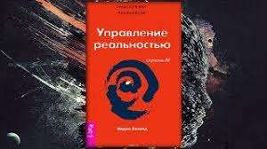

# Трансерфингийн хууль  буюу Вадим Зеландын мөнгөний талаар тайлбарласан сонирхолтой зөвлөгөө

Дэлхийн хамгийн их борлуулалттай номуудын нэг болох, “Трансерфинг Реальности” номыг зохиогч, зохиолч Вадим Зеланд, ертөнцийн зүй тогтлын талаар зарчимын цоо шинэ үзэл бодлыг гарган тавьж, тухайн хувилбаруудаа загварчилан трансерфингийн хууль гэх зүйлийг баталж, түүн дээрээ үндэслэсэн ном зохиолууд бичсэн нь, дэлхийн 15 орны хэл дээр хэвлэгдэн, хамгийн эрэлттэй номуудын тоонд орсоор байгаа юм. Тэр маш нууцлаг амьдралтай. Хэвлэл мэдээллийнхэнтэй холбогддоггүй, зураг хөргөө ч авахуулдаггүйгээс түүний хоёр зураг л олон нийтийн дунд явдаг. Харин, тэр өөрийнхөө тухай, “Би дөч гаран насны. ЗХУ-ыг задрахаас өмнө квантын физикийн судалгаан дээр ажиллаж байсан, дараа нь компьютерийн технологийг судалж байсан, одоо ном бичдэг. Оросод амьдардаг. Яс үндэс орос. Эстонитой хольцтой. Өөр бусад зүйл маань бусдын л адил. Тиймээс ач холбогдол өгөх хэрэггүй” гэж товч танилцуулсан байдаг.

Тэрээр, энэхүү хуулиар, бодит зүйлсийг энергийн нягтрал гэж сүүлийн үед үздэг болсон, энэ нь үнэн. Тиймээс, мөнгө мөн энерги учираас, өөрийн гэсэн хууль, зүй тогтолтой байдаг, эдгээрийг мэдэж авч хэрэгжүүлэхэд, богино хугацааны дараа үр дүн нь гарч ирдэг болохыг судалгааны үндсэн дээр нотолсноо, ихэд итгэлтэйгээр тайлбарласан байдаг.

Тайлбар №1\
Мөнгө, зорилго тодорхой үед ирдэг.\
Уул нь мөнгө бол цаасаар хийсэн, нууцлал, тоо, тэмдэглэлтэйгээс биш яг өөрөө үнэт зүйл биш. Харин хүмүүсийн хэрэгцээ, хэрэглээг шийдэж өгдөг, мөн мөнгө их байх нь хүнд таатай байдаг зэргээс болж, хүмүүсийн сэтгэл хөдлөлтэй нягт холбогддогоос энергижин бараг амьд болдог. Мөнгөнд хэт төвлөрөхийн оронд, зорилгоо бодох нь илүү мөнгийг авчирдаг. Аливаа үнэтэй зүйлийн үнийг бодож сүрдэхийн оронд, түүнийхээ эзэмшигч болоход эрмэлз. Мөнгө байхгүйгээс мөрөөдөл биелдэггүй биш, харин мөнгө мөрөөдлөө биелүүлэхээр зүтгэх явцад орж ирдэг зүйл болохыг ойлго. Мөрөөдөл тань, зорилго болж, зорилго тань хэлбэржиж төлөвлөгөө болсон байх нь чухал. Мөрөөдөлд тодорхой үр дүн, арга зам заагддаггүй тул биелэх нь ховор байдаг.\
Тайлбар №2\
Мөнгөнд эерэг, хөнгөн хандаж байх\
Мөнгө бол үргэлж байж, хүмүүсийн хэрэгцээнд эргэлдэж байдаг зүйл бөгөөд таны хэтэвчинд бага ч бай мөнгө байж л байдаг. Мөнгө бага үед мөнгөгүй болох нь гэж айж, эмээдгээ болих нь дээр. Та өдөр бүр, хэтэвчээ шалгахын адил, амьдралаа харж, гудамжинд, хоолгүй болох нь гэж сандарч, санаа зовдоггүй, тэр бүхэн чинь яагаад ч гэсэн шийдэгдээд л явж байдаг. Үүний адил мөнгөний хэмжээнээс болж санаа зовох хэрэг байна уу? Ингэхээ больсон цагт, таны ертөнцөд ирэх, мөнгөний энергийн ургалын блок буюу хаалт тайлагдна. Мөнгөнд, байдаг зүйлийн хэмжээнд хандаж, баяртайгаар хүлээн авч, хөнгөхөн салж бай. Санаа зовинолоос сал. Бүү нарийл. Хэр их нарийлж, горойтлоо санаа зовно төдий чинээ багыг олно. Зорилгогүйгээр ихийг хураах нь алдагдалд хүргэдэг. Зорилготойгоор хурааж, хүссэнээ авч, баяр, сэтгэл ханамжаар өөрийгөө шагнаж бай.\
Тайлбар №3\
Мөнгөнд хүндэтгэлтэй хандах\
Мөнгө нэгэнт энерги учираас мөн хүндэтгэл шаардна. Мөнгөнд хайр гамгүй хандаж, үрчийлгэж чихэх, мөнгийг муу зүйлийн уурхай гэх мэт сөрөг бодол тээх, хөл доор хэвтэх жижиг дэвсгэртийг голж авахгүй байх, өөрөөсөө илүү мөнгөтэй хүмүүст атаархах, муугаар бодох зэрэг нь таны баяжих боломжийг хааж байдаг. Мөнгөтэй “найзлах”-ын тулд, мөнгөний гэр орон болох хэтэвч түрийвчээ анхаарч, сайхан түрийвч хэрэглэх, мөнгөн дэвсгэртийг барих үедээ эерэг сэтгэлтэй байх /багахан хайрлаад илчихэд ч гэмгүй/, мөн мөнгийг их бага дэвсгэрт гэлгүй үнэлэн хандах, урагдаж гэмтсэн жижиг дэвсгэртийг хаяхгүй байх хэрэгтэй байдаг.\
Тайлбар № 4\
Мөнгө эерэг, өөдрөг хүмүүст “хайртай” байдаг\
Бага цалин, гэр бүл, өрсөлдөгчид болон улс орныхоо эдийн засаг, улс төрийн байдалд бухимдаж, асуудалдаа дийлдэн, зовж бухимдсан царай, унжсан мөр, бөгтийсөн нуруунаас, мөнгө айж мэгдэн зайлдаг гэж хэлж болно. Мөрөө тэгшлээд, эерэг бодолтой инээмсэглэн, зорилго руугаа итгэлтэйгээр алхаад үз. Мөнгө яалт ч үгүй, таныг сонирхоод эхэлнэ. Сэтгэл санаа, байр байдлаа баян хүмүүсийн адил болгож, сэтгээд үз. Танаас зөв энерги ялгарч эхлэн, мөнгө соронз адил татагдан ирнэ. Мөнгөтэй холбоотой бодлуудаа эерэг болго. “Бүх баячууд хулгайч, луйварчид”, “Мөнгө муу зүйл“, ”Мөнгө цаас болжээ”, “Их мөнгийг шударгаар олж чадахгүй” гэх мэт бодлуудыг ухаан санаанаасаа авч хая. Эерэг, өөдрөг хүнд мөнгө үргэлж дуртай байдаг.\
Тайлбар № 5\
Мөнгө, таныг тав тухтай орчиноосоо салах буюу дуртай дассан зүйлээсээ татгалзах, өөрчилөлтөөс айхаа болих үед ихээр ирдэг\
Багыг хүсвэл, багыг л авна гэсэн үг байдаг. Бага зүйлд сэтгэл ханамжтай байж, байгаа нөхцөлдөө амьдраад байвал, багахан мөнгөнөөс тань бусад мөнгө таныг тойроод л байх болно. Илүү сайхан нөхцөлд амьдрах, их мөнгөтэй болохын тулд, хэрэглээгээ чанаржуулах хэрэгтэй. Энэ үйлдэл нь, надад их зүйл хэрэгтэй гэсэн ертөнц, нийгэм, орчин тойрондоо илгээх мессеж болж байдаг. Дассан өөрт амар орчинд байсаар байвал тэр чигтээ л амьдарна. Өөрчилөлтөд хүрэхийн тулд, саад бэрхшээлийг давж сур. Алх яв, аливаагаас бүү бэрхшээ, шийдэмгий бай. Энэ тохиолдолд, шагнал нь их мөнгө байх нь зайлшгүй байдаг. Бэрхшээлийг давахдаа өөдрөг баяр баясалтай байж, мөн аливааг сайн талаас нь харж, сайн сайхныг хүлээж бай. Ажиллахдаа, мөнгөний төлөө биш, шийдвэрийнхээ төлөө ажиллаж бай. Мөнгөнд хэт бүү төвлөр, орж гарч байдаг зүйл гэж хүлээж ав. Бусдыг баярлуулахад хэрэглэх нь өөрийгөө шагнах шагнал, мөн мөнгийг татах хүчтэй хэрэгсэл болж байдаг. ,
