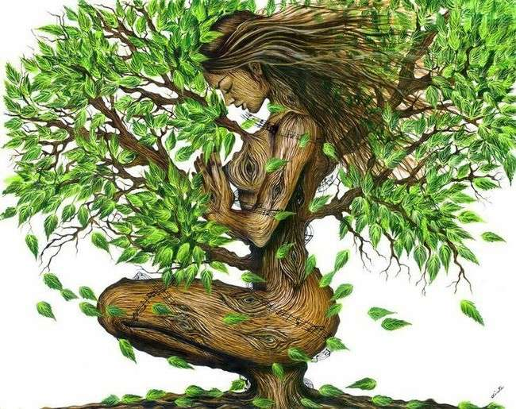
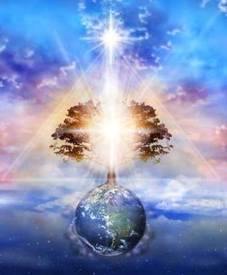

# Төрлийн холбоо ба удмын энерги

Удам угсаа, уг гарал, төрлийн холбоо бол мөнхийн уялдаатай сэтгэл, оюун санааны энергийн нэгдсэн систем юм. Энэ систем нь, хамтын зорилт, хамтын асуудал, хамтын амьдралыг илэрхийлэх бөгөөд салшгүй холбоог заадаг.

Төрлийн холбооны нэг гол зарчим нь, төрлийн холбоотой хэн нь ч тэр, зөв амьдарч, эерэг амьдралыг удамшуулан үлдээхэд байдаг ба “удмын хараал”-г үр удамдаа дамжуулахгүй байхад оршдог. Хэрэв хэн нэг нь, амьдралд хөл алдах, эсвэл буруу амьдрах, төрлөөсөө санаатайгаар татгалзах, салах зэрэг үйлдэл хийхэд, төрлийн холбоо тэр чигтээ суларч, доройтож, удамд нөлөөлж эхэлдэг. Үр хүүхэд нь эцэг эхээ ойшоохгүй хаях, эсвэл эцэг эхчүүд зөвшилцөн үр хүүхдээ аборт хийлгэн авахуулах /эрэгтэй нь, эмэгтэйгээ хүчээр энэ үйлдэлд түлхсэн бол, тэр эрэгтэй хараалыг үүрнэ, хэрэв хамт шийдсэн бол хоёул үүрдэг, эмэгтэй өөрөө шийдсэн бол, бүр хүнд хараал үүрдэг/ зэргээс удмын энерги, “хасах” сөрөг энергээр дүүрч, үр удамд дамждаг. Хүн бүр эцэг эхтэй. Эцэг эх маань бидний үндэс бөгөөд үндэсгүй мод хатдагийн адил, хүн ч тэр, эцэг эхээ үл хүндлэх, шүүмжлэх, гомдоох, үзэн ядах зэргээр авирлах нь, түүнийг, үндэсгүй мод мэт хатаж доройтоход хүргэдэг байна. Эцэгтээ хандах хандлага, хүний бүтээлч чанар, урам зориг, бодит амьдралыг жолоодох чадвар, өөрийгөө илэрхийлэх чадвар зэрэгт нөлөөлдөг гэдэг. Эцгээ үл тоох нь, сэтгэл санааны дарамттай, сэтгэл хангалуун бус амьдралд хүргэдэг. Эхдээ хандах хандлага нь оюун санааны өсөлт, ажил үйлсийн амжилт, албан тушаалын ахилт, санхүүгийн өсөлтөд нөлөөлдөг гэх бөгөөд эхийгээ хүндлэхгүй байх нь эд материалын хангалуун байдлаас татгалзаж байна гэсэн үг аж. Түүнчлэн, эцэг эхийн хоорондын харьцаа мөн гол үүрэг гүйцэтгэж байдаг. Ямар ч байсан, удмын энергээ цэвэр, хүчтэй байлгах нь, гэр бүлийн гишүүн бүрийн зайлшгүй үүрэг, зорилго байх ёстой байдаг бөгөөд хийж буй үйлдэл, алхам бүрээ зөв сайнаар хийж, бодол санаагаа хайр энэрэл, сайхан сэтгэлээр дүүргэн амьдрах нь, удмын энергээ цэвэр хадгалахад тусалдаг байна. Мөн гаргасан алдааныхаа төлөө өршөөл, уучлал сэтгэлдээ гуйх нь, дотоод ухамсрыг өөрчилж, зам мөрийг засч өгдөг ажээ. Эмэгтэйчүүдийн зөөлөн эевэргүү, нинжин сэтгэл, ухаалаг зан, эвлэрүүлэн нийцүүлэх чадвар төрлийн холбоог бэхжүүлж байдаг байна. Цэвэр, хүчтэй удмын энергитэй байх асуудал нь хүн бүрийн гарт байдаг болохыг мартаж болохгүй бөгөөд хүн бүрт, аз жаргалтай амьдрах, аз жаргалтай ирээдүйг үр удамдаа үлдээх чадвар хүч, боломж бий.
